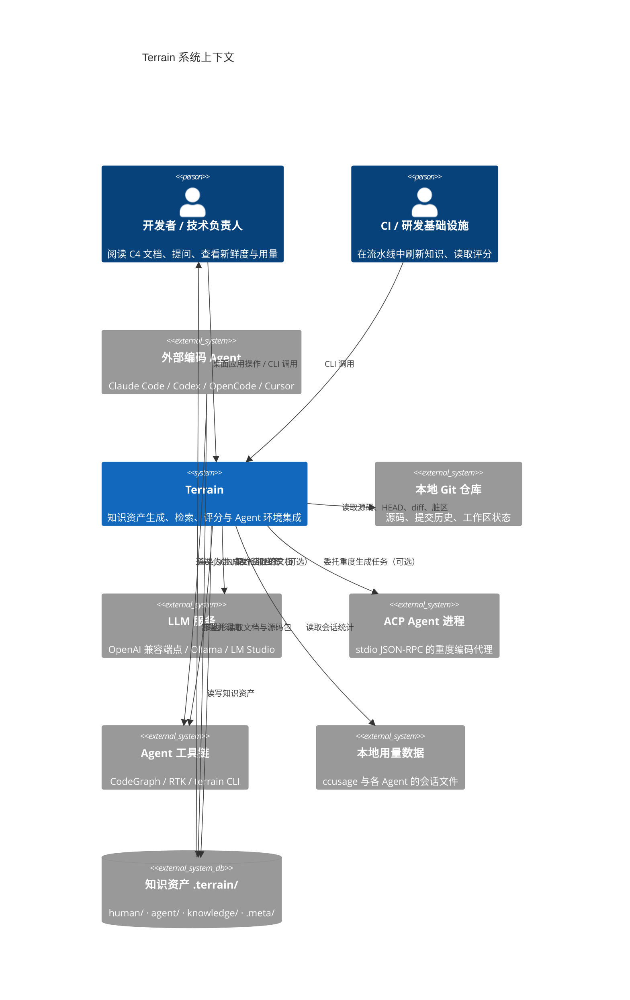

# Terrain —— 为 AI 时代准备的工程环境

Terrain 是一个"把仓库变成地图"的工具。你给它一个本地 Git 仓库的路径，它在这个仓库里长出 `.terrain/` 目录：一套人类读得懂的 C4 架构文档、一份 AI Agent 读得懂的宏观上下文、一个可按需 grep 的源码包，以及一份持续记录"这份知识落后代码多少"的新鲜度账本。它同时提供桌面应用（Tauri）和无界面 CLI 两种形态，两者共享同一套 Rust 内核。

**版本**：1.1.2（Cargo workspace 统一版本，见 `Cargo.toml:13`）

---

## 它为什么存在

onboarding 一个陌生仓库，通常要先翻 Wiki、再问资深同事、最后自己在源码里 grep 三天。AI 编码助手把这件事加速了，但同时也制造了一个新的裂缝：人类看的是"文档里的项目"，AI 看的是"活仓库里的 grep 结果"，两边对项目的理解从来不是同一份东西。文档会过期，而 grep 没有全局观。

Terrain 的答案是**一份共享的地图**。它不去取代 Git，也不去取代 Wiki，而是在仓库内维护一层"从代码生成、随提交演进"的知识资产。人类在阅读器里读到的是叙述性的 C4 文档，Agent 通过 `terrain tools` 读到的是同一批内容的宏观摘要与微观切片——两者引用的是同一份文件、同一个提交基线。

这个定位带来一个很重要的工程约束：**凡是能离线完成的，绝不调用 LLM**。扫描、打包、检索、评分、环境探测全部是确定性的文件与 Git 操作（`crates/terrain-core/Cargo.toml` 里没有任何 HTTP 客户端依赖）。只有"写文档、写上下文、答问题"这类真正需要语言模型的工作，才会走 LLM 或外部 ACP Agent。这意味着 CI 机器上没有 API Key，也照样能刷新知识、输出新鲜度。

---

## 它能做什么

**扫描并建立索引**——`ProjectScanner::scan_repo`（`crates/terrain-core/src/ingest/mod.rs:52`）走查仓库，识别技术栈（`Cargo.toml`、`package.json`、`go.mod`、`pyproject.toml`、`pom.xml`、`build.gradle`），生成 `index.md`；如果仓库里有 OpenAPI/Swagger 描述文件，还会额外生成 `interfaces/` 下的接口文档。

**生成人类可读的 C4 文档**——Litho 流水线（`crates/terrain-agent/src/litho.rs`）驱动四阶段：预处理 → C4 研究 → 编排 → 输出。中间研究笔记落在 `.terrain/.litho-agent/`（`preprocessing.md`、`c1-system-context.md`、`architecture.md` 等），最终六件套写入 `.terrain/human/`。你正在读的这篇就是它的产物。

**生成 Agent 可读的上下文**——`agent/context.md` 被硬性限制在 16 KiB（`assets/context_layers.rs:6`），因为它要被预载进问答的 prompt。它按"宏观 / 中观 / 微观"三层组织，Agent 先拿宏观索引，需要细节时再用工具去取。

**打包源码索引**——基于 `repomix-core` 生成 `agent/repomix.md`，带行号、可 grep、可按文件切片读取（默认每次 150 行）。它是 Agent 定位实现细节的"底层地图"。

**给知识打分**——`compute_freshness`（`freshness/compute.rs:47`）以资产记录的 baseline HEAD 为基准，统计提交漂移、改动文件比例、同步天数与工作区脏状态，得出 0–100 的分数。≥80 视为新鲜，≥70 需要交叉核对，<50 时问答不再预载宏观上下文。这个分数不是装饰：它直接改变 Agent 的信任策略。

**一键把 Agent 工具链装好**——`terrain env apply` 按依赖顺序部署 Skills、CodeGraph、RTK 和受管的 `AGENTS.md` 片段到 `~/.terrain/`。这把"每个仓库重新发明一遍 AI 上手流程"变成了一次性操作。

**在知识上提问**——DeepWiki 面板与 `terrain ask query` 共享同一个 `ChatEngine`（`crates/terrain-agent/src/chat/mod.rs`），回答附带可点击的源码引用；LLM 不可用时会降级为纯检索答复而不是报错。

**把需求走成可审阅的四步**——SDD 工作流产出 `1.requirements.md`、`2.tech-design.md`、`3.implementation.md`、`4.code-review.md`，每一步都可复核、可回退。

---

## C4 Context 图（系统全景）

下面这张图回答一个简单问题：Terrain 站在谁和谁之间。它左边是人类与外部 Agent，右边是 Git 仓库与各类模型服务，它自己则是那个"读代码、写知识、再喂给消费者"的中转站。

从图中能读出一个关键设计：Terrain **不持有知识的唯一副本**。知识写在仓库自己的 `.terrain/` 里，随 Git 分支流转。Terrain 更像一个"编译器"而不是"服务器"——它把源码编译成知识，编译产物留在原地。

---

## 技术选型背后的思考

Terrain 的技术栈不是"什么都用最新的"，而是每一层都在服务同一个目标：**单二进制、可离线、类型不漂移**。

| 技术领域 | 具体选择 | 为什么这样选 |
|---------|---------|------------|
| 语言与构建 | Rust edition 2024，MSRV 1.94 | 需要一个能同时被 CLI 和桌面壳复用、且分发时不需要运行时的内核。release 配置 `lto="thin"`、`strip=true`、`codegen-units=1`，是为了把安装包压到可接受体积 |
| 领域内核 | `terrain-core`（零 HTTP 依赖） | 把"离线可用"从文档承诺变成编译期事实。想在内核里偷偷发请求，得先改 `Cargo.toml` |
| Agent 框架 | adk-rust 2.2（agent/core/model/runner/session/tool） | 自研 ReAct 循环的收益极低，adk 已经提供 LlmAgent、工具注册、会话服务与流式事件 |
| ACP | `agent-client-protocol` 1.3 + `adk-acp` | 把"读几十个文件、写十几篇文档"这类重度工具任务交给成熟的外部 Agent，Terrain 只负责编排与校验 |
| 源码索引 | `repomix-core` 2.0 | 直接复用成熟的仓库切片能力，避免自研 token 预算与文件树裁剪 |
| IPC 类型 | `ts-rs` 10 | Rust 是唯一真源，前端类型由 `bun run gen:types` 生成。手写 TS interface 迟早会与 IPC 载荷漂移，而漂移的表现是运行时 `undefined` |
| 桌面壳 | Tauri 2（dialog / shell 插件） | 复用系统 WebView，安装包远小于 Electron；Rust 能力可以直接暴露成 command |
| 前端 | Svelte 5 runes + Vite 8 + Tailwind 4 | 流式 token 渲染需要细粒度响应式；`marked` + `mermaid` + `highlight.js` 满足"文档阅读器"的核心诉求 |
| 分发 | npm 平台包（`npm/cli-*`、`npm/rtk-*`） | 无界面机器与 CI 用 npm 安装最省事；桌面安装包覆盖 macOS 与 Windows |

---

## 它做什么，不做什么

边界比能力更能说明一个系统的定位。

**它做的事**：把一个 Git 仓库变成可持续维护的知识底座；让人类和 Agent 读同一份内容；在代码变动后告诉你"这份知识还值不值得信"；把 Agent 需要的工具链一键装好；在知识之上提供问答与 SDD 工作流。

**它不做的事**：不托管代码（只读本地 Git，不 push）；不做云端知识库（`~/.terrain/registry.json` 只存项目路径指针，正文永远在仓库里）；不常驻后台（没有 daemon、没有数据库，一切按需触发）；不替人做判断（生成的文档标记为禁止自动合并，冲突时要求重新扫描）；不做多用户权限（信任模型是本地单用户，路径校验只保证不写出仓库之外）。

---

## 关键路径速查

| 你想找的 | 位置 |
|---------|------|
| 领域内核对外 API | `crates/terrain-core/src/lib.rs` |
| 仓库扫描 | `crates/terrain-core/src/ingest/mod.rs`、`ingest/git.rs` |
| 知识路径解析 | `crates/terrain-core/src/paths.rs` |
| 新鲜度评分 | `crates/terrain-core/src/freshness/{scoring,compute,codegraph}.rs` |
| Litho 生成编排 | `crates/terrain-agent/src/litho.rs`、`litho_native.rs` |
| DeepWiki 问答 | `crates/terrain-agent/src/chat/` |
| CLI 子命令 | `crates/terrain-cli/src/cli.rs` |
| 桌面 IPC | `src-tauri/src/lib.rs`（`generate_handler!`）、`src-tauri/src/commands/` |
| 前端入口 | `src/App.svelte`、`src/lib/api.ts` |
| 生成类型（勿手改） | `src/lib/generated/`、`crates/terrain-ts-export/src/main.rs` |
