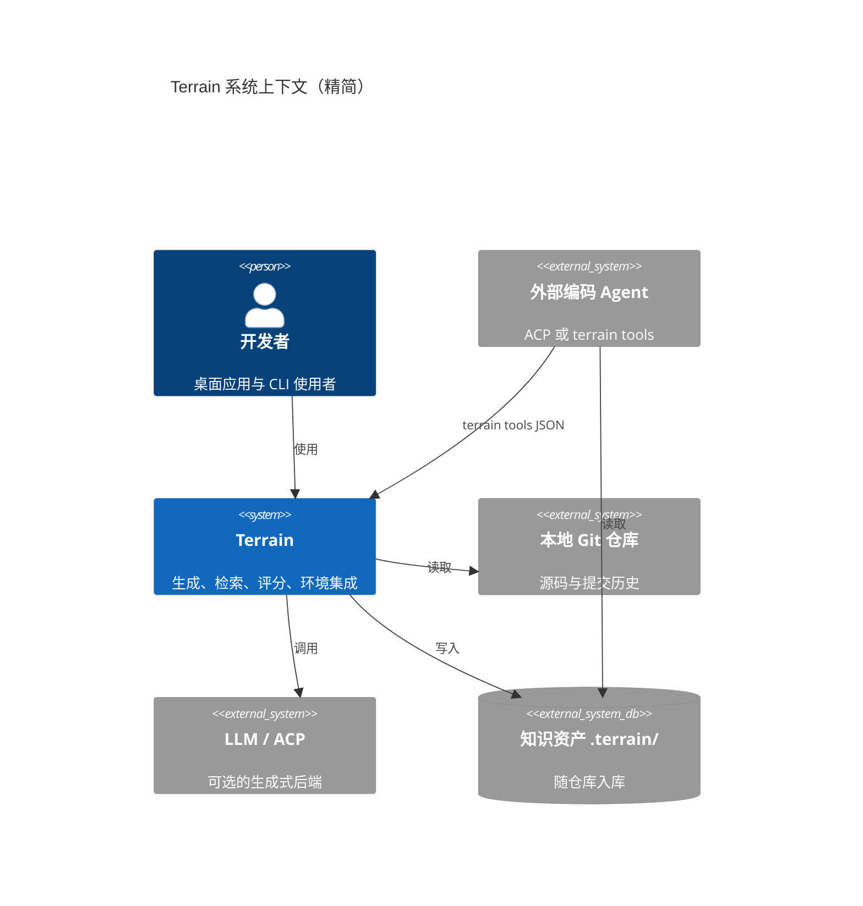
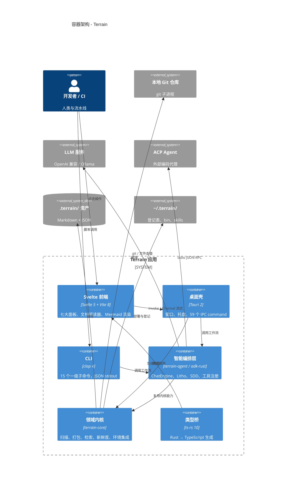
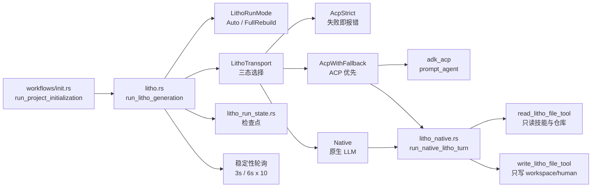
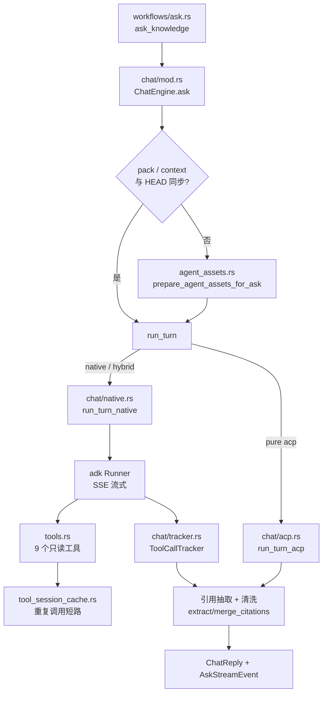
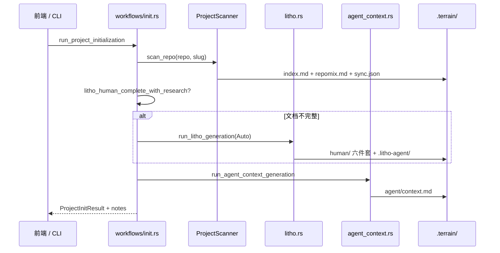
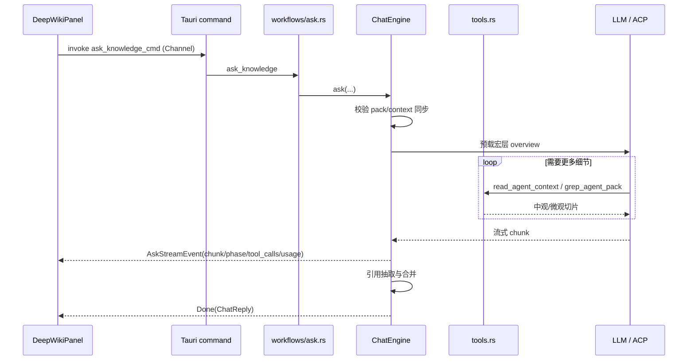

# 系统架构文档：Terrain

**版本：** 1.0
**分类：** 内部架构文档
**生成日期：** 2026-11-14

---

## 1. 架构概述

### 1.1 设计理念

如果只用一句话概括 Terrain 的架构，那就是：**把"确定性"和"生成式"在编译期就分开**。这不是一句口号，而是刻在 `Cargo.toml` 里的依赖边界。

**1. 离线内核，生成式外挂**

`terrain-core` 依赖 `walkdir`、`ignore`、`glob`、`repomix-core`、`serde`、`chrono`，唯独没有任何 HTTP 客户端。所有需要模型的能力都上移到了 `terrain-agent`（它才依赖 `reqwest` 与 `adk-model`）。这个分层带来一个非常实际的好处：CI 上跑 `terrain refresh` 不需要任何 API Key，也能完成扫描、打包、评分。想违反这条规则，开发者必须先改依赖清单——成本高到不会误犯。

**2. 管道-过滤器，中间产物落盘**

知识生成不是一次调用，而是一条流水线：扫描 → 打包 → 研究 → 编排 → 输出。每一步都把结果写到磁盘（`.terrain/.litho-agent/*.md`、`.terrain/.meta/*.json`、`agent/repomix.md`），下一步从磁盘读。这和"把中间结果留在内存变量里"的写法相比啰嗦得多，但换来三件事：进程中断可以续跑、失败可以只重跑一段、人可以打开文件直接检查模型到底写了什么。

**3. fail-closed 的信任模型**

新鲜度算不出来的时候，系统不会假装它很新。`score_layer` 在 `!drift.is_measured()` 时直接扣掉 40（提交）+ 30（文件）+ 5（时长）= 75 分（`crates/terrain-core/src/freshness/scoring.rs:27-40`）。也就是说，基线提交丢失、仓库不可读这类情况，会让资产立刻跌到"不可用于预载"的区间。这是一个刻意的选择：**无法验证 ≠ 新鲜**。

**4. 能力即工具，工具即边界**

Agent 不能直接读文件系统。它能做的每一件事都被包装成一个 `Tool`（`crates/terrain-agent/src/tools.rs`）：列项目、读上下文、grep 包、读包内文件、搜索知识、读文档。这个设计不只是安全考虑——它同时是**成本控制**：每个工具都有字符上限（`MAX_TOOL_JSON_CHARS = 24000`、`MAX_PACK_META_TREE_CHARS = 2500`、`DEFAULT_PACK_FILE_LINES = 150`），模型不可能一次读爆上下文。

### 1.2 核心架构模式

| 模式 | 实现方式 | 目的 |
|------|---------|------|
| 分层架构 | `terrain-core ← terrain-agent ← {terrain-cli, src-tauri}`，单向依赖 | 保证内核可被 CLI/桌面复用，且不会反向耦合 UI |
| 管道-过滤器 | `ProjectScanner` → `GitScanner`/`OpenApiImporter`/`repomix` → `SyncMeta`；Litho 四阶段 | 每段可独立重跑、可观测、可续跑 |
| 策略模式 | `LlmProvider`（openai/ollama/lmstudio）；`AgentExecution`（acp / acp_native）；`LithoTransport`（AcpStrict/AcpWithFallback/Native） | 把"用哪个后端"变成运行时可判定的枚举，而不是散落各处的 `if` |
| 适配器模式 | `CompatTool`（`compat_tool.rs`）、`tool_schema.rs::ensure_tool_parameters_object` | 抹平不同模型/工具 schema 的差异 |
| 仓储/路径对象 | `KnowledgePaths`（`paths.rs:11`） | 把"`.terrain/` 下的第 N 个文件"变成有名字的方法，杜绝字符串拼接 |
| 状态机 + 检查点 | `LithoRunState`（`assets/litho_run_state.rs`） | 长任务中断后可续跑，且不重写已完成文档 |
| 双轨输出 | `human/`（人读）与 `agent/`（机读） | 同一份理解，两种表示，各自优化 |

### 1.3 技术栈概述

Rust workspace 有 5 个成员：`terrain-core`（领域内核）、`terrain-agent`（智能编排）、`terrain-cli`（CLI 二进制）、`terrain-ts-export`（类型导出）、`src-tauri`（桌面壳）。前端是独立的 Svelte 5 工程，通过 Tauri IPC 与 Rust 通信。

桌面侧使用 Tauri 2 + `tauri-plugin-dialog` / `tauri-plugin-shell`；Agent 侧使用 adk-rust 2.2（`adk-agent`、`adk-core`、`adk-model`、`adk-runner`、`adk-session`、`adk-tool`）以及可选的 `adk-acp`；源码索引依赖 `repomix-core` 2.0；类型桥依赖 `ts-rs` 10。前端依赖 `marked`、`mermaid` 11、`highlight.js`、`html2canvas`、`@lucide/svelte`。

一个值得注意的细节：`time` 被钉在 `>=0.3.36, <0.3.48`（`Cargo.toml`），注释写明了原因——0.3.48 与 Tauri/cookie 的 blanket `From` 实现冲突（E0119）。这类"看起来无关紧要"的版本约束，往往是一个项目最真实的踩坑记录。

---

## 2. 系统上下文（C4 Level 1）

这张图在概述文档里出现过一次，这里保留精简版，用于说明架构文档的起点：Terrain 的所有能力都围绕"读写 `.terrain/`"这件事展开。



---

## 3. 容器视图（C4 Level 2）

下图把 Terrain 拆成可独立描述的容器。注意左右两侧的"消费者"是不同的：人类走 UI，Agent 走 JSON 契约，但它们的下游是同一批文件。



### 3.1 领域模块职责

表的"关键抽象"一列是阅读源码的入口——想理解一个模块，先看它导出了什么。

| 模块/领域 | 路径 | 职责 | 关键抽象 |
|---------|------|------|---------|
| 知识资产编排 | `crates/terrain-core/src/assets/` | Litho 计划、增量 diff、上下文分层、会话、工具部署 | `LithoPlan`、`IncrementalPlan`、`KnowledgeUpdateMode`、`ContextOverview`、`LithoRunState` |
| 仓库摄取 | `crates/terrain-core/src/ingest/`、`repo_walk.rs`、`repo.rs` | 走查仓库、生成结构文档、触发打包 | `ProjectScanner`、`GitScanner`、`OpenApiImporter`、`ScanReport` |
| 新鲜度 | `crates/terrain-core/src/freshness/` | Git/CodeGraph 漂移、评分、账本 | `FreshnessSummary`、`GitDrift`、`DriftBasis`、`score_asset` |
| 检索与文档 | `crates/terrain-core/src/search.rs`、`doc.rs`、`citations.rs`、`assets/{query,pack_read}.rs` | 全文检索、包 grep/读取、Markdown 解析、引用合并 | `KnowledgeSearch`、`SearchHit`、`KnowledgeDoc`、`SourceCitation` |
| 环境集成 | `crates/terrain-core/src/assets/env/`、`integrations/`、`agent_tools_deploy.rs` | plan → apply → status 部署 Skills/工具/AGENTS.md | `EnvPlan`、`EnvApplyResult`、`EnvStatus`、`IntegrationDef` |
| 项目/路径/设置 | `crates/terrain-core/src/{project,registry,paths,path_portable,settings,git_policy,language}.rs` | 登记表、路径解析、设置、Git 策略、i18n | `KnowledgePaths`、`ProjectOverview`、`ModelSettings`、`AcpSettings` |
| 源码与文本 | `crates/terrain-core/src/{source,model_text,render,fingerprint,human}.rs` | 源码切片、模型输出清洗、渲染 | `SourceSlice`、`read_source_slice`、`prepare_model_markdown` |
| Token 用量 | `crates/terrain-core/src/usage.rs` | 探测本地会话源、汇总 ccusage | `UsageSnapshot`、`UsageProbeResult`、`CcusageLaunch` |
| Litho 编排 | `crates/terrain-agent/src/{litho,litho_native}.rs` | 四阶段流水线调度、断点续跑、双通道 | `LithoRunMode`、`LithoTransport`、`NativeLithoCtx` |
| Agent 运行时 | `crates/terrain-agent/src/{runtime,builder,model,tools,acp,throttle,tool_session_cache}.rs` | Agent 构建、工具注册、LLM 适配、ACP 配置、节流缓存 | `Runtime`、`AgentConfig`、`ModelConfig`、`Tool` 工厂 |
| DeepWiki 问答 | `crates/terrain-agent/src/chat/` | 三层检索问答、流式事件、引用抽取 | `ChatEngine`、`NativeBackend`、`ToolCallTracker` |
| 工作流编排 | `crates/terrain-agent/src/workflows/`、`agent_context.rs`、`agent_assets.rs` | init/refresh/ask/sdd 四类入口 | `run_project_initialization`、`run_agent_context_generation` |
| CLI | `crates/terrain-cli/src/` | 子命令、JSON 输出 | `Cli`、`Commands` |
| 桌面壳 | `src-tauri/src/` | IPC 边界、托盘、资源注入 | `AppState`、`generate_handler!` |
| 前端 UI | `src/`、`src/lib/` | 面板、状态、i18n、渲染 | `App.svelte`、runes stores、`api.ts` |

---

## 4. 组件视图（C4 Level 3）

### 4.1 Litho 生成编排的组件架构

Litho 是整个系统里最"绕"的一块，因为它要同时应付三种运行环境：有 ACP、只有 LLM、两者都有。下图展示这些组件如何拼起来。



**组件职责**：`run_litho_generation` 只负责"编排"，不负责"生成"。它先向 `plan_litho_generation` 要一份 `LithoPlan`（技能目录、仓库路径、输出目录、工作区），再根据设置决定走哪条传输通道，然后循环执行"发起一轮 → 轮询文档是否稳定 → 判定是否完成"。真正的写作由外部 ACP Agent 或 `run_native_litho_turn` 完成。`litho_native` 的两个工具把文件访问限制在"技能目录 + 工作区 + 输出目录"三处，这是原生回退路径的安全底座。

### 4.2 问答引擎的组件架构

问答的复杂度不在"调模型"，而在"控制模型能看到什么"。下图是这条约束链。



**组件职责**：`ChatEngine` 负责"准入"（资产是否同步、用哪个后端），`NativeBackend` 负责"执行"（adk Runner + 内存会话服务），`ToolCallTracker` 负责"观测"（把 adk 的细粒度 Event 归并成用户看得懂的工具调用卡片），`tool_session_cache` 负责"省钱"（同一会话重复调用同一工具直接返回缓存）。

---

## 5. 关键流程

### 5.1 项目初始化



### 5.2 DeepWiki 问答



---

## 6. 技术实现

### 6.1 关键架构模式

最值得单独讲的是**"信任降级"的实现方式**。新鲜度不是一个展示用的数字，它是一组阈值，直接改变系统的行为：

```rust
// crates/terrain-core/src/freshness/mod.rs:20-26
pub const MACRO_PRELOAD_THRESHOLD: u8 = 50;  // 低于此值不预载宏观上下文
pub const FRESH_THRESHOLD: u8 = 80;          // UI 绿色
pub const VERIFY_THRESHOLD: u8 = 70;         // 黄色：须用 repomix 交叉核对
```

Agent 拿到的不是"85 分"这个数字，而是一段 `format_freshness_trust_block` 生成的说明：这份资产基于哪个提交、落后多少、哪些声明需要验证。这比单纯给个分数有用得多——模型知道"该怀疑哪一部分"。

### 6.2 并发和并行策略

系统里没有"高并发"的场景，但有三种不同性质的等待，处理方式各不相同：

- **IPC 长任务**：Tauri command 异步执行，通过 `Channel<AskStreamEvent>` 或 `ProgressEvent` 把中间状态推给前端。用户看到的是进度条，而不是转圈。
- **外部 Agent 写文件**：Litho 不知道 ACP 什么时候写完，所以用轮询——每 3 秒看一次文件数，连续 10 个 tick 且间隔 6 秒仍稳定，就认为完成。这比"等进程退出"更鲁棒，因为外部 Agent 可能先退出再落盘。
- **模型调用**：`throttle.rs` 给 LLM 和工具调用加冷却（`TERRAIN_CALL_COOLDOWN_MS`），避免 Agent 自循环时触发 429。

### 6.3 性能优化策略

- **缓存**：`read_pack_text_cached` 用 `Arc<str>` 缓存整包文本（2.4 MB 的 repomix 包反复 grep 时差别很大）；`tool_session_cache` 缓存工具结果；`usage.rs` 有 120 秒的 TTL 缓存；`invalidate_env_status_cache` 在环境变更后精确失效。
- **跳过而非重算**：`maybe_pack_agent_assets` 会先判断包是否已与 HEAD 同步；`plan_incremental_update` 会返回 `KnowledgeUpdateMode::UpToDate` 并且只重盖 baseline。
- **限额**：上下文 16 KiB、overview 4500 字符、单节 3500 字符、工具 JSON 24000 字符、包内文件 150 行/次。这些数字不是随手写的，它们共同构成"一次问答的 token 预算"。

---

## 附录：架构决策记录（ADR）

**ADR 1：知识资产放在仓库内（`.terrain/`），而不是用户主目录**
- **决策**：知识随代码入库，跟随分支流转。
- **放弃了什么**：一个全局中央知识库（便于跨项目管理、便于统一检索）。
- **原因**：知识必须和代码同版本才有意义。分支切换时，旧分支应该看到旧知识。
- **后果**：每个分支可能各带一份生成物，冲突时无法自动合并。因此 `git_policy.rs` 给生成物写了 `-merge` 属性，并明确要求"刷新集中在主干"。

**ADR 2：把文档生成委托给外部 ACP Agent**
- **决策**：Litho 通过 ACP 拉起外部编码 Agent，Terrain 只提供技能目录、路径契约与校验。
- **放弃了什么**：在 Rust 内部实现完整的"多轮读文件 + 写文档"编排。
- **原因**：这类重度工具使用任务是外部 Agent 的主场，自研意味着重新解决上下文压缩、工具调用鲁棒性、失败重试。
- **后果**：必须处理"agent 不在 PATH"和"agent 存在但不支持 ACP"两种情况，于是有了 `AcpWithFallback` 与原生 LLM 回退。

**ADR 3：`agent/context.md` 硬上限 16 KiB**
- **决策**：超出就截断，并保留章节索引。
- **放弃了什么**：把完整架构分析塞进 prompt。
- **原因**：上下文窗口是稀缺资源，宏观层只该提供"索引级"信息；细节应由工具按需取。
- **后果**：`context_layers.rs` 必须能可靠切分章节；切分失败时会退化为整体截断。

**ADR 4：不使用数据库**
- **决策**：全部用 Markdown + JSON 文件。
- **放弃了什么**：SQLite 索引带来的快速查询与事务。
- **原因**：知识要能被 Git diff、被人直接打开、被 Agent 直接 grep。可读性优先于查询性能。
- **后果**：检索是 `WalkDir` 全量扫描（`search.rs:61`），仓库很大时会慢；`read_pack_text_cached` 这类缓存因此变得必要。

**ADR 5：前端类型从 Rust 生成**
- **决策**：`ts-rs` 导出到 `src/lib/generated/`，禁止手改。
- **放弃了什么**：手写 TS 接口带来的灵活性。
- **原因**：IPC 载荷漂移的表现是运行时 `undefined`，排查成本极高。
- **后果**：改 IPC 类型必须跑 `bun run gen:types`，且 Rust 的 `Option<T>` 在前端是 `T | null` 而不是 `undefined`。
