# 核心工作流

## 1. 工作流概述

### 1.1 系统架构与工作流理念

理解 Terrain 的运行方式，最好的比喻是**一座两段式工厂**。

前半段是"确定性车间"：传送带把源码送进去，工位按固定工序做扫描、分类、打包、称重（评分），全程不需要任何模型参与。后半段是"生成式车间"：工人（LLM 或外部 ACP Agent）拿着前半段产出的物料，写出文档、写出上下文、回答问题。两段车间之间靠"货架"交接——货架就是 `.terrain/` 目录。这种设计的关键好处是：**前半段永远能跑**，即使模型服务挂了、API Key 过期了，你依然能得到索引、源码包和新鲜度评分，只是拿不到新文档。

还有一条隐含的规则贯穿所有工作流：**每一步都要能单独重跑，且不能把好资产改坏**。所以你会看到大量的 `if 已同步 { 跳过 }`、`record_litho_docs`、`reject_incremental_document` —— 它们不是防御性编程的洁癖，而是一个"长时间运行、外部依赖不稳定"的系统必须付出的成本。

### 1.2 核心执行路径

下图是从"用户点一下"到"文件落盘"的主干。注意两条分叉：是否需要生成文档、是否需要生成 Agent 上下文，这两个判断决定了这一次运行会走多深。

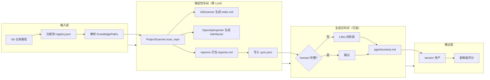

---

## 2. 主要工作流

### 2.1 项目初始化

这是唯一一个"什么都做"的入口：扫描、生成人类文档、打包、生成 Agent 上下文，一条龙。

**为什么它要这么重**：因为新用户第一次接触一个仓库时，需要的是"完整可用的知识底座"，而不是"半成品 + 若干条待办"。代价是它可能跑几十分钟（外部 Agent 逐篇写文档），所以系统给了它断点续跑能力和进度事件。

#### 流程图

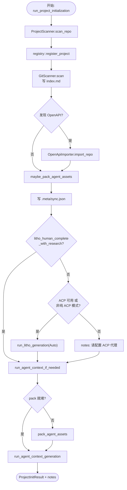

#### 时序图

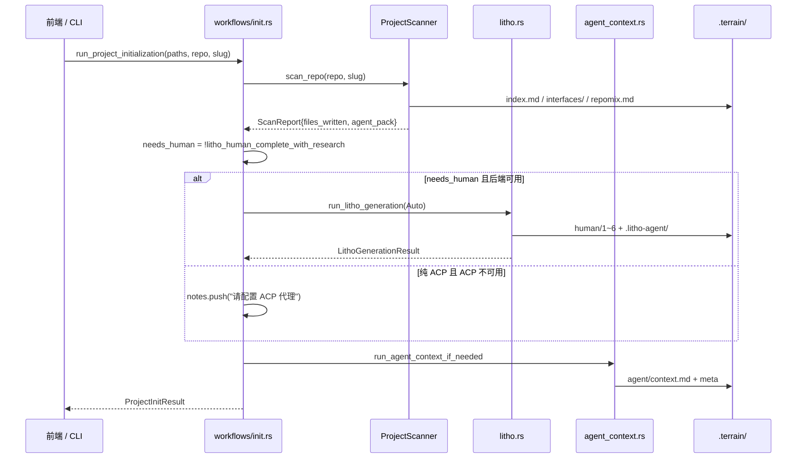

#### 阶段说明

| 阶段 | 执行者 | 输入 | 输出 | 说明 |
|------|-------|------|------|------|
| 扫描 | `ProjectScanner`（`ingest/mod.rs:52`） | 仓库路径、slug | `index.md`、`sync.json` | 顺带把项目注册进 `~/.terrain/registry.json` |
| 接口导入 | `OpenApiImporter`（`ingest/openapi.rs`） | OpenAPI/Swagger 文件 | `interfaces/*.md` | 只在发现规范文件时触发 |
| 打包 | `maybe_pack_agent_assets`（`assets/repomix.rs:146`） | 仓库文件树 | `agent/repomix.md`、`meta.json` | 已与 HEAD 同步则跳过 |
| 文档生成 | `run_litho_generation`（`litho.rs:732`） | `LithoPlan` | `human/` 六件套 | 支持 ACP / 原生双通道 |
| 上下文生成 | `run_agent_context_generation`（`agent_context.rs:26`） | pack + 旧 context | `agent/context.md` | 默认增量 |

---

### 2.2 快速刷新

初始化很重，但日常提交很轻。快速刷新就是为"刚合并了一个 PR，把知识追上来"这个场景设计的。

它的核心判断只有一条：**如果源码索引和上下文都已经同步到当前 HEAD，就什么都不做**。具体来说，`scan_repo` 内部会判断包是否需要重打（`pack_skipped`），上下文生成会先跑 `plan_incremental_update`——如果自 baseline 以来只有 `.terrain/` 自己被提交了，那就只重盖 baseline，一次模型调用都不发。

#### 流程图

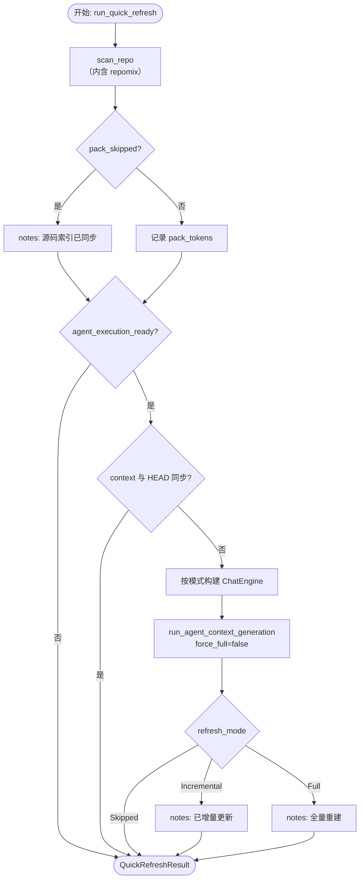

#### 时序图

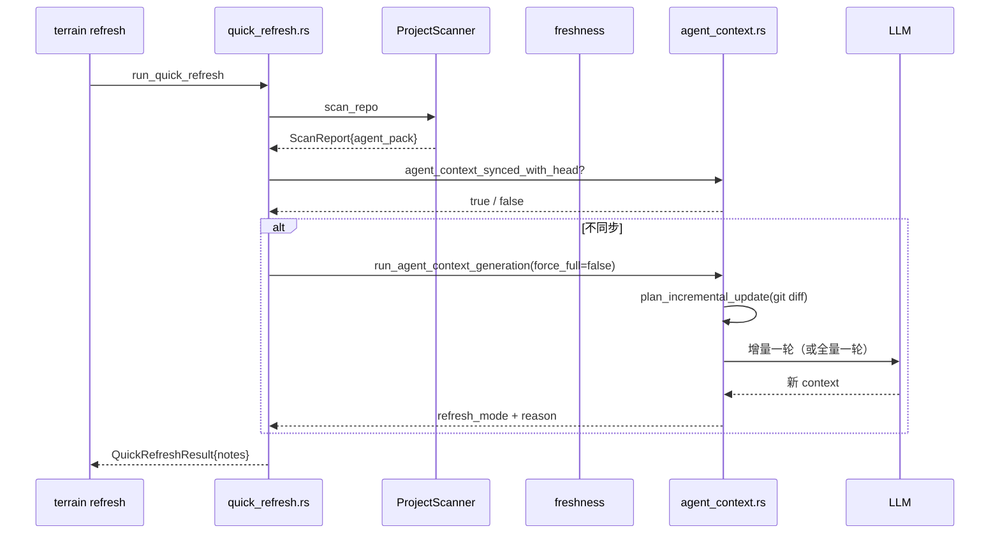

---

### 2.3 DeepWiki 问答

问答是系统里唯一"用户能立刻感知延迟"的路径，所以它的设计重心和文档生成完全不同：**文档生成可以跑 40 分钟，问答必须 3 秒内开始吐字**。

为此引擎做了一个三层切分：宏观层（`context.md` 的概览 + 章节索引，≤4500 字符）直接预载；中观层（单个章节，≤3500 字符）按需读；微观层（repomix 包内单个文件，默认 150 行）只在需要看实现时才取。这样"常见的架构性问题"根本不需要工具调用，而"这个函数怎么实现的"才逐层下潜。

#### 流程图

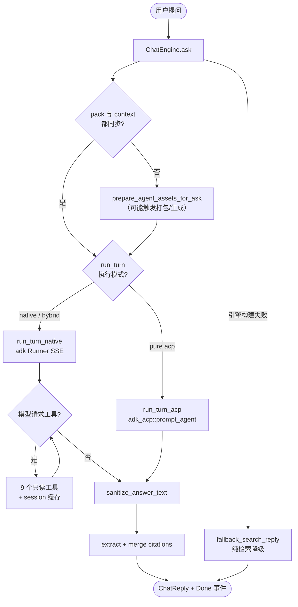

#### 时序图

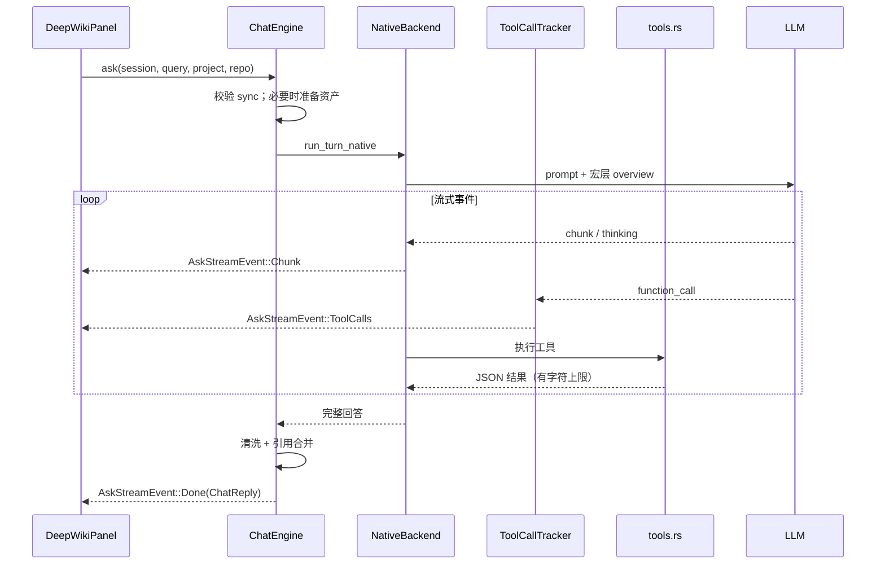

---

### 2.4 SDD 四阶段

SDD（Spec-Driven Development）把"提需求到改代码"拆成四个可审阅的 Markdown 产物。它和 Terrain 其他工作流的关系是：**SDD 消费知识，也生产知识**——每一阶段都会把 `agent/context.md` 与相关文档带进 prompt。

顺序约束是硬的：`run_sdd_phase` 在开始前会检查前一阶段的输出文件是否存在，不存在直接 `bail!`（`workflows/sdd.rs:35-44`）。这不是为了刁难用户，而是因为"没有技术方案就生成代码"几乎必然产出垃圾。

#### 流程图

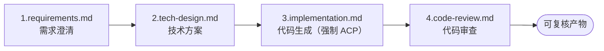

#### 时序图

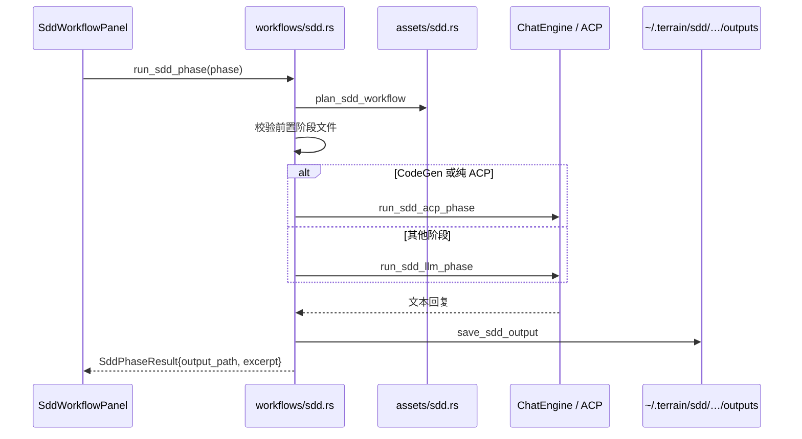

---

### 2.5 新鲜度计算

新鲜度是这套系统里唯一"给资产定价"的流程。它不生成任何内容，但决定了别的流程要不要信任已有内容。

算法本身不复杂，难的是边界情况：基线提交被 rebase 掉了怎么办？仓库是浅克隆怎么办？工作区有未提交改动怎么办？Terrain 的处理原则是**宁可低估，不可高估**。

#### 流程图

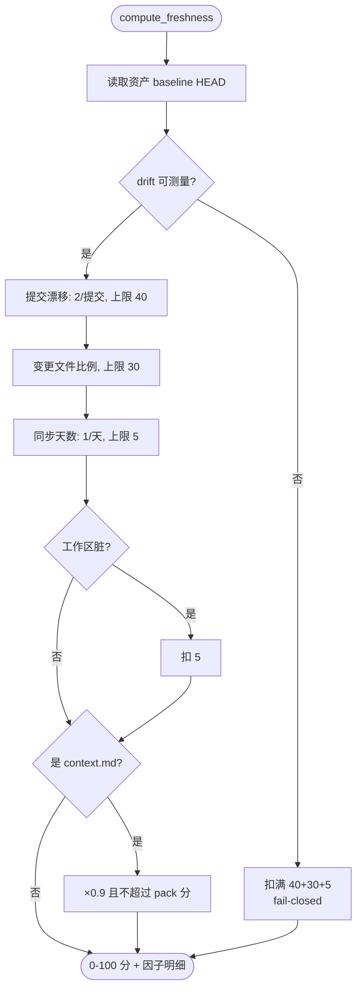

#### 时序图

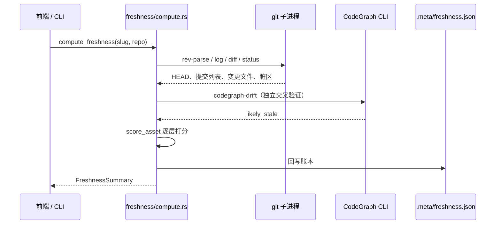

---

## 3. 并发与异步模型

系统里没有"每秒几千请求"的场景，但有三种不同性质的等待，处理方式刻意不同。

**Tauri IPC 长任务**走异步 command + 事件推送。前端不是"等 promise resolve 然后一次性渲染"，而是边收 `ProgressEvent` / `AskStreamEvent` 边更新，这也是为什么 `TaskProgressBar.svelte` 和 `DeepWikiPanel.svelte` 会是前端最大的两个组件之一。

**外部 Agent 写文件**用的是轮询而不是等待进程。原因很实际：ACP Agent 可能先退出再从缓冲落盘，也可能一边写一边被用户中断。Litho 的做法是每 3 秒数一次文件，连续 10 个 tick（后续间隔 6 秒）文件数不变，才认定"稳定"。总超时 45 分钟。

**模型与工具调用**有冷却机制（`throttle.rs`）。Agent 循环里最坏的情况是模型反复调用同一个工具，冷却 + `tool_session_cache` 的"重复调用短路"共同把这类浪费压住。

---

## 4. 错误处理策略

Terrain 的错误处理有一条清晰的价值观：**局部失败不应该中断全局，但失败绝不能伪装成成功**。

具体表现：

- 工作流层用 `notes: Vec<String>` 收集"被跳过的原因"（比如"请先在设置中配置 LLM"），返回给 UI 展示，而不是直接抛错让整个初始化失败。
- 生成层用 `reject_incremental_document` 检查增量结果是不是"缩水版"——如果更新后的文档比基线短很多，说明模型没好好干活，此时拒绝写入、保留旧文件。
- Litho 用 `LithoRunState` 记录检查点。中断后重跑时，提示词里会明确列出"这些文档已完成，不要重写"，避免把好文档改坏。
- 新鲜度层 fail-closed：`drift.is_measured()` 为假就直接扣满惩罚。
- 问答层降级：`ChatEngine` 构建失败时返回 `fallback_search_reply`——用检索结果 + 一句"LLM 不可用"作答，用户至少能拿到相关文档。

这套策略的代价是"有时会显得保守"（比如明明可以重试却直接跳过），但换来的是**资产不会被无声地破坏**——对一个要长期入库、随分支流转的知识库来说，这是正确的取舍。
