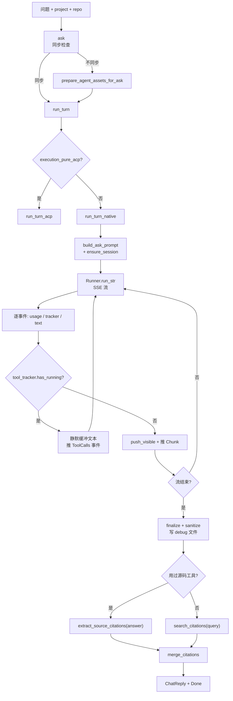

# DeepWiki 问答领域

**模块路径**：`crates/terrain-agent/src/chat/`
**生成日期**：2026-11-14

---

## 这个模块在做什么

问答模块是 Terrain 的**前台接待**。它面对的是"我现在就想知道这个项目怎么鉴权"这类即时需求，所以它和文档生成的设计取向完全相反：文档生成追求"完整、可续跑、能跑 40 分钟"；问答追求"立刻开始吐字、答案有出处、模型看不见的东西不要瞎编"。

实现上它做了两件事。第一，**控制可见范围**：模型只能通过九个只读工具看到知识，工具本身还有字符上限；第二，**把过程透明化**：每一次工具调用、每一个阶段变化都通过流式事件推给前端，用户能看到"它在查什么"，而不是干等一个黑盒答案。

这个模块还承担一个容易被忽略的职责：**决定引用从哪来**。如果模型用过源码包工具，引用就从答案文本里抽取 `path:line`；如果没用过，就退回到对本问题的知识检索结果。这个分支保证了"即使模型偷懒，用户也能看到相关文档"。

---

## 核心功能点

1. **双后端引擎**——`ChatEngine`（`chat/mod.rs:66`）持有 `native: Option<NativeBackend>`。`with_settings`（`:89`）根据 `AgentExecution` 决定：需要原生就 `build_native_backend`，纯 ACP 则校验 `acp_available` 后把 native 置空。

2. **准入检查**——`ask`（`:130`）先判断 `agent_pack_synced_with_head` 与 `agent_context_synced_with_head`；任一不同步就调 `prepare_agent_assets_for_ask` 补上。这一步保证了"知识是当前的"，也解释了为什么第一次提问有时会慢——它在后台补资产。

3. **原生流式循环**——`run_turn_native`（`native.rs:130`）用 adk `Runner::run_str` 拿到 SSE 流，逐事件处理：累加 token 用量、喂给 `ToolCallTracker`、抽取可见文本与 thinking 文本。整个循环有 `ASK_TIMEOUT = 1200s` 的截止时间（`mod.rs:33`），每次 `stream.next()` 都带剩余时间超时。

4. **"说话与干活"分段**——`ModelAnswerCollector`（`native.rs:318`）会在工具执行窗口期间**静默缓冲**模型文本（`push_visible_silent`），避免用户看到"我这就去查一下……"这类过程性废话。工具结束后再决定哪些段落进入最终答案。

5. **阶段状态机**——`ChatPhase` 在 `Thinking → Tools → Generating → Streaming` 之间迁移，通过 `on_phase` 推给前端。前端据此显示"思考中 / 调用工具 / 生成中"。

6. **引用抽取与合并**——如果工具记录里出现过 `grep_agent_pack` / `read_agent_pack_file` / `read_agent_context`，则走 `extract_source_citations(&answer, repo_path)`；否则走 `search_citations(query, ...)`。两条路径的结果最后都会 `merge_citations`。

7. **空答案兜底**——模型有时只调工具不给最终文本。此时会根据"有没有引用、有没有工具记录"生成三种不同的说明，而不是返回空字符串。

8. **ACP 通道**——`run_turn_acp`（`chat/acp.rs:20`）用 `adk_acp::prompt_agent` 把问题交给外部 Agent，并合成一条 `acp-{session_id}` 的工具调用记录，让 UI 至少有"正在用外部 agent"的可见性。

9. **用量估算**——`finalize_usage`（`mod.rs:40`）在 provider 没返回 usage 时按 4 字符 ≈ 1 token 估算，并标记 `estimated = true`，避免用量面板显示 0。

---

## 关键组件

| 组件/类型 | 文件路径 | 核心职责 |
|---------|---------|---------|
| `ChatEngine` | `crates/terrain-agent/src/chat/mod.rs:66` | 准入 + 后端分流 + 引用检索 |
| `ChatEngine::ask` | `crates/terrain-agent/src/chat/mod.rs:130` | 对外主入口，处理资产同步 |
| `run_turn` | `crates/terrain-agent/src/chat/mod.rs:172` | 按执行模式分流 ACP / native |
| `NativeBackend` | `crates/terrain-agent/src/chat/native.rs:42` | adk `Runner` + `InMemorySessionService` |
| `build_native_backend` | `crates/terrain-agent/src/chat/native.rs:47` | 构建 LLM、Agent、Runner |
| `run_turn_native` | `crates/terrain-agent/src/chat/native.rs:130` | 流式事件循环、用量、阶段、引用 |
| `ChatContextGenerator` | `crates/terrain-agent/src/chat/native.rs:30` | 实现 `AgentContextGenerator`，打破循环依赖 |
| `run_turn_acp` | `crates/terrain-agent/src/chat/acp.rs:20` | ACP 子进程通道 |
| `ToolCallTracker` | `crates/terrain-agent/src/chat/tracker.rs:8` | 把 adk Event 归并成工具调用记录 |
| `ModelAnswerCollector` | `crates/terrain-agent/src/chat/native.rs:318` | 按工具窗口切分可见文本 |
| `build_ask_prompt` | `crates/terrain-agent/src/chat/prompt.rs` | 组装三层阅读指引 |
| `ASK_TIMEOUT`、`finalize_usage` | `crates/terrain-agent/src/chat/mod.rs:33,40` | 超时与用量兜底 |

---

## 内部数据流

**关键步骤说明**：

1. `ask`（`mod.rs:130`）——注意它对 `repo_path` 做了 `normalize_repo_hint` 归一化，这是因为同一个仓库可能以相对路径、绝对路径、`~` 路径三种形式传入。
2. `build_ask_prompt`（`prompt.rs`）——除了把问题塞进去，它还写清了三层阅读顺序与"引用要带 `path:line`"的要求。提示词是问答质量的第一道闸。
3. `Runner.run_str`——adk 的 Runner 自带工具调用循环（最多 50 轮，见 `builder.rs:152` 的 `max_iterations`），所以这里的 `loop` 是在消费"已经带工具循环的流"，而不是自己驱动 ReAct。
4. `ToolCallTracker.ingest_event`（`tracker.rs:30`）——处理三件事：去重流式 partial function call、把 function response 匹配到对应 running call、判断"这一批工具是否都结束了"。
5. `ModelAnswerCollector`——`had_tools` 标记决定了段落拼接方式；工具运行期间的文本不进入最终答案，但也不会被丢弃（留在 segments 里供后续拼接判断）。
6. 引用分支——这是一个很实用的设计：模型用了源码工具说明它在看实现，引用从答案里抽；没用说明它主要在总结文档，那就用检索结果兜底。

---

## 关键接口与扩展点

- **`AgentContextGenerator` trait**（定义在 core/agent 交界处，实现于 `native.rs:30`）——这是一个为了打破循环依赖而存在的抽象：`build_agent` 需要"确保上下文存在"的能力，但那个能力在 `agent_context.rs` 里，后者又依赖 ChatEngine。用 trait 把依赖倒置，两边都能编译。
- **后端切换**——`ChatEngine::new` / `new_native` / `with_settings` 三个构造器覆盖了"跟随设置""强制原生""显式指定"三种用法。SDD 的文档阶段就是用 `new_native` 强制走原生 LLM。
- **工具集**——问答模式注册的是精简工具集（`builder.rs` 的 `ask_mode` 分支）：`list_projects`、`search_knowledge`、`read_doc_ask`，以及按需的上下文/包工具。想加新能力，只需在 `tools.rs` 写一个工厂并在 `build_agent` 注册。
- **`ChatPhase`**——新增阶段需要同时改 core 的枚举（ts-rs 导出）与前端渲染。

---

## 与其他模块的交互

| 交互模块 | 方向 | 接口/协议 | 说明 |
|---------|------|---------|------|
| `crate::tools` | 依赖 | 9 个 `Arc<dyn Tool>` | 模型能看到的全部知识入口 |
| `crate::builder` | 依赖 | `build_agent`、`AgentConfig` | 组装 LlmAgent |
| `crate::model` | 依赖 | `build_llm`、`ensure_llm`、`ModelConfig` | 模型构建与校验 |
| `crate::agent_assets` | 依赖 | `prepare_agent_assets_for_ask` | 提问前补齐资产 |
| `terrain-core/search` | 依赖 | `KnowledgeSearch::search` | 引用兜底检索 |
| `terrain-core/citations` | 依赖 | `extract_source_citations`、`merge_citations` | 引用抽取合并 |
| `crate::workflows/ask` | 被依赖 | `ChatEngine::ask` | CLI/UI 的问答入口 |
| `src-tauri/commands` | 被依赖 | `ask_knowledge_cmd` | `Channel<AskStreamEvent>` 流式 IPC |

---

## 跨模块协作场景

**在「DeepWiki 问答」流程中**：本模块是绝对主角。`workflows/ask.rs:12` 从 `Runtime` 取到 `ChatEngine`，把五个回调（chunk / thinking / tool_calls / phase / usage）接成 `AskStreamEvent` 推给前端；结束后由 `workflows/ask.rs` 再补一次 `Done` 事件。

**在「Agent 上下文生成」中**：`run_agent_context_generation` 用一个以 `agent-ctx-` 开头的 session id 调用 `ChatEngine`。`run_turn_native` 里有个专门判断（`native.rs:140`）：如果 session 以 `agent-ctx-` 开头，就把 query 直接当 prompt（因为调用方已经组好完整提示词），不再套问答模板。这是一个很小但很关键的复用技巧。

**在「SDD」中**：`run_sdd_llm_phase` 用 `ChatEngine::new_native` 强制原生，把 SDD 提示词直接作为 query 传入——同样走这条"直通"路径。

---

## 性能考量

- **流式优先**：所有输出都是增量推送，用户看到的第一个字符通常在秒级，而不是等整段生成完。
- **短路重复工具调用**：`tool_session_cache` 让同会话内相同参数的调用直接返回缓存（并附带 `duplicate` 提示）。
- **字符上限**：工具返回 JSON 上限 24,000 字符，包内文件默认 150 行，防止一次工具调用吃掉整个上下文。
- **超时预算**：20 分钟总超时 + 每次读取按剩余时间设限，避免半开连接导致挂死。
- **调试落盘**：`write_debug_file("last-ask-raw.md")` 与 `last-ask-sanitized.md` 保留原始与清洗后文本，排查"模型说了但用户没看到"这类问题时非常省事。

---

## 实现亮点

**亮点一：静默缓冲。** "工具执行期间的模型文本不展示"这个细节，看起来只是 UI 打磨，实际上解决了一个真实的体验问题：模型在调用工具前经常说"让我查一下"，工具结束后又说一遍结论，用户会看到重复且断裂的文本。`ModelAnswerCollector` 用 `had_tools` 把这类文本隔离掉，答案读起来连贯得多。

**亮点二：引用来源的自适应。** 用没用源码工具，决定了引用从哪来。这不是权宜之计，而是对"模型行为不可控"的务实回应——你无法保证它一定调用工具，那就为两种情况都准备好引用。

**亮点三：空答案的三种兜底文案。** 分别对应"什么都没找到""查了但模型没总结""找到 N 条引用"，而不是统一返回空。这种细致度直接影响用户对系统可靠性的感知。
