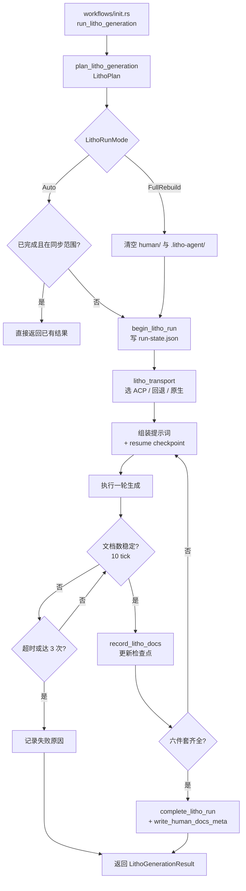

# Litho 生成编排领域

**模块路径**：`crates/terrain-agent/src/litho.rs`、`crates/terrain-agent/src/litho_native.rs`
**生成日期**：2026-11-14

---

## 这个模块在做什么

Litho 是 Terrain 里**唯一一个"要跑几十分钟"的部件**，因此它的代码有 41.6 KB——大部分篇幅不是在"生成文档"，而是在处理"生成文档的过程中可能出的一百种意外"。

它的工作可以类比成**包工头**：自己不砌墙，但负责拿图纸、找施工队、盯着进度、验收成果、记录哪里没干完。图纸是 `LithoPlan`；施工队可能是外部的 ACP Agent（默认 `opencode acp`），也可能是内置的原生 LLM（带受限文件工具）；"盯着进度"靠轮询文件数；"记录没干完"靠 `LithoRunState`。

为什么需要这么一层？因为文档生成是**外部进程 + 长时间 + 多文件写入**的组合，最坏的情况下三种失败会同时发生：Agent 崩了、文件写了一半、用户以为跑完了。没有编排层，这些状态会直接漏给用户。

---

## 核心功能点

1. **三态传输选择**——`LithoTransport`（`litho.rs:64`）有三个变体：`AcpStrict`（纯 ACP，失败即报错）、`AcpWithFallback`（ACP 优先，运行时失败回退原生）、`Native`（ACP 不在 PATH，直接原生）。这个设计解决了一个很实际的难题：**"二进制在 PATH 上"和"二进制支持 ACP"是两件事**，后者无法在启动前可靠探测，只能运行时兜底。

2. **运行模式判定**——`LithoRunMode::Auto` 会尽量复用已有成果（完整且在同步范围内就跳过，只有少量漂移就增量）；`FullRebuild` 会清空 `human/` 与研究工作区，从头跑四阶段。UI 上的「重新生成」对应后者。

3. **提示词组装（含续跑声明）**——基础提示词来自 `build_litho_generation_prompt`；如果存在已完成清单，则追加 `build_litho_generation_prompt_with_progress` 的 "Resume checkpoint" 段落，明确禁止重写已有文档。

4. **稳定性轮询**——外部 Agent 是异步写文件的，进程退出与文件落盘不保证同序。`run_litho_generation` 用 `POLL_INTERVAL_SECS = 3`、`POLL_INTERVAL_STABLE_SECS = 6`、`STABLE_TICKS = 10` 判断"文档数连续稳定"，比等进程退出更可靠。

5. **失败重试与超时**——`MAX_COMPOSITION_ATTEMPTS = 3` 给编排阶段三次机会；`DEFAULT_WALL_TIMEOUT_SECS = 45 * 60` 是整轮硬超时。超时后不会丢弃已有文档，而是把状态留在检查点里。

6. **原生回退的受限工具**——`litho_native.rs` 提供两个工具：`read_litho_file_tool` 只能读技能目录与工作区（单次上限 `MAX_READ_CHARS = 40_000`），`write_litho_file_tool` 只能写工作区与 `human_out`。这把"模型写文件"的风险限制在已知目录内，避免它把仓库源码改坏。

7. **进度事件**——每一轮都通过 `ProgressEvent` 上报阶段与文档计数，前端 `TaskProgressBar` 直接消费。

---

## 关键组件

| 组件/类型 | 文件路径 | 核心职责 |
|---------|---------|---------|
| `LithoRunMode` | `crates/terrain-agent/src/litho.rs:25` | 复用 vs 全量重建 |
| `LithoTransport` | `crates/terrain-agent/src/litho.rs:64` | 三态传输（严格 ACP / 带回退 / 纯原生） |
| `AcpTurnConfig` | `crates/terrain-agent/src/litho.rs:86` | 一轮 ACP 所需的设置、仓库路径、计划 |
| `litho_transport` | `crates/terrain-agent/src/litho.rs:100` | 根据设置与 PATH 选择传输 |
| `prepare_litho_generation` | `crates/terrain-agent/src/litho.rs:125` | 生成 `LithoGenerationJob`（计划 + 提示词 + 命令标签） |
| `run_litho_generation` | `crates/terrain-agent/src/litho.rs:732` | 主编排循环（feature `opencode` 下有独立实现） |
| `NativeLithoCtx` | `crates/terrain-agent/src/litho_native.rs:34` | 原生通道的上下文（paths / model_config / plan） |
| `read_litho_file_tool` | `crates/terrain-agent/src/litho_native.rs:84` | 受限读取工具 |
| `write_litho_file_tool` | `crates/terrain-agent/src/litho_native.rs:143` | 受限写入工具 |
| `run_native_litho_turn` | `crates/terrain-agent/src/litho_native.rs:226` | 跑一轮原生 LLM 生成 |
| `LithoRunState`（来自 core） | `crates/terrain-core/src/assets/litho_run_state.rs` | 检查点读写 |

---

## 内部数据流

**关键步骤说明**：

1. `plan_litho_generation`（core，`assets/litho.rs:18`）——拿到 `skill_dir`、`repo_path`、`human_output_dir`、`litho_workspace_dir`。这四个绝对路径是提示词的全部坐标系统。
2. `litho_transport`（`litho.rs:100`）——先看 `execution_pure_acp`，是则 `AcpStrict`；否则看 `acp_available`，在则 `AcpWithFallback`，不在则 `Native`。注意它每次都重新构造 `NativeLithoCtx`，因为回退路径随时可能被触发。
3. `run_litho_generation`——主循环里既执行生成，也执行"判定是否完成"。判定用的是 `litho_human_complete_with_research` 与 `count_markdown_in_dir`，而不是信任 Agent 的自我汇报。
4. `record_litho_docs`——把当前 `human/` 下的文档名与 HEAD 写进检查点。这是"断点续跑"的事实来源。
5. `write_human_docs_meta`——记录 baseline HEAD，供新鲜度与增量更新使用。

---

## 关键接口与扩展点

**唯一的扩展点是"谁来跑这一轮"**，它被抽象成 `LithoTransport` 枚举而不是 trait。这是一个有意的取舍：trait 适合"未来会有很多实现"，而这里只有三种确定的组合，枚举能让 `match` 穷尽检查帮上忙。

想加第四种后端（比如"远程生成服务"），需要：
1. 在 `LithoTransport` 加变体；
2. 在 `litho_transport` 的决策链里加分支；
3. 在主循环的 `match transport` 里加实现。

原生通道的工具集（`read_litho_file_tool` / `write_litho_file_tool`）是另一个可扩展点：新增工具时只要保证路径限制不变，就能给模型更多能力而不扩大风险面。

---

## 与其他模块的交互

| 交互模块 | 方向 | 接口/协议 | 说明 |
|---------|------|---------|------|
| `terrain-core/assets/litho` | 依赖 | `plan_litho_generation`、`litho_human_complete_with_research` | 计划与完整性判定 |
| `terrain-core/assets/litho_run_state` | 依赖 | `begin`、`record`、`complete`、`is_resumable` | 检查点 |
| `crate::acp` | 依赖 | `acp_spawn_command`、`build_acp_config`、`execution_pure_acp` | ACP 配置与可用性 |
| `crate::litho_native` | 依赖 | `NativeLithoCtx`、`run_native_litho_turn` | 原生回退 |
| `crate::model` | 依赖 | `ModelConfig` | 原生通道的模型配置 |
| `crate::workflows/init` | 被依赖 | `run_litho_generation` | 初始化流程调用 |
| `src-tauri/commands` | 被依赖 | `run_litho_generation_cmd`、`generate_human_docs_cmd` | UI 触发 |

---

## 跨模块协作场景

**在「项目初始化」中**：本模块是第二步的主角。`workflows/init.rs:146` 在 `needs_human` 为真时调用 `run_litho_generation(..., LithoRunMode::Auto, ...)`，并把 `result.human_doc_count` / `human_docs_complete` 带回给 `ProjectInitResult`。如果这一步失败，初始化**不会**整体失败——后续的 Agent 上下文生成仍会尝试，只是质量会差一些。

**在「重新生成」按钮中**：前端 `runLithoGeneration(repoPath, slug, true)` 把 `forceRefresh=true` 一路传到 `LithoRunMode::FullRebuild`，于是 `human/` 被清空、四阶段重跑。这个语义差别是刻意的：用户点「重新生成」就是明确表示"我不信任现有内容"。

**在「快速刷新」中**：默认**不跑** Litho（`incremental_human_docs = false`）。原因写在 `KnowledgeSettings` 的注释里——Litho 是最慢的阶段，快速刷新要保持"快"。

---

## 性能考量

- **避免全量重跑**：`Auto` 模式先检查完整性，再检查漂移规模。真实项目里最常见的场景是"改了三个文件"，此时整个 Litho 阶段会被跳过。
- **轮询而非阻塞**：3 秒/6 秒两档间隔 + 稳定 10 tick，兼顾"尽快发现完成"和"不误判"。轮询本身几乎不耗资源（只是数文件）。
- **单次读取上限**：原生通道 `MAX_READ_CHARS = 40_000`，避免模型一次把大文件全吞进去。
- **超时保护**：45 分钟硬超时防止"外部 Agent 卡死导致任务永远挂着"。

---

## 实现亮点

**亮点一：把"探测不到的东西"交给运行时。** 代码注释写得很清楚：一个二进制可能在 PATH 上但不支持 ACP，这一点没有可移植的预检办法。所以 `AcpWithFallback` 不是"启动时探测"，而是"运行中兜底"——这种诚实地承认边界的设计，比假装能预检要可靠得多。

**亮点二：验收权不在 Agent 手里。** 无论 ACP Agent 怎么宣称"我完成了"，最终判定都由 `litho_human_complete_with_research` 做——它只认文件。这是整个模块最重要的一条设计原则。

**亮点三：失败也留证据。** 超时或重试耗尽时，检查点与已写文档都保留，`LithoGenerationResult` 带回原因。下次运行能从断点继续，而不是从零开始。
