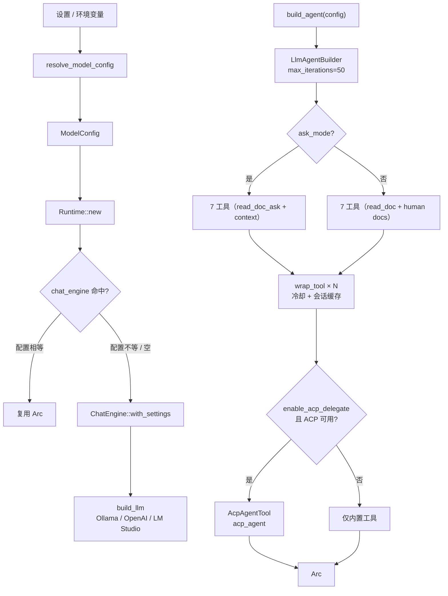

# Agent 运行时领域

**模块路径**：`crates/terrain-agent/src/runtime.rs`、`builder.rs`、`model.rs`、`tools.rs`、`acp.rs`、`throttle.rs`、`tool_session_cache.rs`、`tool_schema.rs`、`compat_tool.rs`
**生成日期**：2026-11-14

---

## 这个模块在做什么

如果 `terrain-agent` 是一个车间，那么这一层就是**总装线**：它把"模型"（LLM）、"工具"（9 个知识检索工具）、"外部编码代理"（ACP）和"限流器"装配成一个可运行的 Agent，并保证这套装配在设置变更后能安全重建。

它要同时满足三个互相拉扯的诉求：

| 诉求 | 手段 |
|------|------|
| 同一个 Agent 要能跑"问答"和"生成"两种任务 | `AgentConfig.ask_mode` 切换工具集与系统提示词 |
| 模型/ACP 设置随时可能改 | `Runtime` 惰性缓存 + 配置相等性校验 |
| 免费/本地模型容易 429、容易重复调用 | 冷却包装 + 会话级工具结果缓存 |

理解这一层的关键是：**它不是业务逻辑，而是"装配与约束"**。业务在 `chat/`、`workflows/` 里，这里只负责"给它们一个正确构造的 Agent"。

---

## 核心功能点

1. **运行时缓存**——`Runtime`（`runtime.rs:11`）持有 `paths`、`model_config`（`RwLock`）与 `chat: Mutex<Option<Arc<ChatEngine>>>`。`chat_engine()`（`:55`）在返回缓存前会比对 `engine.model_config()` 与当前配置、`engine.acp_settings()` 与当前 ACP 设置；任一不等就丢弃重建。这是"设置改了但旧引擎还在跑"问题的正面解法。

2. **Agent 装配**——`build_agent`（`builder.rs:147`）用 `LlmAgentBuilder` 设置名称、系统提示词、模型、`max_iterations(50)`、`max_output_tokens(64000)`，再按模式挂工具：
   - `ask_mode = true`：`list_projects`、`search_knowledge`、`read_doc_ask`、`read_agent_context`、`read_agent_pack_meta`、`grep_agent_pack`、`read_agent_pack_file`；
   - `ask_mode = false`：`list_projects`、`search_knowledge`、`read_doc`、`read_agent_pack_meta`、`grep_agent_pack`、`read_agent_pack_file`、`list_human_docs`。

   两种模式都是 7 个工具，差异在"读文档"的粒度：问答模式用 `read_doc_ask`（带章节裁剪），生成模式用 `read_doc`（整篇）。

3. **模型解析**——`resolve_model_config`（`model.rs:71`）优先读 `~/.terrain/settings.json`，缺失则回退默认（OpenAI + 默认模型）并叠加环境变量（`TERRAIN_LLM_PROVIDER`、`TERRAIN_MODEL`、`OLLAMA_HOST`、`OPENAI_BASE_URL`、`TERRAIN_OPENAI_API_MODE`、`OPENAI_API_KEY`/`TERRAIN_API_KEY`）。`finalize_config` 补齐各 provider 的默认端点，LM Studio 还会补一个占位 API key（它不校验但客户端库要求非空）。

4. **客户端构造**——`build_llm`（`:141`）按 `LlmProvider`（Ollama / Openai / LmStudio）返回 `Arc<dyn Llm>`；`llm_status`（`:216`）给出"是否已配置"的结构化状态；`probe_llm`（`:357`）发一个 `max_output_tokens = 16` 的最小请求做连通性验证。

5. **ACP 解析与注入**——`acp.rs` 负责把 `AcpSettings` 变成可执行命令：`acp_binary` / `acp_args` / `acp_spawn_command`（支持三者组合覆盖），`build_acp_config` 注入技能目录（`TERRAIN_ASK_SKILL` / `TERRAIN_AGENT_ARCH_SKILL`）与环境变量。`execution_pure_acp` / `execution_uses_native_llm` 决定"这次任务到底走 ACP 还是走内置 LLM"。

6. **限流包装**——`throttle.rs` 的 `wrap_llm` / `wrap_tool` 在每次调用后 sleep `DEFAULT_CALL_COOLDOWN = 200ms`（可用 `TERRAIN_LLM_COOLDOWN_MS` 覆盖）。`take_tool_execution_ms(call_id)` 单独记录"工具净执行时间"，把冷却睡眠排除在外——否则 UI 上每个工具都显示"耗时 200ms 以上"，无法定位真正的慢工具。

7. **重复调用短路**——`tool_session_cache.rs` 以 `session_id + tool + 参数指纹` 为键缓存工具结果。同一会话里模型再次请求相同内容时，返回原结果并打上 `duplicate_call: true` 与一句"不要重复调用"。这对小模型尤其有效——它们经常在同一个问题上反复 grep。

8. **Schema 兼容**——`tool_schema.rs` 的 `ensure_tool_parameters_object` 给缺失 `properties` 的 object schema 补上空对象。LM Studio 这类严格校验器会直接拒绝不合规的 function schema，而不同模型的 schema 生成质量参差不齐，所以这一层是"让工具能被所有 provider 接受"的适配垫。

---

## 关键组件

| 组件/类型 | 文件路径 | 核心职责 |
|---------|---------|---------|
| `Runtime` | `crates/terrain-agent/src/runtime.rs:11` | 引擎/配置缓存与失效 |
| `AgentConfig` | `crates/terrain-agent/src/builder.rs:108` | 装配参数（路径、cwd、ACP、模式） |
| `build_agent` | `crates/terrain-agent/src/builder.rs:147` | 构造 `Arc<dyn Agent>` |
| `knowledge_paths_from_env` | `crates/terrain-agent/src/builder.rs:239` | 从环境还原知识路径 |
| `LlmProvider` / `ModelConfig` | `crates/terrain-agent/src/model.rs:23,30` | provider 与运行配置 |
| `resolve_model_config` | `crates/terrain-agent/src/model.rs:71` | 设置 + 环境变量合并 |
| `build_llm` | `crates/terrain-agent/src/model.rs:141` | 按 provider 造客户端 |
| `llm_status` / `probe_llm` | `crates/terrain-agent/src/model.rs:216,357` | 配置状态与探活 |
| `list_provider_models` | `crates/terrain-agent/src/model.rs:287` | 拉取 `/models` 列表 |
| 9 个工具工厂 | `crates/terrain-agent/src/tools.rs:42–525` | 知识检索工具集 |
| `resolve_acp_settings` / `build_acp_config` | `crates/terrain-agent/src/acp.rs:11,193` | ACP 命令与技能注入 |
| `wrap_llm` / `wrap_tool` | `crates/terrain-agent/src/throttle.rs:28,32` | 冷却包装 |
| `take_tool_execution_ms` | `crates/terrain-agent/src/throttle.rs:43` | 工具净耗时 |
| `get_cached` / `store_cached` | `crates/terrain-agent/src/tool_session_cache.rs:16,21` | 会话级重复调用缓存 |
| `ensure_tool_parameters_object` | `crates/terrain-agent/src/tool_schema.rs:6` | schema 兼容垫 |
| `CompatTool` | `crates/terrain-agent/src/compat_tool.rs:12` | 老式工具适配 adk trait |

---

## 内部数据流

**关键步骤说明**：

1. `Runtime::new` 立刻解析一次配置，但不构造 ChatEngine——启动阶段不做网络/子进程工作。
2. `chat_engine()` 的相等性校验包含 ACP 设置，因为 ACP 变更会改变"走哪条执行链路"，而不仅是参数。
3. `set_model_config` 与 `invalidate_chat_engine` 都只是把缓存置 `None`，真正的重建延迟到下一次调用——避免"保存设置时同步构造引擎"造成的 UI 卡顿。
4. `build_agent` 里 `list_projects_tool` 是两种模式共有的；它让模型始终能先"看有哪些项目"，再决定读哪一个。
5. ACP 委托只有 `enable_acp_delegate` 且 `acp_available` 才挂载；不可用时只 warn 不报错——没有 ACP 的机器仍然能用纯 LLM 问答。
6. `wrap_tool` 内部先 `CompatTool::wrap` 再套冷却，顺序不能反：冷却层需要看到统一的 `Tool` trait。

---

## 关键接口与扩展点

- **`AgentConfig.ask_mode`**：新增一种任务形态（比如 "review 模式"）时，在这里加枚举而非布尔值更合适；目前只有两态，所以布尔够用。
- **工具工厂**：每个工具是独立 `pub fn ..._tool(paths) -> Arc<dyn Tool>`，新增工具只需写工厂 + 在 `build_agent` 注册 + 在 `tools.rs` 定义 schema。
- **`LlmProvider`**：新增 provider 要同时改 `model.rs`（解析、构造、默认端点）与前端设置面板的下拉项。
- **`ProviderProfile` 的 `api_mode`**：`chat_completions` / `responses` 两种路由，用来兼容不同 OpenAI 风格端点。
- **`CompatTool`**：如果未来升级 adk 的 Tool trait，这里是唯一的适配点。

---

## 与其他模块的交互

| 交互模块 | 方向 | 接口/协议 | 说明 |
|---------|------|---------|---------|
| `terrain-core/paths` | 依赖 | `KnowledgePaths` | 工具与引擎的知识根 |
| `terrain-core/settings` | 依赖 | `load_model_settings`、`AcpSettings` | 配置来源 |
| `terrain-core/search`、`assets` | 依赖 | 检索与包读取原语 | 工具实现底座 |
| `terrain-agent/chat` | 被依赖 | `ChatEngine::with_settings` | 运行时缓存的产物 |
| `terrain-agent/workflows` | 被依赖 | `build_agent`、`AgentConfig` | 生成类任务 |
| `src-tauri` | 被依赖 | `Runtime`、`AppState` | 桌面端单例 |
| `terrain-cli` | 被依赖 | `Runtime` | CLI 问答 |

---

## 跨模块协作场景

**在「DeepWiki 问答」中**：`Runtime::chat_engine()` 提供引擎；`ChatEngine` 内部按 `ask_mode` 装配 Agent；工具调用经过冷却与会话缓存。用户在设置里换了模型后，`save_model_settings_cmd` 调 `set_model_config`，下一次提问自动用新模型——不需要重启应用。

**在「Litho 生成」中**：`workflows/litho.rs` 用 `build_agent` 装配"生成模式"（`ask_mode = false`），因此模型能拿到 `list_human_docs` 与整篇 `read_doc`，适合"读现有文档再重写"。

**在「纯 ACP 模式」中**：`execution_pure_acp` 为真时，内置 LLM 不参与，任务直接交给外部编码代理。此时 `Runtime` 仍然需要存在（提供 paths 与 ACP 设置），但 `build_llm` 不会被调用。

---

## 性能考量

- **引擎复用**：`Arc<ChatEngine>` 让每次问答不必重建 HTTP 客户端与工具图；配置相等性校验保证"该复用才复用"。
- **工具净耗时单独记录**：UI 上的 `tool_calls` 时间线需要区分"模型慢"与"工具慢"，冷却睡眠混进去会让所有工具看起来一样慢。
- **重复调用缓存**：省下的不只是 token，还有一次完整的工具执行（grep 一个大包可能几十毫秒到几百毫秒）。
- **`probe_llm` 只花 16 token**：连通性检查不应该产生费用，也不应该因为长回答超时。
- **延迟构建**：启动、保存设置都不构造引擎，把成本压到"第一次真正提问"。

---

## 实现亮点

**亮点一：缓存失效靠"配置相等"而不是"手动标记"。** 很多实现会在保存设置时手动 `invalidate`，一旦某条路径漏调就会用到旧配置。Terrain 在取用时比对 `model_config` 与 `acp_settings`，把正确性从"记得调用"变成"结构上不可能错"。

**亮点二：`duplicate_call` 是一等公民。** 返回缓存时不仅给数据，还明确告诉模型"这是重复调用，不要再试"。小模型对这种显式指令的遵循度远高于隐式的"结果看起来一样"。

**亮点三：冷却时间与执行时间分离。** `take_tool_execution_ms` 单独维护一张 `call_id → ms` 表，把"为了限流而 sleep 的时间"从指标里剔除。这是一个只有真正调过优的人才会想到的细节。
