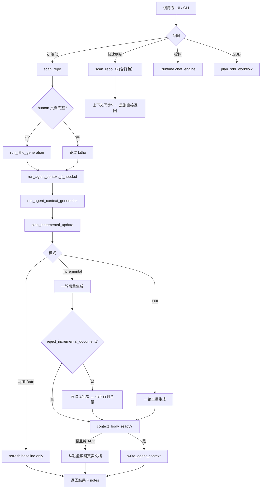

# 工作流编排领域

**模块路径**：`crates/terrain-agent/src/workflows/`、`agent_context.rs`、`agent_assets.rs`、`context_generator.rs`
**生成日期**：2026-11-14

---

## 这个模块在做什么

`workflows/` 是 Terrain 的**总调度室**。它不做具体技术活——扫描由 core 做、生成由 Litho 做、问答由 ChatEngine 做——它负责的是"什么时候该做哪一件、失败了怎么办、结果怎么汇报"。

四个入口对应四种用户意图：

| 入口 | 用户意图 | 文件 |
|------|---------|------|
| `run_project_initialization` | "我第一次用这个仓库，帮我全部准备好" | `workflows/init.rs:114` |
| `run_quick_refresh` | "我刚提交了代码，把知识追上来" | `workflows/quick_refresh.rs:24` |
| `ask_knowledge` | "回答我一个问题" | `workflows/ask.rs:12` |
| `run_sdd_phase` | "帮我走一阶段 SDD" | `workflows/sdd.rs:16` |

这四个入口有一个共同特征：**它们都返回"结果 + 若干条 notes"，而不是遇到问题就抛错**。notes 是给用户看的解释（"已跳过源码索引，因为它已与当前提交同步"），这种"把跳过也当作一种结果来汇报"的做法，是这套系统可维护性的重要来源。

---

## 核心功能点

1. **初始化编排**——`run_project_initialization` 串起扫描、Litho、Agent 上下文三个阶段。它对每个阶段的"要不要跑"都有独立判断：文档不完整才跑 Litho；`agent_context_ready` 为假或 Litho 刚跑过才刷上下文（因为 Litho 会改写上下文所依据的叙述）。

2. **快速刷新编排**——`run_quick_refresh` 把"扫描 + 打包"合并成一次调用（`scan_repo` 内部就完成打包），然后只在 `!agent_context_synced_with_head` 时刷新上下文。它还区分了三种包状态：跳过（已同步）、没打包（feature 关闭）、正常（带 token 数）。

3. **问答入口与降级**——`ask_knowledge` 从 `Runtime` 取 `ChatEngine`；取不到就用 `fallback_search_reply` 返回检索结果 + 原因说明，并依然发一个 `Done` 事件让前端正常收尾。这个"永远给一个答复"的保证，避免了 UI 卡在"生成中"。

4. **SDD 阶段编排**——`run_sdd_phase` 做三件事：建目录、校验前置阶段文件、按阶段选引擎（`CodeGen` 强制 ACP，因为要真改代码）。

5. **Agent 上下文的三种刷新模式**——`run_agent_context_generation`（`agent_context.rs:26`）是这几条工作流里最精细的一段：
   - `UpToDate`：只有 `.terrain/` 变了 → 只重盖 baseline，**一次模型调用都不发**；
   - `Incremental(plan)`：带 git diff 做补丁式更新；
   - `Full{reason}`：显式重建或变更过大。

6. **两级失败恢复**——增量结果若被 `reject_incremental_document` 判定为"缩水"，先尝试从磁盘读回 ACP Agent 就地编辑的文件（`recovered_from_disk_after_*`）；不行再退到全量重建（`full_after_incremental_*`）。全量重建仍产出空文本时直接 `bail!`，文件保持不变。

7. **ACP 摘要回复的抢救**——有些 ACP Agent 会把文档写到 `TERRAIN_AGENT_CONTEXT_OUTPUT` 指定的文件，然后只在回复里说"完成了"。Terrain 的契约是"回复即文件"，所以遇到这种情况会从磁盘读回真实文档（`recovered_from_disk_after_summary_reply`）。

8. **资产就绪保障**——`agent_assets.rs` 提供三个粒度：只确保包（`ensure_agent_pack`）、缺上下文才生成（`generate_agent_context_if_missing`）、两者都确保（`ensure_agent_assets`）；`prepare_agent_assets_for_ask` 是问答前的轻量版本。

---

## 关键组件

| 组件/类型 | 文件路径 | 核心职责 |
|---------|---------|---------|
| `run_project_initialization` | `crates/terrain-agent/src/workflows/init.rs:114` | 扫描 → Litho → 上下文 |
| `run_agent_context_if_needed` | `crates/terrain-agent/src/workflows/init.rs:26` | 判断并刷新上下文，写 notes |
| `run_quick_refresh` | `crates/terrain-agent/src/workflows/quick_refresh.rs:24` | 轻量刷新 |
| `ask_knowledge` | `crates/terrain-agent/src/workflows/ask.rs:12` | 问答入口 + 事件桥接 |
| `fallback_search_reply` | `crates/terrain-agent/src/workflows/ask.rs:67` | LLM 不可用时的检索降级 |
| `run_sdd_phase` | `crates/terrain-agent/src/workflows/sdd.rs:16` | SDD 单阶段执行 |
| `run_agent_context_generation` | `crates/terrain-agent/src/agent_context.rs:26` | 上下文生成主逻辑与恢复链 |
| `run_agent_context_turn` | `crates/terrain-agent/src/agent_context.rs:220` | 单轮生成（ACP / native 分派） |
| `context_prompt_for` | `crates/terrain-agent/src/agent_context.rs:240` | 全量提示词 vs 增量提示词 |
| `ensure_agent_assets` | `crates/terrain-agent/src/agent_assets.rs:73` | 包 + 上下文的就绪保障 |
| `AgentContextGenerator` | `crates/terrain-agent/src/context_generator.rs` | 上下文生成的 trait 抽象 |

---

## 内部数据流

**关键步骤说明**：

1. `scan_repo`（`terrain-core/src/ingest/mod.rs:52`）——它内部就完成了注册、布局、Git 扫描、OpenAPI 导入与 repomix 打包。工作流层只需要读 `ScanReport.agent_pack` 的 `pack_skipped` 与 token 数。
2. `run_litho_generation`——只有 `needs_human` 为真才调用。判断依据是 `litho_human_complete_with_research`，它同时要求研究笔记与最终文档。
3. `plan_incremental_update`——返回 `UpToDate` 时，代码会 `refresh_agent_context_baseline` 并立即返回。这个分支的价值在于：**"什么都没变"不等于"什么都不做"**，baseline 必须前移，否则下次还会重复判断。
4. `reject_incremental_document` 的恢复链——先 `read_agent_context_body` 看 ACP 是否就地改过文件；改过且通过校验就采用。这一步体现了一个务实的判断：**Agent 的实际产出比它的回复更可信**。
5. `context_body_ready`——要求正文 ≥500 字符且至少 4 个 `##` 章节。这是"完整性"的量化定义，比"非空"严格得多。
6. `write_agent_context`——写入时同步更新 `baseline_head` 与元数据，供新鲜度与下次增量使用。

---

## 关键接口与扩展点

- **`AgentContextGenerator` trait**（`context_generator.rs`）——把"确保上下文存在"抽象出来，让 `builder.rs` 可以在不依赖 `agent_context.rs` 的情况下构建 Agent。这是本模块唯一真正的接口扩展点。
- **`KnowledgeSettings` 三个开关**：`incremental_refresh`（是否增量）、`incremental_max_changed_files`（何时退全量）、`incremental_human_docs`（快速刷新是否也刷人类文档）。这三个开关是用户能调整的全部行为面，其余都是硬编码的保守策略。
- **`ProgressEvent`**——每个阶段都发进度，前端 `TaskProgressBar` 直接消费；新增阶段只需发一个新 event。

---

## 与其他模块的交互

| 交互模块 | 方向 | 接口/协议 | 说明 |
|---------|------|---------|------|
| `terrain-core/ingest` | 依赖 | `ProjectScanner::scan_repo` | 扫描与打包 |
| `terrain-core/assets` | 依赖 | `plan_incremental_update`、`reject_incremental_document`、`write_agent_context` | 增量与写入 |
| `crate::litho` | 依赖 | `run_litho_generation` | 文档生成 |
| `crate::chat` | 依赖 | `ChatEngine::run_turn`、`ask` | 生成与问答 |
| `crate::model` | 依赖 | `llm_status`、`ModelConfig` | 可用性判断 |
| `crate::acp` | 依赖 | `acp_available`、`execution_pure_acp` | 模式判断 |
| `crates/terrain-cli` | 被依赖 | `commands/{init,project,ask,sdd}.rs` | CLI 入口 |
| `src-tauri/commands` | 被依赖 | `initialize_project_cmd` 等 | UI 入口 |

---

## 跨模块协作场景

**在「项目初始化」中**：本模块是唯一的编排者。它先调 core 的扫描，再调 agent 的 Litho，最后调自己的上下文生成。特别值得注意的是 `force_refresh` 参数的双重含义：在 `run_agent_context_if_needed` 里，它表示"Litho 刚重写过人类文档，所以上下文必须重建"——因为上下文是文档的摘要，文档换了摘要就没有锚点了。

**在「快速刷新」中**：本模块刻意**不跑 Litho**。默认配置下 `incremental_human_docs = false`，理由是 Litho 是最慢的阶段。这是一个明确的产品取舍：刷新应该在一分钟内完成。

**在「DeepWiki 问答」中**：本模块提供入口与降级，真正的问答逻辑在 `chat/`。分层的意义在于：CLI 和 Tauri 都只需要调 `ask_knowledge`，不用关心后端是 ACP 还是原生。

---

## 性能考量

- **能跳就跳**：`UpToDate` 分支一次模型调用都不发；`pack_skipped` 分支跳过重新打包；`agent_context_synced_with_head` 为真时快速刷新直接返回。
- **增量优先**：默认 `incremental_refresh = true`。对于"改三个文件"的提交，增量一轮比全量一轮便宜一个数量级。
- **超过 60 个文件退全量**：这不是性能优化而是正确性判断——diff 太大时它不再是"变更摘要"，继续打补丁反而更容易出错。
- **不走重复路**：`run_agent_context_if_needed` 在 Litho 已经打包过的情况下不会重复打包（检查 `agent_pack_ready`）。

---

## 实现亮点

**亮点一：把"跳过"也当作一等结果。** 几乎所有工作流都维护一个 `notes: Vec<String>`，把"为什么没做"写清楚。这让用户不会面对"点了一下，什么都没发生"的困惑。

**亮点二：两级恢复链。** 增量被拒 → 读回 Agent 就地编辑的文件 → 仍不行则全量重建 → 全量仍空则 `bail!` 并保留原文件。四层防线，每一层都有明确理由，而不是简单地 `unwrap_or_default()`。

**亮点三：`context_body_ready` 的量化门槛。** "≥500 字符且≥4 个 `##` 章节"这个判断看起来武断，但它精准地挡住了最常见的失败模式：模型返回一句"已完成"或者一段摘要，却把真正的文档覆盖掉。
