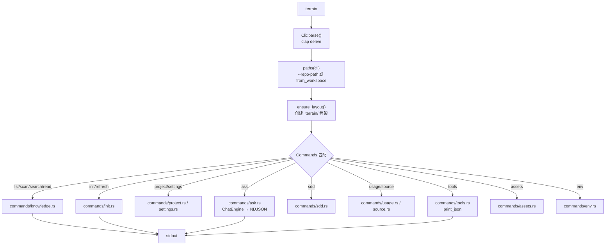

# CLI 领域

**模块路径**：`crates/terrain-cli/`（`src/main.rs`、`src/cli.rs`、`src/commands/`、`src/util.rs`）
**生成日期**：2026-11-14

---

## 这个模块在做什么

CLI 是 Terrain 的**后门钥匙**：桌面应用能做的事，它基本都能做，只是没有图形界面。更重要的是，它是**外部 Agent 的接口层**——`terrain tools *` 系列命令的存在，让 Claude Code、OpenCode 这类编码 Agent 不必理解 Terrain 的内部结构，只要会跑命令、读 JSON 就能使用知识库。

它有三个身份，对应三种使用方式：

| 身份 | 典型命令 | 输出 |
|------|---------|------|
| 人类运维工具 | `terrain init` / `refresh` / `search` | 可读文本 + 进度 |
| 脚本数据源 | `terrain usage snapshot --json` 类 | 结构化 JSON |
| ACP 工具契约 | `terrain tools grep-pack` | JSON（stdout，稳定字段） |

第三种身份是设计上最特殊的：它要求输出格式**长期稳定**，因为消费方是别人写的 Agent 提示词，而不是我们自己的代码。

---

## 核心功能点

1. **单入口分发**——`main.rs` 只做四件事：加载 `.env`、初始化随包资源（bundled tools / env catalog / preset skills）、后台线程把 env catalog 部署到 `~/.terrain/`、`commands::run(Cli::parse())`。分发本身是一张 `match` 表（`commands/mod.rs:19`），每个分支对应一个命令模块。

2. **15 个一级子命令**——`Commands`（`cli.rs:26`）列出全部入口：`list`、`scan`、`init`、`refresh`、`search`、`read`、`project`、`settings`、`ask`、`sdd`、`usage`、`source`、`tools`、`assets`、`env`。其中 8 个还有二级子命令枚举（`ProjectCommands`、`SettingsCommands`、`AskCommands`、`SddCommands`、`UsageCommands`、`SourceCommands`、`ToolsCommands`、`AssetCommands`、`EnvCommands`）。

3. **仓库定位**——`--repo-path` 是全局参数，可放在任何位置。`util::paths`（`util.rs:8`）优先用它，否则 `KnowledgePaths::from_workspace()`（`TERRAIN_REPO_PATH` 或最近 Git 根）。`require_repo_path` 在两者都缺失时给出明确错误，而不是默默用当前目录。

4. **目录预置**——`commands::run` 在分发前调用 `paths.ensure_layout()`。任何命令（包括只读的 `list`）都保证 `.terrain/` 骨架存在，避免下游代码到处写"目录不存在就创建"。

5. **Slug 规则**——`slug_from`（`util.rs:23`）用仓库目录名做 `slugify`，`--slug` 可覆盖。所有命令共享同一规则，所以 `scan` 建的项目与 `search --project` 查的项目一定是同一个 key。

6. **ACP 工具契约**——`commands/tools.rs` 的 9 个子命令全部只输出 JSON：`list-projects`、`pack-meta`、`grep-pack`、`read-pack-file`、`read-context`、`search`、`read-doc`、`freshness`、`codegraph-drift`。它们直接对应 Agent 工具集的 CLI 镜像——同一份能力，两种调用方式（进程内工具 / 子进程命令）。

7. **流式问答**——`terrain ask query --stream` 输出 NDJSON 事件（`chunk` / `tool_calls` / `phase` / `usage` / `done`），每行一个 JSON 对象。这让 shell 管道可以边收边处理，而不必等整段回答结束。

8. **素材与环境的批处理**——`assets` 子命令覆盖 `pack-agent`、`plan-litho`、`prepare-litho`、`plan`、`run-litho`、`list-human`、`grep-pack`、`agent-context`、`register`、`repair-context`；`env` 覆盖 `status` / `plan` / `apply`，`--ids` 与 `--reinstall` 支持逗号分隔的批量操作。

---

## 关键组件

| 组件/类型 | 文件路径 | 核心职责 |
|---------|---------|---------|
| `main` | `crates/terrain-cli/src/main.rs` | 初始化 + 分发 |
| `Cli` / `Commands` | `crates/terrain-cli/src/cli.rs:16,26` | clap 入口与 15 个子命令 |
| `SddPhaseArg` | `crates/terrain-cli/src/cli.rs:186` | 四个 SDD 阶段的 CLI 映射 |
| `run` | `crates/terrain-cli/src/commands/mod.rs:11` | 统一分发 + `ensure_layout` |
| `knowledge.rs` | `crates/terrain-cli/src/commands/knowledge.rs` | `list` / `scan` / `search` / `read` |
| `init.rs` | `crates/terrain-cli/src/commands/init.rs` | `init` / `refresh` |
| `tools.rs` | `crates/terrain-cli/src/commands/tools.rs` | ACP JSON 工具集 |
| `ask.rs` | `crates/terrain-cli/src/commands/ask.rs` | 问答与 NDJSON 流 |
| `assets.rs` | `crates/terrain-cli/src/commands/assets.rs` | 知识资产生成与打包 |
| `env.rs` | `crates/terrain-cli/src/commands/env.rs` | 环境集成三态 |
| `print_json` | `crates/terrain-cli/src/util.rs:48` | 统一 pretty JSON 输出 |
| `paths` / `slug_from` | `crates/terrain-cli/src/util.rs:8,23` | 仓库定位与 slug 规则 |

---

## 内部数据流

**关键步骤说明**：

1. `load_dotenv` 在最早执行，让 `.env` 里的 API key 能影响后续所有配置解析。
2. `ensure_bundled_tools_initialized` 等三个初始化函数把"随包资源"注册进全局单例，命令层随后可以无参访问。
3. `ensure_layout` 放在分发之前，意味着即使是 `terrain list` 这种纯读命令也可能创建 `.terrain/`。这是有意的取舍：一致性 > 严格只读。
4. `tools` 分支与其它分支的差别在于**只输出 JSON**。人类可读的提示一律走 stderr 或完全省略，避免污染 stdout 的机器可读契约。
5. `ask --stream` 不经过 `print_json`，而是逐行写 stdout 并 flush，保证管道消费者能实时收到事件。

---

## 关键接口与扩展点

- **新增一级命令**：在 `Commands` 加变体 → 在 `commands/` 加模块 → 在 `run()` 加一条 `match` 分支。三处，编译器会提醒你漏了哪处。
- **新增 ACP 工具**：在 `ToolsCommands` 加子命令 → `tools.rs` 里实现 → 同步更新 `preset_skills` 里给 Agent 的 CLI 提示词。契约是双向的，只改一边会让 Agent 调不到。
- **`SddPhaseArg`**：CLI 的 `kebab-case` 阶段名与核心 `SddPhase` 之间有一层显式 `From` 映射，新增阶段时两处都要改。
- **`--repo-path` 全局参数**：子命令内的位置参数（如 `scan [repo_path]`）优先于全局参数，`require_repo_path` 里顺序明确。

---

## 与其他模块的交互

| 交互模块 | 方向 | 接口/协议 | 说明 |
|---------|------|---------|---------|
| `terrain-core` | 依赖 | `KnowledgePaths`、检索、资产、新鲜度 | 几乎所有命令的底座 |
| `terrain-agent` | 依赖 | `Runtime`、`ChatEngine` | `ask` / `sdd` 命令 |
| `terrain-core/assets/env` | 依赖 | `get_env_status`、`plan/apply` | `env` 命令 |
| 外部编码 Agent | 被依赖 | `terrain tools *` JSON | ACP 工具契约 |
| `src-tauri` | 平行 | `.terrain/` 文件格式 | 两个前端共享同一套磁盘契约 |
| `preset_skills` | 被依赖 | 工具调用提示词 | Agent 通过命令名发现能力 |

---

## 跨模块协作场景

**在「CI 流水线」中**：`terrain init <repo> --slug myproj` → `terrain assets plan-litho` → `terrain assets run-litho`。全部走 CLI，不需要图形界面。`--force` 控制是否重跑已完成的文档。

**在「外部 Agent 集成」中**：Claude Code 通过 `terrain tools read-context --project x --section 架构` 拿到宏观上下文，通过 `terrain tools grep-pack` 找符号，通过 `terrain tools read-pack-file` 取行区间。这三条命令就是 DeepWiki 工具集的 CLI 版本。

**在「开发调试」中**：`terrain tools freshness --project x` 与 `terrain tools codegraph-drift --project x` 是两个诊断入口——前者检查知识资产是否落后于代码，后者独立验证 CodeGraph 索引是否过期。它们不修改任何东西，适合放进脚本定期跑。

---

## 性能考量

- **单二进制**：CLI 与桌面端共享 `terrain-core`，没有运行时解释器开销；`tokio` 只在需要异步（问答、SDD）时启用多线程 runtime。
- **按需初始化**：随包资源初始化是惰性的，`terrain --version` 这类命令不会去扫目录。
- **JSON 直出**：`print_json` 用 `to_string_pretty` 一次成型，不做流式拼装（除 `ask --stream`）。
- **批量参数**：`--ids a,b,c` 让环境集成一次进程启动完成多项安装，避免 N 次冷启动。

---

## 实现亮点

**亮点一：把"给 Agent 用的命令"单独分组。** `tools` 不是把内部命令换个名字，而是重新设计了一套**只读、只输出 JSON、参数显式**的接口。它不提供 `init` 这种有副作用的操作，因为 Agent 不该在用户不知情时改仓库。

**亮点二：分发前统一 `ensure_layout`。** 这个决定让所有下游代码可以假设目录存在。代价是"只读命令也可能写磁盘"，但换来的是几十处 `create_dir_all` 的消失——对可维护性来说很划算。

**亮点三：`ask --stream` 用 NDJSON 而不是 SSE。** 命令行场景下，一行一个 JSON 对象最容易被 `jq`、`while read` 处理；SSE 需要额外的解析器。选择标准是"消费方用什么工具"，而不是"协议是否时髦"。
