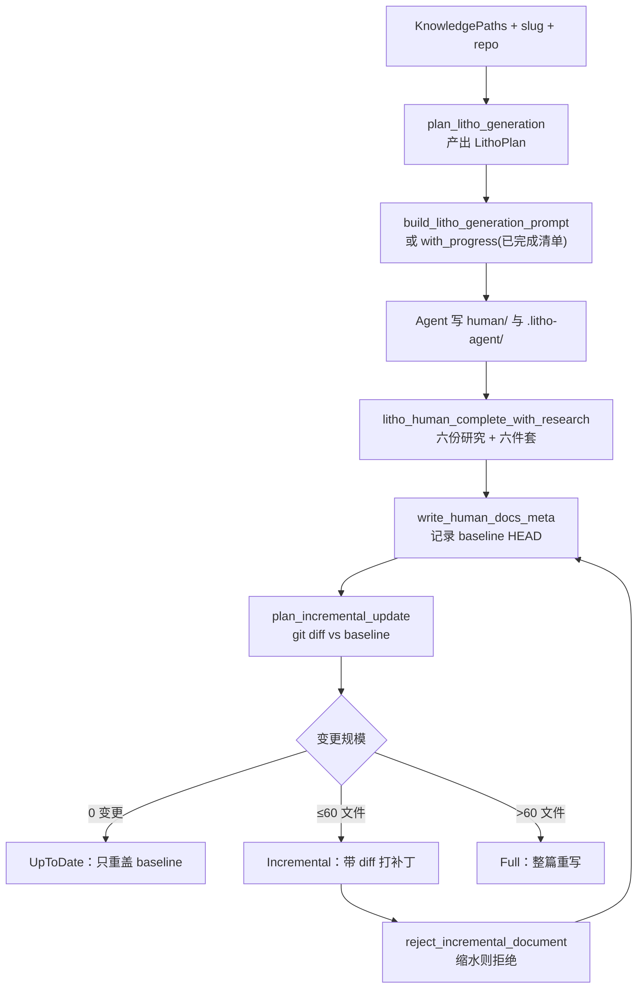

# 知识资产编排领域

**模块路径**：`crates/terrain-core/src/assets/`
**生成日期**：2026-11-14

---

## 这个模块在做什么

如果 Terrain 是一座工厂，`assets/` 就是**工艺科**：它不亲自拧螺丝，但它决定"这一批活该做哪些件、先做哪道工序、做完怎么验收、上次做到哪了"。

具体说，它回答四类问题：这次要生成哪些文档（`LithoPlan`）；已有的文档还差哪些（`litho_human_complete_with_research`）；这次应该重写整篇还是按 diff 打补丁（`plan_incremental_update`）；上次跑到一半中断了，从哪继续（`LithoRunState`）。没有这一层，`terrain-agent` 里的编排代码会退化成几百行"检查文件是否存在"的 `if`。

它同时是"限额"的唯一住址：上下文 16 KiB、概览 4500 字符、单节 3500 字符都定义在这里（`context_layers.rs:6-12`）。把这些数字集中在一个文件里，是为了让"一次问答的 token 预算"可被审计，而不是散落在各个调用点。

---

## 核心功能点

1. **生成计划与提示词构造**——`plan_litho_generation`（`assets/litho.rs:18`）把 `KnowledgePaths`、技能目录、仓库路径打包成 `LithoPlan`；`build_litho_generation_prompt` 把这份计划渲染成一段自然语言指令（含目标语言、文件清单、绝对路径约束）。提示词由代码生成而不是硬编码在技能里，好处是同一份技能可以被不同项目、不同语言复用。

2. **完整性判定**——`LITHO_CORE_RESEARCH_FILES`（`:8`）列出六份核心研究笔记，`LITHO_REQUIRED_HUMAN_FILES`（`:277`）列出人类文档六件套。`litho_human_complete_with_research` 同时检查两边，避免"文档齐了但研究笔记是空的"这种假完成。

3. **增量更新规划**——`plan_incremental_update`（`assets/incremental.rs:76`）拿 baseline HEAD 与当前 HEAD 做 `git diff`，返回 `KnowledgeUpdateMode`：`Incremental(plan)` / `UpToDate` / `Full{reason}`。超过 `incremental_max_changed_files`（默认 60）时自动退回全量——因为 diff 已经不再是一份"变更摘要"，而是一份"重写清单"。

4. **增量结果校验**——`reject_incremental_document`（`:282`）比较更新后与基线的正文长度，若明显缩水则拒绝。这是防止模型"用一段摘要替换掉整篇好文档"的最后一道闸。

5. **上下文分层**——`split_context_sections` 把 `context.md` 切成章节，`build_context_overview` 生成宏观概览（≤4500 字符），`extract_context_section` 按名取单节（≤3500 字符），`enforce_context_max_size` 在写盘前强制截断到 16 KiB。

6. **断点续跑**——`assets/litho_run_state.rs` 维护 `run-state.json`：`begin` 记下 baseline HEAD 与目标文件清单，`record` 在每篇文档落盘后更新，`complete` 收尾，`is_resumable` 判断上次运行是否还能续（HEAD 变了或文件被删了就不续）。

7. **源码包读取与检索原语**——`pack_read.rs` 提供带缓存的整包读取与按文件切片；`query.rs` 提供 `grep_repomix_pack`。这两个是 Agent 工具层的底座。

8. **会话与工作流资产**——`ask.rs` 管问答会话的创建/列出/删除；`sdd.rs` 管 SDD 会话、阶段计划、提示词与输出路径。

9. **环境集成与项目元数据**——`env/` 子目录负责 Skills/工具的 plan→apply→status；`project_meta.rs` 采集 `terrain-meta.json` 等开发者输入。

---

## 关键组件

这些文件各自承担一段"工艺"，彼此通过 `assets/mod.rs` 的 re-export 汇成一个对外 API 面。读代码时建议从 `mod.rs` 开始，它相当于这个领域的目录。

| 组件/类型 | 文件路径 | 核心职责 |
|---------|---------|---------|
| `LithoPlan`、`LITHO_REQUIRED_HUMAN_FILES` | `crates/terrain-core/src/assets/litho.rs` | 定义一次生成运行的路径契约与文档清单 |
| `build_litho_generation_prompt` | `crates/terrain-core/src/assets/litho.rs` | 把计划渲染成给 Agent 的指令 |
| `IncrementalPlan`、`KnowledgeUpdateMode` | `crates/terrain-core/src/assets/incremental.rs` | 决定重写/打补丁/跳过 |
| `reject_incremental_document` | `crates/terrain-core/src/assets/incremental.rs` | 拒绝缩水的增量结果 |
| `ContextOverview`、`AGENT_CONTEXT_SAVE_MAX_CHARS` | `crates/terrain-core/src/assets/context_layers.rs` | 上下文分层与限额 |
| `LithoRunState` | `crates/terrain-core/src/assets/litho_run_state.rs` | 断点续跑状态机 |
| `agent_context_baseline_head`、`write_agent_context` | `crates/terrain-core/src/assets/agent_context.rs` | 上下文读写与 baseline 比对 |
| `pack_agent_assets`、`AgentPackReport` | `crates/terrain-core/src/assets/repomix.rs` | repomix 打包（feature `repomix`） |
| `read_agent_pack_file`、`read_pack_text_cached` | `crates/terrain-core/src/assets/pack_read.rs` | 包内文件切片与整包缓存 |
| `grep_repomix_pack`、`GrepMatch` | `crates/terrain-core/src/assets/query.rs` | 包内 grep |
| `build_sdd_phase_prompt`、`plan_sdd_workflow` | `crates/terrain-core/src/assets/sdd.rs` | SDD 阶段计划与提示词 |
| `collect_project_meta`、`ProjectMetaBundle` | `crates/terrain-core/src/assets/project_meta.rs` | 采集开发者提供的元信息 |
| `EnvPlan`、`apply_env_integration` | `crates/terrain-core/src/assets/env/` | 环境集成（详见 core-env 篇） |

---

## 内部数据流

下面这条链是"一次生成 + 一次增量判定"的完整路径。注意下游的判定又反过来影响下一次的输入——这是一个闭环。

**关键步骤说明**：

1. `plan_litho_generation`（`assets/litho.rs:18`）——这一步只是收集路径，但它决定了后续所有绝对路径的来源。注意 `skill_ready` 字段：技能目录不存在时仍返回计划，只是标记未就绪，让调用方自己决定是否继续。
2. `build_litho_generation_prompt_with_progress`（`:78`）——中断重跑时会在提示词尾部追加一段"Resume checkpoint (MANDATORY)"，明确列出已完成文档并要求"不要重写、重排、截断或删除"。
3. `litho_human_complete_with_research`——同时要求研究笔记和最终文档齐全。这是为了防止"直接跳到编排阶段"这种跳步行为。
4. `plan_incremental_update`（`assets/incremental.rs:76`）——依赖 `freshness::git` 的漂移结果；只有 `.terrain/` 自身的提交被显式排除，否则每次提交知识资产都会触发无意义的"代码变了"。
5. `reject_incremental_document`——它不是一个"润色"步骤，而是硬性拒绝。拒绝后调用方会保留旧文件并把原因写进 `refresh_reason`。

---

## 关键接口与扩展点

这个模块的扩展点主要是**feature flag 与策略枚举**，而不是 trait 插件：

- **`repomix` feature**（`Cargo.toml` 的 `default = ["repomix"]`）——关掉后 `pack_agent_assets` 不存在，`scan_repo` 的 `agent_pack` 变成 `None`，快速刷新会往 notes 里写"未启用 repomix feature"。这允许在没有 repomix-core 的平台上裁剪构建。
- **`KnowledgeUpdateMode`**——新增一种更新策略只需在这个枚举上加变体，`plan_incremental_update` 是唯一决策点。
- **`IncrementalOutputMode`**（`incremental.rs:319`）——区分"重写全文"与"局部替换"两种输出契约，提示词会据此生成不同的 `update_rules_block`。
- **`META_FILENAME` / `MetaInputSpec`**（`project_meta.rs`）——开发者元信息的采集是声明式的：加一项输入只需加一个 spec，不用改采集逻辑。

---

## 与其他模块的交互

| 交互模块 | 方向 | 接口/协议 | 说明 |
|---------|------|---------|------|
| `paths` / `schema` | 依赖 | `KnowledgePaths`、`LithoPlan` | 所有路径与类型的来源 |
| `freshness::git` | 依赖 | `git_drift_since`、`git_snapshot` | 增量判定需要 diff |
| `repo_walk` / `preset_skills` | 依赖 | `repo_file_walk`、`resolve_litho_skill_dir` | 元信息采集与技能定位 |
| `terrain-agent/workflows` | 被依赖 | `run_agent_context_generation` 调 `plan_incremental_update` | 编排层消费计划与校验 |
| `terrain-cli` / `terrain-agent/tools` | 被依赖 | `read_agent_pack_file`、`grep_repomix_pack` | 工具层直接调这些原语 |
| `terrain-core/lib.rs` | 被依赖 | 大量 re-export | 对外统一 API 面 |

---

## 跨模块协作场景

**在「项目初始化」中**：本模块提供 `LithoPlan` 与完整性判定。具体参与：`workflows/init.rs:126` 调用 `litho_human_complete_with_research(&human_dir, Some(&litho_workspace))` 决定是否需要跑 Litho；生成结束后 `write_human_docs_meta` 记录 baseline，供下次增量判定使用。

**在「DeepWiki 问答」中**：本模块是工具层的底座。`grep_agent_pack_tool` 内部调 `grep_repomix_pack`，`read_agent_pack_file_tool` 调 `read_agent_pack_file`，`read_agent_context_tool` 调 `extract_context_section`。可以说问答的"三层检索"完全建立在本模块的四个原语之上。

**在「SDD 工作流」中**：`plan_sdd_workflow` 与 `build_sdd_phase_prompt` 复用同一套"计划 → 提示词 → 产物路径"的模式，只是产物目录从 `.terrain/` 换到了 `~/.terrain/sdd/`。

---

## 性能考量

这个模块的性能工作几乎都是"避免重复劳动"：

- `read_pack_text_cached`（`pack_read.rs:113`）把整包文本缓存为 `Arc<str>`。repomix 包在真实项目里能到 2–3 MB，一次问答里 grep 三五次是常态，没有缓存就是反复读盘 + 反复解码。
- `invalidate_pack_text_cache` 在包被重写后精准失效，避免读到旧内容。
- `plan_incremental_update` 的价值不只是"少调用模型"，更在于它把"每次提交都全量扫描 + 全量生成"的成本降到了"一次 diff"。
- `enforce_context_max_size` 是"预防性"的：与其指望模型自己写短，不如在写盘前截断。

---

## 实现亮点

**亮点一：把"token 预算"变成常量。** `AGENT_CONTEXT_SAVE_MAX_CHARS = 16 * 1024` 这类常量放在 `context_layers.rs` 顶部，配注释说明每个数字服务哪个场景（写盘 / 预载 / 单节）。这比在十几个调用点写魔法数字可维护得多。

**亮点二：增量更新带"反向证据"。** `IncrementalPlan::evidence_block`（`incremental.rs:167`）会把 diff 摘要渲染成提示词的一部分，而 `reject_incremental_document` 又从结果侧反向校验。一进一出，构成一个可验证的闭环——这在纯提示词工程里是很少见的严谨度。

**亮点三：检查点用"文件清单 + HEAD"而不是"阶段号"。** `LithoRunState` 记录的是具体哪些文档已完成、基于哪个 HEAD。这样即使 HEAD 变了，`still_valid` 也能判断"上次的成果还能不能用"，而不是盲目续跑。
