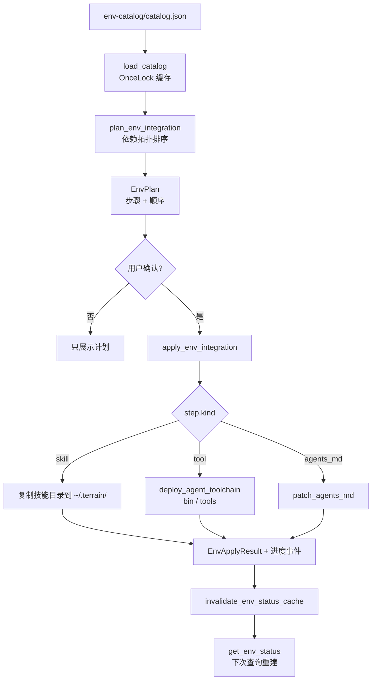

# 环境集成领域

**模块路径**：`crates/terrain-core/src/assets/env/`、`integrations/`、`agent_tools_deploy.rs`、`bundled_tools.rs`、`shell_path.rs`、`process.rs`、`platform.rs`
**生成日期**：2026-11-14

---

## 这个模块在做什么

如果 Terrain 的三大支柱是"地图 / 道路 / 路标"，这个模块负责铺**道路**：把 Agent 需要的工具（CodeGraph、RTK、terrain CLI）和指令（Skills、`AGENTS.md` 片段）装到合适的位置，让每个新仓库不必从零配置。

它解决的是一个非常具体、也非常扫兴的问题：你告诉 AI "先用 codegraph 查调用关系"，它会回答"codegraph: command not found"。模型不知道你的机器上装了什么、装在哪。Terrain 的答案是**由它来保证这些东西一定存在且可发现**——统一部署到 `~/.terrain/bin/`，并把路径写进受管的 `AGENTS.md` 片段。

这个模块还有一个不那么显眼但同样重要的职责：**在 Windows 上不闪黑窗**。打包版是 GUI 子系统，没有控制台，任何 `Command::new` 都会弹一个终端窗口。`process.rs` 统一加上 `CREATE_NO_WINDOW`，并用一个测试扫描整个代码库防止回归。

---

## 核心功能点

1. **声明式目录（catalog）**——`env-catalog/catalog.json`（version 2）用 `integrations` 数组声明每个条目的 `id`、`kind`（skill/tool）、`label`、`description`、`depends_on`、`required`/`optional`、`bundled`、`check` 命令。Rust 侧用 `EnvCatalog` / `IntegrationDef` / `InstallStep` / `AgentsMdBlockDef`（`assets/env/catalog.rs:76-129`）反序列化。

2. **拓扑排序安装**——`depends_on` 构成 DAG（例如 `skill-codegraph` 依赖 `tool-codegraph` 与 `skill-terrain-knowledge`）。`plan_env_integration` 产出 `EnvPlan`（步骤 + 顺序），`apply_env_integration` 按序执行。

3. **plan / apply / status 三件套**——这是整个模块的对外节奏：先给用户看"将要做什么"（`EnvPlan`），确认后执行（`EnvApplyResult` + `EnvApplyProgress`），最后可查询状态（`EnvStatus`）。UI 的 `EnvPlanPanel` / `EnvIntegratePanel` 正对应前两步。

4. **运行时目录解析**——`ROOT: OnceLock<PathBuf>` + `ensure_env_catalog_initialized`（`catalog.rs:35`）按优先级解析：`init_env_catalog_root`（Tauri 资源目录）→ `TERRAIN_ENV_CATALOG` 环境变量 → `~/.terrain/env-catalog/` → 随包发现。注释明确说明了为什么不能用 `CARGO_MANIFEST_DIR`：打包后那个路径不存在。

5. **工具落地**——`deploy_agent_toolchain_with_options`（`agent_tools_deploy.rs:76`）把 CLI 落到 `~/.terrain/bin/` 与 `~/.terrain/tools/`。策略是平台相关的：Unix 用符号链接（便宜、永远跟随 sidecar）；Windows 用文件拷贝 + 指纹跳过 + 原子替换 + "目标被占用时优雅降级"（因为可能正在有 Agent 跑着 `terrain.exe`）。

6. **AGENTS.md 受管片段**——`patch_agents_md`（`assets/env/agents_md.rs:21`）把受管块插入仓库的 `AGENTS.md`，`agents_md_ready` 判断是否已就位。这让"知识优先的工作流"能被任何 Agent 读到，而不依赖它是否支持某个专有配置。

7. **PATH 修复**——`augment_path_from_login_shell`（`shell_path.rs:20`）解决 macOS GUI 应用的经典问题：从 Finder 启动的 app 拿不到 shell profile 里的 PATH，于是 `bun`、`codegraph` 一律找不到。这个函数主动去登录 shell 里取一次 PATH 并合并。

8. **子进程封装**——`command` / `async_command`（`process.rs:33,40`）是唯一允许的建进程入口：Windows 上加 `CREATE_NO_WINDOW`，其它平台零成本。`ensure_hidden_console` 在 main 启动时兜底。

9. **平台探测**——`platform_key`、`bundled_binary_candidates`、`agent_tool_filename`、`expand_user_path`（`platform.rs`）把"不同平台二进制叫什么、在哪"收敛到一处。

---

## 关键组件

| 组件/类型 | 文件路径 | 核心职责 |
|---------|---------|---------|
| `EnvCatalog` / `IntegrationDef` / `InstallStep` | `crates/terrain-core/src/assets/env/catalog.rs:76,84,116` | 目录模型 |
| `load_catalog` / `ensure_env_catalog_initialized` | `crates/terrain-core/src/assets/env/catalog.rs:66,35` | 目录加载与根解析 |
| `deploy_env_catalog_to_home` | `crates/terrain-core/src/assets/env/catalog.rs:138` | 复制目录到 `~/.terrain/` |
| `plan_env_integration` / `apply_env_integration` | `crates/terrain-core/src/assets/env/apply.rs` | 计划与执行 |
| `EnvApplyResult` / `EnvApplyProgress` | `crates/terrain-core/src/assets/env/apply.rs:26` | 执行结果与进度 |
| `patch_agents_md` / `agents_md_ready` | `crates/terrain-core/src/assets/env/agents_md.rs:21,10` | AGENTS.md 受管片段 |
| `get_env_status` / `invalidate_env_status_cache` | `crates/terrain-core/src/integrations/mod.rs` | 状态查询与缓存失效 |
| `deploy_agent_toolchain_with_options` | `crates/terrain-core/src/agent_tools_deploy.rs:76` | 工具落地（符号链接 / 拷贝） |
| `AgentToolPaths` / `DeployOptions` | `crates/terrain-core/src/agent_tools_deploy.rs:40,34` | 落地路径与选项 |
| `bundled_terrain_cli` / `bundled_rtk` | `crates/terrain-core/src/bundled_tools.rs` | 随包二进制发现 |
| `command` / `async_command` | `crates/terrain-core/src/process.rs:33,40` | 唯一允许的子进程入口 |
| `augment_path_from_login_shell` | `crates/terrain-core/src/shell_path.rs:20` | GUI 下 PATH 修复 |
| `platform_key` / `user_home` | `crates/terrain-core/src/platform.rs` | 平台抽象 |

---

## 内部数据流

**关键步骤说明**：

1. `load_catalog`——`OnceLock<EnvCatalog>` 缓存整个目录，避免每次状态查询都读 JSON。
2. `plan_env_integration`——依赖排序不是简单地"按数组顺序"，而是按 `depends_on` 拓扑。这一点在 `catalog.json` 里能直接看出来：`skill-codegraph` 依赖 `tool-codegraph`，所以工具必须先装。
3. `apply_env_integration`——每步执行后发 `EnvApplyProgress`，UI 能显示"正在安装 RTK（3/7）"。
4. `deploy_agent_toolchain`——Unix 走 symlink 分支，Windows 走拷贝分支。Windows 分支额外处理"目标文件被占用"这种情况：因为可能有 Agent 正在运行 `terrain.exe`，直接替换会失败，此时保留旧版本而不是报错。
5. `patch_agents_md`——只改动受管标记之间的内容，用户手写的部分原样保留。
6. `invalidate_env_status_cache`——安装完成后精确失效，避免 UI 显示"未安装"。

---

## 关键接口与扩展点

- **新增一个集成项**：在 `catalog.json` 的 `integrations` 里加一条，声明 `kind` 与 `depends_on` 即可。这是这个模块最重要的设计目标——**加工具不需要改 Rust 代码**。
- **`kind`**：目前是 `skill` / `tool` / `agents_md`（块）。新增类型需要在 `apply.rs` 里加分支。
- **`TERRAIN_ENV_CATALOG`**：覆盖目录根，便于测试或自定义分发。
- **`DeployOptions { force }`**：`force = false` 时只补缺和更新陈旧副本，`true` 时强制重装。UI 的「重装」勾选对应这个字段。

---

## 与其他模块的交互

| 交互模块 | 方向 | 接口/协议 | 说明 |
|---------|------|---------|------|
| `bundled_tools` | 依赖 | `bundled_terrain_cli`、`ensure_bundled_tools_initialized` | 随包二进制 |
| `platform` / `shell_path` | 依赖 | 平台键、PATH 修复 | 跨平台 |
| `process` | 依赖 | `command` | 所有子进程 |
| `paths` / `path_portable` | 依赖 | `to_tilde_path` | 路径归档 |
| `env-catalog/`（资源） | 依赖 | `catalog.json`、skills、agents-md 片段 | 数据源 |
| `terrain-cli/commands/env.rs` | 被依赖 | `status` / `plan` / `apply` | CLI 入口 |
| `src-tauri/commands/env.rs` | 被依赖 | `get_env_status_cmd` 等 | UI 入口 |
| `terrain-agent/tools` | 被依赖 | 工具可用性 | Agent 侧 |

---

## 跨模块协作场景

**在「一键配置 Agent 环境」中**：用户在 `EnvIntegratePanel` 勾选需要的项 → `plan_env_integration` 返回计划 → 确认后 `run_env_integration` 执行 → 进度事件驱动界面 → 完成后 `get_env_status` 刷新状态。整个流程是一个标准的"预览-执行-验证"闭环。

**在「CLI 首次运行」中**：`terrain env apply` 会先确保 env-catalog 已部署到 `~/.terrain/env-catalog/`（`deploy_env_catalog_to_home`），再执行安装。这让 CLI 与桌面应用共享同一份目录，不会出现"两个入口装了两份"。

**在「Agent 上下文生成」中**：外部 ACP Agent 需要能调用 `terrain tools`。`deploy_agent_toolchain` 保证了 `~/.terrain/bin/terrain` 存在，而 `AGENTS.md` 片段告诉 Agent 优先用它。

---

## 性能考量

- **状态缓存 + 精确失效**：`get_env_status` 会做不少文件系统检查（每个 skill 目录、每个二进制），缓存是必要的；安装后立即失效避免"装完还显示未装"。
- **指纹跳过**：Windows 拷贝分支用文件指纹判断是否需要覆盖，避免每次 apply 都重写几 MB 的二进制。
- **符号链接优先**：Unix 上用 symlink 而不是拷贝，安装几乎零成本，且 sidecar 更新后自动生效。
- **`OnceLock` 而非每次读盘**：catalog 与 env root 都是进程级单例。

---

## 实现亮点

**亮点一：`process_convention` 测试。** `crates/terrain-core/tests/process_convention.rs` 会扫描整个代码库，发现 `process.rs` 之外的裸 `Command::new` 就失败。这条约定本身很简单，但用测试把它钉死，才真正防住了"Windows 上每个子进程闪一次黑窗"这种回归。

**亮点二：承认打包后 `CARGO_MANIFEST_DIR` 不存在。** `catalog.rs` 的模块注释直接写明这一点，并给出四级回退。很多项目会在打包后才第一次发现这类问题。

**亮点三：Windows 文件占用降级。** "目标被占用就保留旧版本而不报错"——这个决定看起来是妥协，实际上是对真实使用场景的理解：用户可能就是在 Agent 跑着的时候点了一下更新。

**亮点四：PATH 从登录 shell 取。** macOS GUI 应用的 PATH 问题极其常见，但很少有人主动去修复。`augment_path_from_login_shell` 让"Finder 启动的 Terrain 也能找到 bun"成为默认行为。
