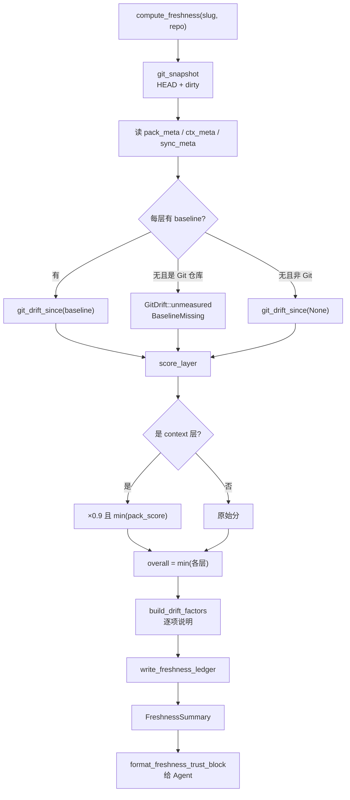

# 新鲜度领域

**模块路径**：`crates/terrain-core/src/freshness/`
**生成日期**：2026-11-14

---

## 这个模块在做什么

新鲜度模块回答一个所有"文档自动生成"工具都必须面对、但大多数都回避的问题：**这份文档还可信吗？**

Wiki 的问题是它会悄悄过期。自动生成解决了"生成"，但没有解决"过期"——生成完三个月后，代码改了两百次，文档还在那里，看起来和新的一样。Terrain 的做法是给每一层资产生成一张"体检报告"：基于哪个提交、落后多少、改了哪些文件、工作区是否干净，最后折算成 0–100 分。

这个分数不是一个装饰性的徽章。它是一个**行为开关**：≥80 显示绿色；≥70 进入"需要交叉核对"的黄区；<50 时问答直接拒绝预载宏观上下文——因为一份严重过期的架构文档比没有架构文档更危险，它会误导模型。

模块的设计哲学可以概括成四个字：**fail-closed**。算不出来就当作过期，而不是当作新鲜。

---

## 核心功能点

1. **Git 漂移测量**——`git_snapshot`（`freshness/git.rs`）读 HEAD 与工作区状态；`git_drift_since(repo, baseline)` 统计自 baseline 以来的提交数与变更文件。关键细节：**纯 `.terrain/` 的提交被排除**（`count_source_commits_in_log` 的测试在 `freshness/mod.rs:40`），否则每次提交知识资产都会让自己"变旧"。

2. **可测性判定**——`GitDrift::is_measured()` + `DriftBasis`（`BaselineMissing` 等）。当资产"已就绪、在 Git 仓库里、但没有 baseline"时，它和"baseline 被 rebase 掉了"一样不可验证，因此走同一套惩罚。两个例外保留"按天数估算"：非 Git 仓库、以及还没有任何提交的仓库——这两种情况不是"测不出漂移"，而是"本来就没有可比的漂移"。

3. **评分公式**——`score_asset`（`freshness/scoring.rs:81`）：
   - 提交漂移：2 分/提交，上限 40；
   - 变更文件比例：`changed / total * 30`，上限 30；
   - 同步天数：1 分/天，上限 5；
   - 工作区脏：5 分。

4. **fail-closed 惩罚**——`UNMEASURED_DRIFT_PENALTY = 40 + 30 + 5`（`scoring.rs:27-40`），直接把分数压到 25 分以下。

5. **上下文折扣**——`agent/context.md` 是 LLM 生成的派生资产，所以 `discount_context_score` 乘 0.9，`context_score_from_raw` 还要求它不超过其源码包的分数。结果是这一层**封顶 90 分**——架构层永远不该声称比原始源码更可信。

6. **阈值与原因**——`stale_reason_for` 输出机器可读的原因（`asset_not_ready`、`repo_advanced_N_commits`、`working_tree_dirty`、`baseline_unreachable` 等），前端据此显示"为什么变黄"。

7. **漂移因子明细**——`drift_factors.rs`（35.8 KB，模块内最大文件）把每个扣分项展开成结构化因子，供 UI 的 `FreshnessHelpPanel` 逐条展示。这是"可解释性"的落地：用户不只知道掉了 17 分，还知道是哪 17 分。

8. **账本持久化**——`ledger.rs` 读写 `.terrain/.meta/freshness.json`，并用 `freshness_ledger_still_valid` 判断缓存是否还能用（比如 HEAD 没变就不必重算）。

9. **CodeGraph 独立校验**——`codegraph_drift`（`codegraph.rs:23`）只读 `.codegraph/codegraph.db` 的 mtime，再用 `git log --since` 统计其后的提交与变更文件，得出 `likely_stale`。这个函数的存在有明确背景：CodeGraph 自己的 `status` 会误报"最新"，所以需要一个不依赖它自述的交叉验证。

10. **给 Agent 的信任声明**——`format_freshness_trust_block`（`compute.rs:274`）生成一段自然语言，告诉模型"这份上下文基于哪个提交、落后多少、哪些结论需要验证"。这比只传一个数字有用得多。

---

## 关键组件

| 组件/类型 | 文件路径 | 核心职责 |
|---------|---------|---------|
| `FRESH_THRESHOLD` / `VERIFY_THRESHOLD` / `MACRO_PRELOAD_THRESHOLD` | `crates/terrain-core/src/freshness/mod.rs:20-26` | 80 / 70 / 50 三档阈值 |
| `score_asset` | `crates/terrain-core/src/freshness/scoring.rs:81` | 核心评分公式 |
| `score_layer` | `crates/terrain-core/src/freshness/scoring.rs:61` | fail-closed 入口 |
| `discount_context_score` / `context_score_from_raw` | `crates/terrain-core/src/freshness/scoring.rs:44,49` | 上下文折扣与封顶 |
| `days_since_rfc3339` | `crates/terrain-core/src/freshness/scoring.rs:103` | 时间解析（`None` 视为未知，扣满） |
| `stale_reason_for` | `crates/terrain-core/src/freshness/scoring.rs:120` | 机器可读的过期原因 |
| `compute_freshness` | `crates/terrain-core/src/freshness/compute.rs:47` | 汇总所有层的评分并落盘 |
| `format_freshness_trust_block` | `crates/terrain-core/src/freshness/compute.rs:274` | 生成给模型的信任声明 |
| `GitSnapshot` / `GitDrift` / `DriftBasis` | `crates/terrain-core/src/freshness/git.rs` | Git 快照与漂移模型 |
| `codegraph_drift` | `crates/terrain-core/src/freshness/codegraph.rs:23` | CodeGraph 索引过期交叉验证 |
| `build_drift_factors` | `crates/terrain-core/src/freshness/drift_factors.rs` | 因子明细 |
| `write_freshness_ledger` | `crates/terrain-core/src/freshness/ledger.rs` | 账本读写 |

---

## 内部数据流

**关键步骤说明**：

1. `git_snapshot`——一次拿到 HEAD 与工作区脏状态，后续所有层复用，避免每层各起一次 `git` 子进程。
2. `layer_drift`（`compute.rs:34`）——这段逻辑是整个模块的价值观所在：baseline 缺失时，如果仓库是 Git 且有 HEAD，就判定"不可测"；如果是非 Git 仓库，则退回按天数估算。注释把这个区分写得很清楚。
3. `score_layer` → `score_asset`——前者处理"能不能测"，后者处理"测出来怎么扣分"。两个函数分开，是为了让"不可测"这个特殊情况只在一个地方判断。
4. `context_score_from_raw`——先打折，再取 `min`。顺序很重要：如果先取 min 再打折，结果可能低于实际应得。
5. `overall_freshness_score`——取所有层的最小值。最弱的一环决定整体可信度，这是"木桶原理"的直接应用。

---

## 关键接口与扩展点

- **新增资产层**：在 `compute_freshness` 里加一段"读 meta → 算 drift → score_layer"即可。层与层之间没有耦合。
- **阈值**：三个常量定义在 `mod.rs`，但真正使用它们的地方分布在工作流与 UI。改阈值要同时检查 `MACRO_PRELOAD_THRESHOLD` 的使用点（问答预载逻辑）。
- **`DriftBasis`**：新增一种"不可测原因"时，加一个枚举变体 + `stale_reason()` 的映射，UI 与 Agent 侧都会自动获得新原因。
- **`CodegraphDriftReport`**：一个独立的小结构，可被 `terrain tools codegraph-drift` 直接序列化输出。

---

## 与其他模块的交互

| 交互模块 | 方向 | 接口/协议 | 说明 |
|---------|------|---------|------|
| `assets` | 依赖 | `agent_pack_ready`、`agent_context_ready` | 判断层是否就绪 |
| `schema` | 依赖 | `AgentPackMeta`、`AgentContextMeta`、`SyncMeta` | baseline 与时间戳来源 |
| `process` | 依赖 | `command("git")` | 起 git 子进程 |
| `paths` | 依赖 | `is_knowledge_output_path` | 排除纯知识提交 |
| `terrain-agent/chat` | 被依赖 | 阈值常量 | 决定是否预载宏观上下文 |
| `src-tauri/commands` | 被依赖 | `compute_freshness_cmd` | UI 展示 |
| `terrain-cli` | 被依赖 | `tools freshness`、`project freshness-cached` | JSON 输出 |

---

## 跨模块协作场景

**在「DeepWiki 问答」中**：新鲜度是"准入控制"。分数低于 50 时，问答不再预载 `context.md` 的宏观层——模型必须自己去查具体文档。这看起来只是一个性能优化，实际上是正确性保护：过期的宏观总结会让模型自信地给出错误结论。

**在「项目初始化 / 刷新」中**：`QuickRefreshResult` 与 `ProjectOverview` 都会带 `FreshnessSummary`。前端 `mergeFreshnessIntoOverview`（`src/lib/mergeFreshness.ts`）把评分合并进项目卡片，`FreshnessHelpPanel.svelte` 则把因子逐条展开。

**在 CI 中**：`terrain project freshness-cached --project <slug>` 直接读账本而不重算，适合在流水线日志里打印"当前知识新鲜度"。这是它唯一设计成"不重算"的入口，因为 CI 里不应为了一个数字再跑一遍 git log。

---

## 性能考量

- **一次快照，多层复用**：`git_snapshot` 只跑一次，所有层共享。
- **账本缓存**：`freshness_ledger_still_valid` 让"HEAD 没变"的情况直接返回缓存结果。
- **git 调用次数可控**：提交统计用一次 `git log` 带格式串解析，而不是逐个提交查询。
- **CodeGraph 检测只看 mtime**：不解析数据库、不调用 CodeGraph CLI，成本接近零。

---

## 实现亮点

**亮点一：把"无法验证"当成一种正式的漂移原因。** 大多数系统会写 `if let Some(baseline) = ... { ... } else { /* 假设没变 */ }`。Terrain 反过来：没有 baseline 就是最坏情况。这个选择让系统在异常数据下依然安全。

**亮点二：上下文封顶 90 分。** 一个 LLM 生成的摘要，凭什么和原始源码一样可信？`min(discount(raw), pack_score)` 这行代码把"派生资产不该比源资产更可信"变成了数学约束，而不是一句文档里的劝告。

**亮点三：专门为 CodeGraph 写了一个不信任它的检测器。** 注释里直接写明"CodeGraph 自己的 status 会报告 up to date 但索引其实落后"。这种"基于外部事实（文件 mtime + git log）而不是工具自述"的验证思路，值得单独记一笔。
