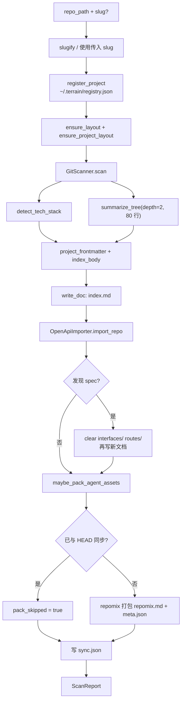

# 仓库摄取领域

**模块路径**：`crates/terrain-core/src/ingest/`、`repo_walk.rs`、`repo.rs`
**生成日期**：2026-11-14

---

## 这个模块在做什么

摄取模块是整条流水线的**进料口**：它决定"哪些文件算这个项目的一部分"，然后据此生成项目索引、接口文档和源码包。

听起来简单，但在真实仓库里这一步最容易翻车。一个仓库里可能有 `node_modules/`、`target/`、`.venv/site-packages/`、`dist/`、`vendor/`，还有 `.gitignore` 里写着的几十条规则。如果摄取阶段把这些算进去，后续所有分析都会被依赖代码淹没——文档会开始描述 React 的内部实现而不是你的业务逻辑，源码包会膨胀到几十万 token。

所以这个模块的真正工作是**边界判定**：`SKIP_DIRS` 硬性排除依赖/构建目录，再叠加 `ignore` crate 的 `.gitignore` / `.git/info/exclude` / global 规则。两层防线共同保证"看到的是项目自己的代码"。

---

## 核心功能点

1. **统一扫描入口**——`ProjectScanner::scan_repo`（`ingest/mod.rs:52`）串起四步：slug 解析（无 slug 时用目录名 slugify）→ `register_project` 写登记表 → `ensure_layout` 建目录 → 各 collector 依次执行。

2. **项目结构索引**——`GitScanner::scan`（`ingest/git.rs:25`）生成 `index.md`：检测技术栈（`Cargo.toml`→Rust、`package.json`→Node.js、`go.mod`→Go、`pyproject.toml`→Python、`pom.xml`/`build.gradle`→Java），并用 `summarize_tree(repo, 2)` 生成两层的目录树摘要（最多 80 行，超出显示 `…`）。

3. **OpenAPI 导入**——`OpenApiImporter::import_repo`（`ingest/openapi.rs:27`）先用 `clear_generated_docs` 删掉上次生成的 `interfaces/` 与 `routes/`，再重新发现并导入规范文件。这个"先清后建"很关键：如果上一次是从依赖包里发现的 spec，这次不该继续留着。

4. **repomix 打包**——`maybe_pack_agent_assets`（`assets/repomix.rs:146`）在扫描末尾触发。它会先判断包是否已与 HEAD 同步，是则跳过，并把 `pack_skipped` 写进报告。

5. **gitignore 感知遍历**——`repo_file_walk`（`repo_walk.rs:45`）用 `WalkBuilder` 开启 `hidden / git_ignore / git_global / git_exclude / ignore` 五档规则，再用 `filter_entry` 叠加 `should_skip_dir` 的硬排除。

6. **Gitignore 缓存**——`build_repo_gitignore` + `GITIGNORE_CACHE`（`LazyLock<Mutex<HashMap<...>>>`）缓存每个目录的 `.gitignore` 解析结果，并按 mtime 失效。一次扫描里会反复判断"这个路径是否被忽略"，缓存避免了重复解析。

7. **路径校验**——`repo.rs::validate_repo_path` 在进入任何扫描逻辑前验证路径存在且是目录；`path_portable::stored_repo_path` 把路径归一成可入库的形式（`~` 而非绝对 home 路径）。

8. **同步元数据**——`SyncMeta`（`.terrain/.meta/sync.json`）记录 project / repo_path / synced_at / collectors，是后续判断"上次扫了哪些 collector"的依据。

---

## 关键组件

| 组件/类型 | 文件路径 | 核心职责 |
|---------|---------|---------|
| `ProjectScanner` | `crates/terrain-core/src/ingest/mod.rs:45` | 编排一次完整扫描 |
| `ProjectScanner::scan_repo` | `crates/terrain-core/src/ingest/mod.rs:52` | 扫描主流程 |
| `ScanReport` / `AgentPackSummary` | `crates/terrain-core/src/ingest/mod.rs:18,27` | 扫描结果（供 IPC/CLI 返回） |
| `GitScanner` | `crates/terrain-core/src/ingest/git.rs:8` | 技术栈探测 + 目录树摘要 |
| `detect_tech_stack` | `crates/terrain-core/src/ingest/git.rs:49` | 按标记文件判断语言 |
| `summarize_tree` | `crates/terrain-core/src/ingest/git.rs:66` | 生成目录树 Markdown |
| `OpenApiImporter` | `crates/terrain-core/src/ingest/openapi.rs:15` | 接口/路由文档导入 |
| `repo_file_walk` | `crates/terrain-core/src/repo_walk.rs:45` | gitignore 感知遍历 |
| `SKIP_DIRS` | `crates/terrain-core/src/repo_walk.rs:21` | 硬性排除目录清单 |
| `build_repo_gitignore` / `GITIGNORE_CACHE` | `crates/terrain-core/src/repo_walk.rs:89` | 忽略规则解析与缓存 |
| `validate_repo_path` | `crates/terrain-core/src/repo.rs` | 路径合法性校验 |
| `SyncMeta` | `crates/terrain-core/src/schema/` | 同步元数据 |

---

## 内部数据流

**关键步骤说明**：

1. `ProjectScanner::scan_repo`（`ingest/mod.rs:52`）——注意它的返回值里 `collectors` 是一个 `Vec<String>`，记录本次实际跑了哪些 collector（`git`、`openapi`、`repomix`）。这让上层能区分"没跑"和"跑了但没产出"。
2. `summarize_tree`（`ingest/git.rs:66`）——用 `entry.depth()` 决定缩进，跳过 depth 0，遇到 80 行就截断。这是一个"够用就好"的设计：索引页的目的不是完整文件清单，而是让人一眼看出项目形态。
3. `OpenApiImporter::clear_generated_docs`——只删 `interfaces/` 与 `routes/` 两个子目录，因为只有这个 importer 会往那里写。
4. `repo_file_walk`——`require_git(false)` 允许在非 Git 目录工作；`hidden(true)` 在这套 API 里表示"应用隐藏文件规则"，配合 `SKIP_DIRS` 一起用。
5. `maybe_pack_agent_assets`——内部调 `agent_pack_synced_with_head` 判断，避免每次扫描都重打 2 MB 的包。

---

## 关键接口与扩展点

- **新增 collector**：`scan_repo` 里每个 collector 都是"调用 → 累加 `files_written` → 往 `collectors` push 一个名字"的三行模式。新增一个（比如 Terraform 图、gRPC proto 索引）不需要改动其他结构。
- **`SKIP_DIRS`**：一个 `&[&str]` 常量，加目录名即可全局生效。
- **`repo_file_walk(repo, max_depth)`**：`max_depth` 让调用方可以要"只看顶层"或"全量"。`project_meta.rs` 的发现逻辑用 `META_DISCOVER_MAX_DEPTH = 6`。
- **`ScanReport`**：IPC 类型，字段变更需跑 `bun run gen:types`。

---

## 与其他模块的交互

| 交互模块 | 方向 | 接口/协议 | 说明 |
|---------|------|---------|------|
| `registry` | 依赖 | `register_project` | 扫描即注册 |
| `paths` | 依赖 | `KnowledgePaths::ensure_layout` | 目录布局 |
| `render` / `schema` | 依赖 | `project_frontmatter`、`ProjectMeta` | 文档渲染 |
| `assets/repomix` | 依赖 | `maybe_pack_agent_assets` | 打包 |
| `path_portable` | 依赖 | `stored_repo_path`、`path_in_repo` | 可移植路径 |
| `terrain-agent/workflows` | 被依赖 | `ProjectScanner::scan_repo` | 初始化与刷新 |
| `terrain-core/assets/project_meta` | 被依赖 | `repo_file_walk`、`discover_repo_walk` | 元信息发现 |

---

## 跨模块协作场景

**在「项目初始化」中**：本模块是第一步，也是"项目被登记进来"的唯一入口。`workflows/init.rs:126` 拿到 `ScanReport` 后，用 `agent_pack.total_tokens` 作为 `repack_tokens` 汇报给前端（用户会看到"源码包约 xx 万 token"这样的信息）。

**在「快速刷新」中**：本模块承担了"扫描 + 打包"两件事。`quick_refresh.rs:41` 只调一次 `scan_repo` 就完成两者，然后根据 `pack_skipped` 决定是否往 notes 里写"已跳过"。

**在「新鲜度」中**：本模块产出的 `SyncMeta.synced_at` 是"同步天数"惩罚项的来源之一；`AgentPackMeta.total_files` 是"变更文件比例"的分母。

---

## 性能考量

- **两层排除**：`SKIP_DIRS` 在遍历时 `filter_entry` 剪枝，`ignore` 规则在 WalkBuilder 内部剪枝。剪枝发生在进入目录之前，而不是读完再过滤——这是大仓库上性能差异的关键。
- **gitignore 缓存**：一次扫描里同一目录会被判断多次，`GITIGNORE_CACHE` 用 `Mutex<HashMap>` + mtime 失效避免重复解析。
- **包复用**：`agent_pack_synced_with_head` 让"提交只改了文档"的情况完全跳过打包。
- **树摘要截断**：80 行上限避免把巨型 monorepo 的完整树写进索引页。

---

## 实现亮点

**亮点一：`clear_generated_docs` 的"先清后建"。** 增量扫描最常见的 bug 是"删掉的接口文档还留在那里"。这里用"只清自己负责的两个子目录，再重建"的方式，既保证一致性，又不会误删别人的产物。

**亮点二：collector 名单即审计日志。** `ScanReport.collectors` 让上层能精确知道这次扫描做了什么，而不是靠猜。CLI 和 UI 都可以把它展示出来。

**亮点三：`require_git(false)`。** 允许在非 Git 目录（比如刚解压的 zip）上工作，同时 `git` 相关能力优雅降级为"不可测"——这与新鲜度的 fail-closed 策略正好配套。
