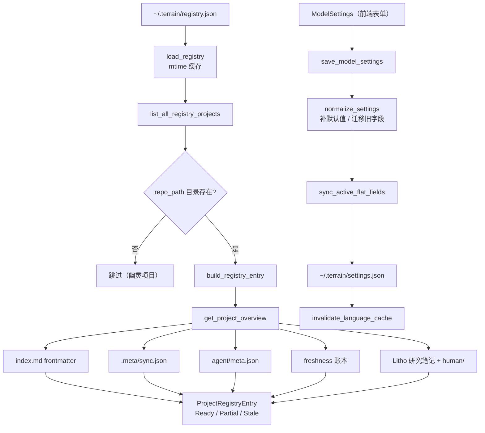

# 项目与路径领域

**模块路径**：`crates/terrain-core/src/paths.rs`、`registry.rs`、`project.rs`、`path_portable.rs`、`settings.rs`、`git_policy.rs`、`language.rs`
**生成日期**：2026-11-14

---

## 这个模块在做什么

如果把 Terrain 比作一座城市，这个模块就是**户籍科 + 地址系统 + 市政规章**：它决定每个项目叫什么名字、家住在哪、门牌号怎么写、哪些东西可以进 Git、以及这座城市的官方语言是什么。

它回答的问题都很朴素，但几乎每个模块都要问一遍：

- 这个仓库的知识资产放在哪？→ `KnowledgePaths::for_repo`
- 用户点开项目列表时看到什么状态？→ `ProjectRegistryEntry`
- 换台机器 clone 下来，`.terrain/` 里存的路径还能用吗？→ `stored_repo_path` + `resolve_stored_repo_path`
- 模型配置和语言偏好存在哪？→ `~/.terrain/settings.json`
- `.terrain/` 里哪些文件该入库、哪些该忽略？→ `ensure_git_policy`

这个模块的价值不在于逻辑复杂，而在于**它是唯一真源**。路径规则一旦分散到各模块，`/Users/xxx` 这种机器相关路径就会渗进提交历史，跨机器协作立刻崩掉。

---

## 核心功能点

1. **路径对象化**——`KnowledgePaths`（`paths.rs:10`）是一个携带 `workspace_repo` 的轻量结构，所有派生路径都从它算出来：`project_dir`、`human_docs_dir`、`agent_pack_main`、`agent_context_main`、`sync_meta_path`、`freshness_meta_path`、`litho_workspace_dir`、`ask_sessions_dir`、`sdd_sessions_dir`。调用方不再自己拼字符串。

2. **仓库发现**——`resolve_workspace_repo`（`:43`）优先读 `TERRAIN_REPO_PATH`，否则从当前目录向上找最近的 Git 根。这解释了为什么在仓库任意子目录下跑 `terrain scan` 都能工作。

3. **注册表**——`~/.terrain/registry.json`（可用 `TERRAIN_REGISTRY_FILE` 覆盖）只存 `{slug, repo_path}` 指针，不存知识正文。`load_registry`（`registry.rs:72`）带 **mtime 缓存**：文件没变就不重复解析。`list_all_registry_projects`（`:203`）会跳过已不存在的目录——这是"项目被删了但注册表还留着"的兜底。

4. **项目概览聚合**——`get_project_overview`（`project.rs:71`）把散落在五六个文件里的信息合成一个 `ProjectOverview`：`index.md` frontmatter（名称、技术栈）、`sync.json`（同步时间、采集器）、`agent/meta.json`（文件数、token）、文档计数、Litho 完成度、资产健康度、freshness 摘要。

5. **可移植路径**——`path_portable.rs` 的核心决定是：**`.terrain/` 里永远不写绝对路径**。`stored_repo_path`（`:63`）无条件返回 `"."`，`resolve_stored_repo_path` 再通过本地注册表把 `"."` 还原成绝对路径。`.terrain/` 因此可以安全提交、被任何人 clone。

6. **设置模型**——`ModelSettings`（`settings.rs:135`）包含 `provider` / `profiles` / `acp` / `knowledge` / `language`；`settings_path`（`:152`）固定为 `~/.terrain/settings.json`。`save_model_settings` 会先 `normalize_settings` 再 `sync_active_flat_fields`，把"按 provider 分档的 profiles"与"顶层扁平字段"同步成一致状态。

7. **Git 策略**——`ensure_git_policy`（`git_policy.rs:149`）在 `.terrain/` 下写 `.gitignore` 与 `.gitattributes`。生成物标记为 `-merge`（禁用自动合并），本机衍生物（`repomix.md`、`meta.json`、`.meta/` 缓存）被忽略。`GIT_POLICY_VERSION = 2` 让策略升级可被检测。

8. **语言解析**——`LanguageSetting`（`system` / `zh-CN` / `en`）经 `resolve_language` 变成 `ResolvedLanguage`，后者不仅决定 UI 文案（`tr("中文","English")`），还决定 **Litho 产物文件名**：中文是 `1.概述.md`，英文是 `1.Overview.md`。语言在这里是契约的一部分，不只是显示层。

---

## 关键组件

| 组件/类型 | 文件路径 | 核心职责 |
|---------|---------|---------|
| `KnowledgePaths` | `crates/terrain-core/src/paths.rs:10` | 所有知识路径的唯一构造函数 |
| `resolve_workspace_repo` | `crates/terrain-core/src/paths.rs:43` | 环境变量 / 最近 Git 根发现仓库 |
| `indexed_project_roots` | `crates/terrain-core/src/paths.rs:76` | slug → 知识根映射 |
| `RegistryEntry` | `crates/terrain-core/src/registry.rs:39` | 注册表条目（slug + repo_path） |
| `load_registry` | `crates/terrain-core/src/registry.rs:72` | 带 mtime 缓存的注册表读取 |
| `ProjectRegistryEntry` / `ProjectRegistryStatus` | `crates/terrain-core/src/registry.rs` | 项目列表行（Ready / Partial / Stale） |
| `get_project_overview` | `crates/terrain-core/src/project.rs:71` | 项目概览聚合 |
| `resolve_project_repo_path` | `crates/terrain-core/src/project.rs:205` | 从 frontmatter / 注册表还原仓库路径 |
| `stored_repo_path` / `resolve_stored_repo_path` | `crates/terrain-core/src/path_portable.rs:63,69` | 可移植路径的写与读 |
| `ModelSettings` | `crates/terrain-core/src/settings.rs:135` | 设置模型根类型 |
| `ProviderProfile` | `crates/terrain-core/src/settings.rs:118` | 单 provider 的模型/密钥/端点 |
| `AcpSettings` | `crates/terrain-core/src/settings.rs:51` | ACP 二进制、参数、执行模式 |
| `KnowledgeSettings` | `crates/terrain-core/src/settings.rs:84` | 增量刷新开关与阈值 |
| `ensure_git_policy` | `crates/terrain-core/src/git_policy.rs:149` | 写 `.gitignore` / `.gitattributes` |
| `ResolvedLanguage` | `crates/terrain-core/src/language.rs:61` | 运行时语言与产物文件名契约 |

---

## 内部数据流

下面两条链分别是"打开项目列表"和"保存设置"的路径。注意它们读的是**同一个 `KnowledgePaths`**——这是所有模块共享的地址系统。

**关键步骤说明**：

1. `load_registry` 用 `mtime` 作为缓存键。注册表只在"添加/删除项目"时变，绝大多数读请求都能命中缓存。
2. `build_registry_entry` 对没有 `index.md` 的目录返回 `Stale` 而不是报错——用户刚 `git clone` 完还没扫描时，列表仍然要能显示这个项目。
3. `get_project_overview` 的多个 `read_json(...).ok()` 都是**可选依赖**：缺 `meta.json` 不影响概览加载，只是对应字段为空。这让"扫描到一半"的项目也能打开。
4. `normalize_settings` 负责向后兼容：旧版本只有顶层 `model` / `api_key`，新版本改为 `profiles` 字典，归一化时会把旧字段搬进对应 profile。
5. `save_model_settings` 末尾调用 `invalidate_language_cache()`——设置里的语言一改，后续所有 `current_language()` 调用必须立刻看到新值，不能等进程重启。

---

## 关键接口与扩展点

- **`KnowledgePaths`**：新增一种目录（例如 `~/.terrain/exports/`）时，在这里加一个方法而不是在调用点拼路径。
- **`TERRAIN_REGISTRY_FILE`**：测试与多实例场景的隔离开关。集成测试靠它把注册表指向临时文件，避免污染真实 `~/.terrain`。
- **`ModelSettings.profiles`**：新增 provider 只需加一个 key 与默认 `ProviderProfile`，不需要改结构体。
- **`git_policy.rs` 的版本号**：策略内容变化时自增 `GIT_POLICY_VERSION`，已有项目下次初始化会自动重写策略文件。
- **`LanguageSetting`**：新增语言要同时补 `litho_required_files` 与 `agent_context_sections`——文件名与章节标题都是契约。

---

## 与其他模块的交互

| 交互模块 | 方向 | 接口/协议 | 说明 |
|---------|------|---------|---------|
| `terrain-core` 全模块 | 被依赖 | `KnowledgePaths` | 几乎所有模块的第一个参数 |
| `freshness` | 依赖 | `read_freshness_ledger` | 概览合并新鲜度 |
| `assets/litho` | 依赖 | `litho_human_complete_with_research` | 概览中的 Litho 状态 |
| `human` | 依赖 | `count_human_docs` | 文档计数 |
| `terrain-agent/model` | 被依赖 | `load_model_settings` | 解析模型配置 |
| `terrain-agent/acp` | 被依赖 | `resolve_acp_settings` | ACP 命令解析 |
| `src-tauri/commands` | 被依赖 | `init_paths`、`AppState::paths` | 桌面端启动时的地址系统 |
| `terrain-cli` | 被依赖 | `--repo-path`、`from_workspace` | CLI 的仓库定位 |

---

## 跨模块协作场景

**在「项目初始化」中**：`initialize_project_cmd` 先 `KnowledgePaths::for_repo`，再 `register_project(slug, repo_path)` 写注册表，最后 `ensure_git_policy` 写忽略规则。顺序很重要：先注册再扫描，扫描中途失败也能在列表里看到这个项目。

**在「DeepWiki 问答」中**：Agent 工具拿到的是 `KnowledgePaths`，它据此定位 `context.md`、`repomix.md` 和 `human/`。工具层完全不知道仓库绝对路径——这正是路径对象化的收益。

**在「设置面板」中**：前端 `getModelSettings` → `load_model_settings`，用户改完 `saveModelSettings` → 归一化 → 写盘 → 语言缓存失效 → `App.svelte` 重新 `checkAcp` / `checkLlm`。一次保存会触发一串状态刷新，但所有落点都在这一个文件。

---

## 性能考量

- **mtime 缓存注册表**：`load_registry` 是高频调用（每次项目列表、每次 slug 解析），缓存让它退化为一次 `metadata()`。
- **概览不做全量扫描**：只读固定几个 JSON/Markdown，不遍历仓库。项目再大，概览加载都是毫秒级。
- **`indexed_project_roots` 只收有 `index.md` 的项目**：检索与工具层因此不会在未初始化项目上做无用功。
- **延迟解析可移植路径**：`"."` 是零成本存储，只在需要绝对路径时才查注册表。

---

## 实现亮点

**亮点一：`.terrain/` 里不写绝对路径。** `stored_repo_path` 直接返回 `"."` 并配了单元测试。这是一个"反直觉但正确"的设计——大多数工具会把仓库绝对路径写进元数据，然后每次换机器都要修一遍。Terrain 把机器相关信息全部推到 `~/.terrain/registry.json`，仓库内资产因此真正可移植。

**亮点二：语言设置影响文件名。** `ResolvedLanguage::litho_required_files` 让"中文项目生成 `1.概述.md`、英文项目生成 `1.Overview.md`"成为编译期可见的契约。文档生成器、完整性检查、CLI 帮助全部引用同一张表，不会出现"检查英文名、生成中文名"的错位。

**亮点三：概览把"缺失"当成正常状态。** `Stale` 状态、`Option` 字段、`.ok()` 读取，三者共同保证"半成品项目"也能被展示。这对一个"扫描可能耗时几分钟"的工具是必需的——用户不该因为扫描没跑完就看不到自己的项目。
