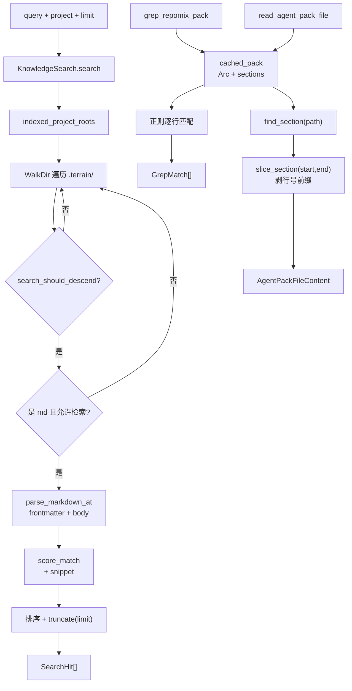

# 检索与文档领域

**模块路径**：`crates/terrain-core/src/search.rs`、`doc.rs`、`citations.rs`、`assets/query.rs`、`assets/pack_read.rs`
**生成日期**：2026-11-14

---

## 这个模块在做什么

这个模块是 Terrain 的**图书管理员**。它不生产知识，但决定了"当有人问一个问题时，系统能翻出哪几页"。

它维护三种截然不同的检索方式，分别服务三种场景：

| 方式 | 场景 | 成本 | 实现 |
|------|------|------|------|
| 知识全文检索 | "有没有文档提到鉴权" | 低（遍历 md 文件打分） | `KnowledgeSearch::search` |
| 源码包 grep | "这个符号在哪定义" | 中（整包文本 + 行扫描） | `grep_repomix_pack` |
| 包内文件切片 | "把 util.rs 第 40-80 行给我" | 低（预建 section 索引） | `read_agent_pack_file` |

三者共同的约束是**输出必须能当引用**：检索结果带 `path` 与 `rel_path`，grep 结果带行号，包内切片带 `start_line` / `end_line` / `total_lines`。没有这些，DeepWiki 的回答就没法让用户点回源码。

---

## 核心功能点

1. **全文检索与打分**——`KnowledgeSearch::search`（`search.rs:47`）遍历 `.terrain/` 下的 Markdown，解析 frontmatter，用 `score_match` 打分：项目名命中 +50、全文命中 +30、正文命中 +20，再按查询词逐个 +10/+5。最后按分数降序、路径升序排序并截断。

2. **检索范围剪枝**——`search_should_descend`（`:151`）不进入 `agent`、`.litho-agent`、`.sdd-agent`、`.meta`、`env`；`search_includes_markdown`（`:162`）更进一步：`agent/` 下**只**允许 `context.md` 参与检索，`repomix.md` 永远排除。这是为了避免 2 MB 的源码包把检索结果淹没。

3. **片段提取**——`snippet`（`:203`）按首个查询词定位，前后各取 40/80 字符，把换行替换为空格，两端加省略号；找不到时退回首行前 120 字符。`floor_char_boundary` / `ceil_char_boundary` 保证不会在 UTF-8 字符中间切断——中文文档里这是必须的。

4. **文档读取与裸文件名展开**——`read_doc_at_in_project` 支持传 `1.概述.md` 这种裸文件名，会自动在 `DOC_SUBDIRS`（`human`、`modules`、`interfaces`、`routes`、`events`、`knowledge`、`agent`）下逐个尝试。这让模型不必记住完整路径。

5. **Markdown 解析与序列化**——`doc.rs` 提供 `parse_markdown_at`（YAML frontmatter + body）、`read_doc`、`write_doc`、`render_markdown`、`read_json`/`write_json`。所有知识文档都经过这一层，保证 frontmatter 格式一致。

6. **包内 grep**——`grep_repomix_pack`（`assets/query.rs:63`）在整包文本上按正则匹配，返回 `GrepMatch`（文件、行号、上下文行）。`grep_text` 是纯文本版本，便于测试。

7. **包内按文件切片**——`read_agent_pack_file`（`pack_read.rs:221`）先从缓存里拿"section 字节偏移索引"，定位 `### path (N lines)` 块，再按请求行区间切片。

8. **行号可靠性标记**——`AgentPackFileContent.line_numbers_reliable`（`pack_read.rs:148`）：当 repomix 输出的是**压缩视图**（折叠过的包）时，行首的 `N:` 是压缩视图编号而非源文件行号，此时该字段为 `false`，提示调用方**不要拿它当引用行号**。这是一个很少见但极其重要的诚实设计。

9. **整包缓存**——`cached_pack` 以"路径 + mtime + len"为键缓存 `Arc<str>` 与 section 索引；`invalidate_pack_text_cache` 用于主动失效。

10. **引用抽取与合并**——`extract_source_citations`（`citations.rs:46`）从文本里识别 `path:line` 形式的引用（按扩展名白名单过滤），`merge_citations` 去重合并。这是把"模型随口提到的文件路径"变成"可点击引用"的桥梁。

---

## 关键组件

| 组件/类型 | 文件路径 | 核心职责 |
|---------|---------|---------|
| `KnowledgeSearch` | `crates/terrain-core/src/search.rs:32` | 全文检索入口 |
| `SearchHit` / `SearchOptions` | `crates/terrain-core/src/search.rs:14,26` | 检索结果与查询选项 |
| `score_match` | `crates/terrain-core/src/search.rs:180` | 加权打分 |
| `snippet` | `crates/terrain-core/src/search.rs:203` | UTF-8 安全片段提取 |
| `read_doc_at_in_project` | `crates/terrain-core/src/search.rs:352` | 文档读取（含裸名展开） |
| `DOC_SUBDIRS` | `crates/terrain-core/src/search.rs:243` | 裸文件名搜索目录 |
| `parse_markdown_at` / `write_doc` | `crates/terrain-core/src/doc.rs` | Markdown 解析与写盘 |
| `KnowledgeDoc` / `DocFrontmatter` | `crates/terrain-core/src/doc.rs` | 文档模型 |
| `grep_repomix_pack` / `GrepMatch` | `crates/terrain-core/src/assets/query.rs:63,9` | 包内正则检索 |
| `read_agent_pack_file` | `crates/terrain-core/src/assets/pack_read.rs:221` | 按文件/行区间取包内容 |
| `AgentPackFileContent` | `crates/terrain-core/src/assets/pack_read.rs:125` | 切片结果（含行号可靠性） |
| `read_pack_text_cached` | `crates/terrain-core/src/assets/pack_read.rs:113` | 整包文本缓存 |
| `extract_source_citations` / `merge_citations` | `crates/terrain-core/src/citations.rs:46,93` | 引用抽取与合并 |

---

## 内部数据流

**关键步骤说明**：

1. `search`（`search.rs:47`）——先把 query 转小写并 trim；空查询直接返回空（避免"搜索空字符串命中所有文档"）。
2. `score_match`——打分是"加权命中"而非 BM25：对知识文档这种规模（几十到几百篇），简单的加权命中已经足够，且完全可预测。
3. `snippet`——`body.floor_char_boundary(idx - 40)` 是这里最专业的细节。直接 `&body[idx-40..]` 在中文文档里会 panic，因为字节索引可能落在多字节字符中间。
4. `cached_pack`——缓存键包含 mtime 与 len，文件被重写后自动失效；`sections` 是一次扫描建立的字节偏移索引，之后每次按文件取内容都是 O(1) 定位。
5. `slice_section`——剥掉 `N: ` 前缀时区分"有正文的 `42: code`"和"空行的 `42:`"。注释专门指出这个差别，因为用同一个函数处理会让空行返回 `42:` 而不是空字符串。
6. `line_numbers_reliable`——`pack_declares_source_line_numbers(&text)` 检查整包是否声明了源行号；压缩视图下为 false。这是"不给出错误引用"的最后一道防线。

---

## 关键接口与扩展点

- **`SearchOptions`**：`project` / `doc_type` / `limit` 三个维度。`doc_type` 允许只搜某一类文档（如只搜 human）。
- **`DOC_SUBDIRS`**：新增一种知识文档目录（比如 `adr/`）时，加进这个常量即可支持裸文件名解析。
- **`score_match`**：打分策略集中在单个函数里，想换 BM25 或 embedding 只需替换它。
- **`AgentPackFileContent`**：字段变化会影响所有调用方（工具层、前端源码抽屉），改动需谨慎并跑 `gen:types`。

---

## 与其他模块的交互

| 交互模块 | 方向 | 接口/协议 | 说明 |
|---------|------|---------|------|
| `paths` | 依赖 | `indexed_project_roots`、`project_dir` | 定位检索根目录 |
| `doc` | 依赖 | `parse_markdown_at`、`read_doc` | 解析文档 |
| `schema` | 依赖 | `DocType`、`SourceCitation` | 类型契约 |
| `assets/repomix` | 依赖 | `pack_declares_source_line_numbers` | 行号可靠性判定 |
| `terrain-agent/tools` | 被依赖 | 检索与包读取原语 | 9 个工具中的 5 个直接建立在此之上 |
| `terrain-agent/chat` | 被依赖 | `KnowledgeSearch`、引用函数 | 引用兜底 |
| `src-tauri/commands` | 被依赖 | `search_knowledge`、`read_document` | UI 检索与阅读 |

---

## 跨模块协作场景

**在「DeepWiki 问答」中**：本模块是整个"三层检索"的底层实现。宏观层来自 `context.md`（由 `extract_context_section` 切分），中观层走 `search_knowledge_tool` → `KnowledgeSearch`，微观层走 `grep_agent_pack_tool` / `read_agent_pack_file_tool`。问答结束后，`extract_source_citations` 再从答案里抠出可点击引用。

**在「知识阅读器」中**：前端 `readDocument(path)` → `read_document` → `read_doc_at_in_project`。裸文件名展开让"从引用跳转到文档"变得宽容：模型给出 `1.概述.md` 也能找到。

**在「源码抽屉」中**：`SourcePanel` 调 `read_source_slice_cmd`（走 `source.rs`，不是本模块），但如果来源是 repomix 包，则会走 `read_agent_pack_file` 取得带行号的切片。

---

## 性能考量

- **整包缓存**：`Arc<str>` 共享所有权，多次 grep 不重复分配。真实项目的 repomix 包常有 2–3 MB。
- **section 索引**：一次线性扫描建立偏移表，之后按文件定位不需要再扫全文。
- **检索剪枝**：跳过 `repomix.md` 与 `.litho-agent/` 是最大的性能收益——它们往往占据 `.terrain/` 90% 以上的体积。
- **限制条数**：CLI 默认 20、工具默认 10，避免一次搜索返回几十条把上下文塞满。

---

## 实现亮点

**亮点一：`line_numbers_reliable`。** 大多数工具会默默把行号返回，即使那个行号是压缩视图的编号。Terrain 显式标记"这个行号不可靠"，并让工具层把它排除在引用之外。这是对"引用必须准确"这条底线的坚持。

**亮点二：UTF-8 边界处理。** `floor_char_boundary` / `ceil_char_boundary` 的使用在中文场景里是刚需，但很多项目会忽略，直到线上 panic。

**亮点三：空行解析的注释。** `parse_numbered_line` 的注释解释了为什么不能复用 `strip_line_number_prefix`——`42:` 这样的空行如果按"要求冒号后有空格"的规则处理，会把整行原样返回。这种级别的细节说明作者真的在这上面踩过坑。
