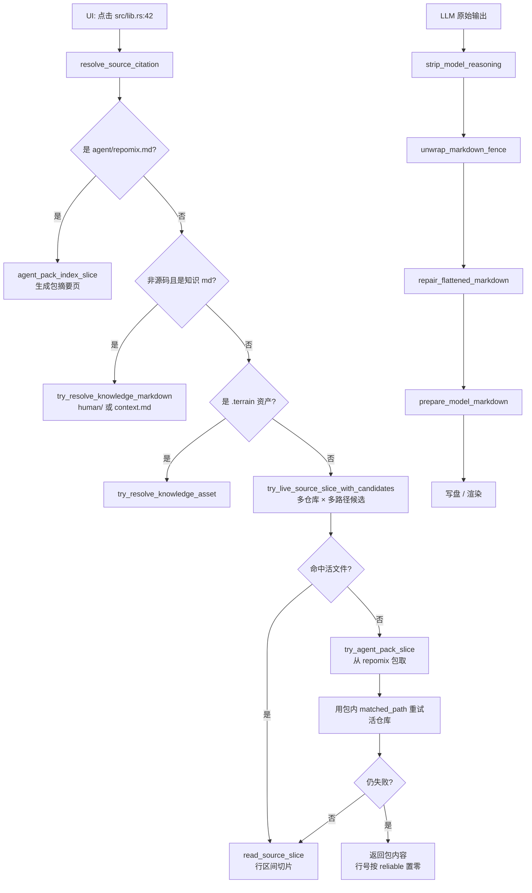

# 源码与文本领域

**模块路径**：`crates/terrain-core/src/source.rs`、`model_text.rs`、`render.rs`、`fingerprint.rs`、`human.rs`
**生成日期**：2026-11-14

---

## 这个模块在做什么

如果说检索领域负责"找到哪一页"，那么这个模块负责**把那一页真正递到你手上**，并且保证递过来的纸不是残页、不是伪造的行号、也不是模型自己编的路径。

它解决三类彼此独立的问题：

| 问题 | 典型调用 | 落点 |
|------|---------|------|
| 引用 `src/lib.rs:42` 点开后显示什么 | `resolve_source_citation` | `source.rs` |
| 模型吐出的 Markdown 为什么能正常渲染 | `prepare_model_markdown` | `model_text.rs` |
| 生成的知识文档头部元数据由谁写 | `project_frontmatter` 等 | `render.rs` |
| 这个文件是不是上次那个文件 | `fingerprint` | `fingerprint.rs` |
| 阅读器左侧文档树从哪来 | `list_human_docs` | `human.rs` |

这五件事看似无关，但共同服务于一个目标：**界面上每一个可点击的位置，都要能落到真实存在的内容上**。一旦这个契约破了，DeepWiki 的引用就会变成一堆 404。

---

## 核心功能点

1. **受限路径解析**——`read_source_slice`（`source.rs:67`）把 `repo_path` + `file_path` + 行区间解析成 `SourceSlice`。第一步 `resolve_source_file_in_repo` 会把相对路径、绝对路径、带仓库前缀的路径统一归一，然后用 `is_path_within_repo`（`:11`）做**越界防护**：目标必须位于仓库目录内，且文件必须真实存在。

2. **引用分级解析**——`resolve_source_citation`（`:391`）是 UI 源码面板的唯一入口，按固定优先级尝试：`agent/repomix.md` 索引 → 知识 Markdown（`human/`、`context.md`、普通文档）→ `.terrain` 资产文件 → **活仓库文件系统** → repomix 包兜底。顺序不是随手排的：活仓库优先，包只用于"发现规范路径"，因为包可能是几小时前的快照。

3. **行号诚实性**——当只能从压缩包取内容时，`pack_file.line_numbers_reliable` 为 `false`，返回的 `start_line` / `end_line` 会被强制置 0（`:453-461`）。注释写得很清楚：内容仍然可读，但绝不能拿压缩视图的行号去锚定源码。

4. **模型输出清洗**——`model_text.rs` 提供 `strip_model_reasoning`（去除模型输出里的推理段）、`unwrap_markdown_fence`（拆掉整体包裹的 ```markdown）、`extract_markdown_body`、`repair_inline_section_headings`、`repair_flattened_markdown`（修复"标题和正文被压成一行"的常见模型故障），最终由 `prepare_model_markdown` / `prepare_chat_markdown` 组合成两条管线。

5. **文档渲染**——`render.rs` 负责把结构化数据变成带 YAML frontmatter 的 Markdown：`project_frontmatter`、`module_frontmatter`、`interface_frontmatter`、`route_frontmatter`，以及对应的 body 渲染函数。所有生成物因此共享同一套头部字段。

6. **内容指纹**——`fingerprint`（`fingerprint.rs:11`）是自实现的 FNV-1a 64 位哈希，输出 16 位十六进制。用来回答"部署的技能文件 / Litho 检查点里的这个文件是否被改过"。

7. **人类文档清单**——`list_human_docs`（`human.rs:15`）把三类目录拼成一棵树：`human/` 下的 Litho 文档、`agent/context.md` 与 `meta-inputs.md`、`interfaces/`+`routes/`+`events/` 下的 OpenAPI 衍生文档。排序按 section 再按路径。

---

## 关键组件

| 组件/类型 | 文件路径 | 核心职责 |
|---------|---------|---------|
| `read_source_slice` | `crates/terrain-core/src/source.rs:67` | 从活仓库读取行区间切片 |
| `resolve_source_citation` | `crates/terrain-core/src/source.rs:391` | 多级回退的引用解析入口 |
| `is_path_within_repo` | `crates/terrain-core/src/source.rs:11` | 仓库边界防护（含 macOS `/private`） |
| `agent_pack_index_slice` | `crates/terrain-core/src/source.rs:245` | 为 `agent/repomix.md` 生成摘要页 |
| `SourceSlice` | `crates/terrain-core/src/schema/` | 切片数据契约（repo/file/行区间/正文） |
| `prepare_model_markdown` | `crates/terrain-core/src/model_text.rs:348` | 模型 Markdown 清洗主管线 |
| `prepare_chat_markdown` | `crates/terrain-core/src/model_text.rs:341` | 聊天场景的轻量清洗 |
| `strip_model_reasoning` | `crates/terrain-core/src/model_text.rs:175` | 剥离推理段 |
| `repair_flattened_markdown` | `crates/terrain-core/src/model_text.rs:302` | 修复被压平的标题/代码块 |
| `project_frontmatter` / `DocFrontmatter` | `crates/terrain-core/src/render.rs:74` | 生成文档头部元数据 |
| `fingerprint` | `crates/terrain-core/src/fingerprint.rs:11` | 稳定内容哈希 |
| `list_human_docs` / `HumanDocEntry` | `crates/terrain-core/src/human.rs:15` | 阅读器文档树 |
| `read_human_doc` | `crates/terrain-core/src/human.rs:145` | 读取单篇人类文档 |

---

## 内部数据流

下面这张图把"点一个引用"和"模型回答落盘"两条路径画在一起。它们共用同一套"归一 → 校验 → 取内容"的思路。



**关键步骤说明**：

1. `read_source_slice` 先检查 `repo.is_dir()`，再解析文件。行区间参数做了两种容错：`start_line == 0 || end_line == 0` 视为"全文"，`start > end` 自动交换。
2. `is_path_within_repo` 的 `/private` 分支不是凑数——macOS 上 `/var` 与 `/private/var` 是同一目录的两种写法，不做兼容会出现"文件明明在仓库里却报越界"。
3. `resolve_source_citation` 的候选路径生成（`source_path_candidates`）会尝试"原样路径"和"去掉项目 slug 前缀"等变体，因为不同模型的引用习惯不同。
4. 包兜底后仍会**回到活仓库重试一次**（`:441`），这一步用包给出的 `matched_path` 纠正大小写或前缀差异。活文件永远优先。
5. `prepare_model_markdown` 的各个修复步骤是幂等的：重复调用不会把已经正常的文档改坏，这让它可以安全地用在"未知是否已清洗"的文本上。

---

## 关键接口与扩展点

- **`SourceSlice`**：`repo_path` / `file_path` / `start_line` / `end_line` / `content`。前端 `SourceDrawer` 直接消费，字段变更需跑 `gen:types`。
- **路径候选策略**：`source_path_candidates` 与 `repo_path_candidates` 是两个集中点。新增"某种引用写法"（比如 `crate::foo` 形式的 Rust 路径）只需扩展候选生成，不用改主流程。
- **文档类型扩展**：`list_structured_docs` 里的 `["interfaces", "routes", "events"]` 是硬编码数组；新增一类衍生文档目录时加一项即可。
- **`fingerprint`**：算法被刻意固定。若换成加密哈希，磁盘上已有的指纹会全部失配——注释明确说明这是"持久化格式"而非内部实现细节。

---

## 与其他模块的交互

| 交互模块 | 方向 | 接口/协议 | 说明 |
|---------|------|---------|---------|
| `paths` | 依赖 | `KnowledgePaths::project_dir`、`human_docs_dir` | 定位知识根目录 |
| `project` | 依赖 | `resolve_project_repo_path` | 无显式 repo 时按项目查注册表 |
| `assets/pack_read` | 依赖 | `read_agent_pack_file` | 包内切片兜底 |
| `assets/repomix` | 依赖 | `AgentPackMeta`、`pack_declares_source_line_numbers` | 包索引与行号可靠性 |
| `doc` | 依赖 | `read_json`、`parse_markdown_at` | 元数据与知识文档读取 |
| `src-tauri/commands` | 被依赖 | `read_source_slice_cmd`、`resolve_source_citation_cmd` | UI 源码抽屉 |
| `terrain-agent/chat` | 被依赖 | `prepare_model_markdown` | 回答落盘前清洗 |
| `terrain-agent/agent_context` | 被依赖 | `prepare_model_markdown` | 上下文生成结果清洗 |

---

## 跨模块协作场景

**在「源码抽屉」中**：前端 `readSourceSlice` / `resolveSourceCitation` → `src-tauri/commands/knowledge.rs` → 本模块。用户从 DeepWiki 回答里点 `crates/terrain-core/src/search.rs:47`，走的是 `resolve_source_citation`；从文档树点文件，走的是 `read_source_slice`。两条路径最终都产出 `SourceSlice`，前端无需区分。

**在「知识生成」中**：Agent 生成 `context.md` 或 Litho 文档后，落盘前会经过 `prepare_model_markdown`。这一步挡掉的是"模型把整篇文档塞进一个 ```markdown 代码块"这类高频事故——如果不拆，阅读器会把整篇文档渲染成一个灰色代码框。

**在「环境集成」中**：部署 Skills 时用 `fingerprint` 判断"这个文件是不是我们上次写的那份"。指纹相同就跳过，不同才覆盖，从而避免把用户手工改过的技能文件冲掉。

---

## 性能考量

- **按行区间读，不整文件读**：`read_source_slice` 虽然用 `read_to_string` 读整文件，但只 join 请求的区间；对于源码文件这是可接受的，因为再大也就几百 KB。
- **不做全仓扫描**：解析靠"候选路径 + `is_file()`"，复杂度是候选数而不是仓库文件数。这是它能在大仓库上瞬间响应的原因。
- **包兜底是最后手段**：只有在活仓库不可用时才读 repomix 包，避免为了一个引用把 2–3 MB 的包加载进内存。
- **`list_human_docs` 只走三个目录**：不遍历整个 `.terrain/`，否则每次刷新文档树都要扫过 `repomix.md` 这类巨型文件。

---

## 实现亮点

**亮点一：活文件优先于缓存快照。** 很多同类工具会直接从索引数据库返回内容，速度快但会展示过期代码。Terrain 的选择是"宁可多一次 `is_file()`，也要给你看当前磁盘上的代码"，包只用来纠正路径。

**亮点二：行号不可靠时置零而不是照抄。** 这是一个很小的决定，但它把"引用可能指错行"变成"引用不指行"，后者是诚实的不完整，前者是自信的错误。

**亮点三：`fingerprint` 不用 `DefaultHasher`。** 标准库哈希算法在不同 Rust 版本间不保证稳定，而这里的摘要要写进磁盘、跨版本比对。于是作者手写了 12 行 FNV-1a，并在注释里写明原因——这类"看起来多余"的谨慎，正是持久化格式该有的样子。
