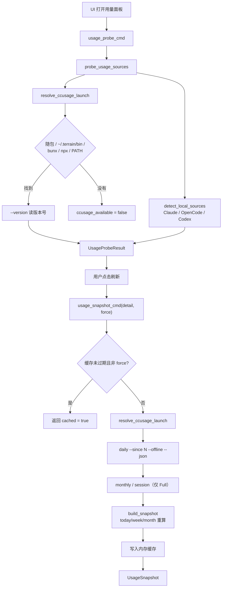

# Token 用量领域

**模块路径**：`crates/terrain-core/src/usage.rs`
**生成日期**：2026-11-14

---

## 这个模块在做什么

Terrain 本身不调用大量模型——真正烧 token 的是 Claude Code、OpenCode、Codex 这些编码 Agent。用量模块相当于**家里的电表**：它不发电，只负责把"这个月用了多少度、哪个电器最费电"读出来给你看。

它有两个刻意的设计约束：

1. **不自己解析各家日志格式。** 具体统计交给开源工具 [ccusage](https://github.com/ryoppippi/ccusage)，Terrain 只负责"找到它、调用它、把 JSON 变成 UI 能用的结构"。
2. **探测与统计分离。** 打开面板时只做文件系统探测（`probe_usage_sources`，毫秒级）；真正跑统计要等用户点"刷新"，且结果缓存 120 秒。

这两条决定了它的性能特征：**默认零子进程**，只有用户主动要求时才付出进程启动成本。

---

## 核心功能点

1. **快速探测**——`probe_usage_sources`（`usage.rs:137`）不启动 ccusage 报告子进程，只做两件事：解析 ccusage 可执行文件位置（`--version` 一次），以及扫描三个 Agent 的本地数据目录。返回 `ccusage_available` / `ccusage_version` / `ccusage_path` / `sources`。

2. **数据源识别**——`detect_local_sources`（`:453`）固定探测三家：Claude Code（`*.jsonl`）、OpenCode（`*.json` / `*.db`）、Codex（`*.jsonl`）。每个源返回 `UsageSourceStatus{ id, label, path, detected, file_count }`，UI 据此显示"已检测到 / 未检测到"。

3. **快照加载**——`load_usage_snapshot(detail, force_refresh)`（`:150`）是唯一的重活入口。它先查内存缓存（`CACHE_TTL = 120s`），未命中则依次调用 ccusage：
   - `daily --since <N days>`：`Summary` 取 30 天，`Full` 取 400 天；
   - `monthly --since <3 年>`（仅 `Full`）；
   - `session --since <30 天>`（仅 `Full`）。

4. **区间汇总**——`build_snapshot`（`:223`）不是简单转发 ccusage 的汇总字段，而是**自己从 daily 行重新求和**：今天 = `period == 今日`，本周 = 最近 7 天，本月 = 当月 1 号起。这样三个口径与 daily 明细永远自洽。

5. **离线与静默**——所有子进程都带 `--offline`（`OFFLINE_ARGS`），并通过 `hidden_command` 创建（Windows 上不弹控制台窗口）。统计不应该产生网络请求，也不应该闪黑框。

6. **启动器多级回退**——`resolve_ccusage_launch`（`:342`）按顺序尝试：随包二进制 → `~/.terrain/bin/ccusage` → `bunx` / `bun x` → `npx -y ccusage` → PATH 上的 `ccusage`。任何一级可用即可，用户不需要预装特定包管理器。

7. **会话文件定位**——`resolve_usage_session_path(agent, period)`（`:614`）把"某条 session 记录"映射回本地日志文件或目录，供 UI 提供"打开源文件"。这是用量数字与原始证据之间的桥。

---

## 关键组件

| 组件/类型 | 文件路径 | 核心职责 |
|---------|---------|---------|
| `probe_usage_sources` | `crates/terrain-core/src/usage.rs:137` | 无子进程的快速探测 |
| `load_usage_snapshot` | `crates/terrain-core/src/usage.rs:150` | 快照加载（缓存 + ccusage） |
| `UsageDetailLevel` | `crates/terrain-core/src/usage.rs:35` | `Summary` / `Full` 两档 |
| `UsageSnapshot` | `crates/terrain-core/src/usage.rs:122` | 完整快照（today/week/month/daily/monthly/sessions） |
| `UsageTotals` | `crates/terrain-core/src/usage.rs:55` | 五类 token + 成本 |
| `UsagePeriodEntry` | `crates/terrain-core/src/usage.rs:88` | 日/月/会话行 |
| `UsageModelBreakdown` | `crates/terrain-core/src/usage.rs:72` | 单行内的模型拆分 |
| `UsageProbeResult` / `UsageSourceStatus` | `crates/terrain-core/src/usage.rs:112,43` | 探测结果 |
| `CcusageLaunch` | `crates/terrain-core/src/usage.rs:342` 附近 | 启动方式枚举（Direct/Bunx/Npx） |
| `resolve_usage_session_path` | `crates/terrain-core/src/usage.rs:614` | 会话 → 本地文件 |
| `CACHE_TTL` | `crates/terrain-core/src/usage.rs:19` | 120 秒缓存窗口 |

---

## 内部数据流

**关键步骤说明**：

1. `probe_usage_sources` 只跑一次 `--version`。它需要知道"能不能用、什么版本"，但不需要任何统计数字。
2. `detect_local_sources` 扫描深度限制为 2 层（`count_matching_files(..., 2)`），避免在 `~/.claude/projects/` 这种深目录里递归太久。
3. `run_ccusage_json`（`:421`）统一追加 `--offline --json`，并把 stderr 作为错误信息回传。ccusage 的报错通常比"exit code 1"更有诊断价值。
4. `build_snapshot` 用 `Local::now()` 计算今天/本周/本月边界，而不是信任 ccusage 的汇总字段——本地时区与"周从周几开始"的差异会导致口径不一致。
5. 缓存是**全局单例**（`SNAPSHOT_CACHE: Mutex<Option<CachedSnapshot>>`），且区分 `detail`：Summary 与 Full 不互相覆盖，避免"看了详细页再回概览，概览变成空 monthly"。

---

## 关键接口与扩展点

- **`UsageDetailLevel`**：两档而非"参数全开"。`Summary` 只跑 daily，成本约为 `Full` 的三分之一；UI 概览页用 Summary，详细页才用 Full。
- **`detect_local_sources`**：新增一个 Agent 数据源只需加一次 `probe_source_dir` 调用与扩展名列表。
- **`resolve_ccusage_launch`**：新增启动方式（例如 `pnpm dlx`）只需加一个 `CcusageLaunch` 变体与 `configure_ccusage_cmd` 分支。
- **`UsagePeriodEntry.source_path`**：字段为 `Option<String>`，前端据此决定是否显示"打开文件"按钮——不是所有行都能定位到源文件。

---

## 与其他模块的交互

| 交互模块 | 方向 | 接口/协议 | 说明 |
|---------|------|---------|---------|
| `process` | 依赖 | `crate::process::command`（别名 `hidden_command`） | Windows 无控制台窗口启动 |
| `bundled_tools` | 依赖 | `bundled_tools().ccusage` | 随包二进制发现 |
| `platform` | 依赖 | `platform_key`、`agent_tool_filename` | 按平台选二进制名 |
| `language` | 依赖 | `current_language().tr(...)` | 错误信息双语 |
| `src-tauri/commands/usage.rs` | 被依赖 | `usage_probe_cmd`、`usage_snapshot_cmd` | 桌面端入口 |
| `terrain-cli/commands/usage.rs` | 被依赖 | `terrain usage probe/snapshot` | CLI 入口 |
| 前端 `UsagePanel` / `UsageBadge` | 被依赖 | `UsageSnapshot` | 图表与徽标 |

---

## 跨模块协作场景

**在「桌面端状态栏」中**：`UsageBadge` 只调 `usage_probe_cmd`，显示"今天用了多少 token"时不触发任何 ccusage 报告。用户点开 `UsagePanel` 才发起 `usage_snapshot_cmd(Summary)`。

**在「详细用量页」中**：切到"模型/会话"标签时用 `Full`，此时才会跑 monthly 与 session 两条命令。两条命令的 `--since` 分别是 3 年与 30 天——一个为了趋势图，一个为了可追溯的会话列表。

**在「CLI」中**：`terrain usage probe` 输出 `UsageProbeResult` JSON，`terrain usage snapshot --detail full --force` 适合写进脚本做定期采集。CLI 与桌面端共享同一个缓存？不——它们是两个进程，各自持有内存缓存。

---

## 性能考量

- **默认零报告子进程**：面板首屏只做文件系统探测，冷启动不会被 `bunx ccusage` 的包解析拖慢。
- **120 秒缓存**：ccusage 一次 `daily` 在真实数据上要几百毫秒到数秒，缓存把连续切页的成本摊平。
- **`force_refresh` 显式穿透**：用户点"刷新"时必须看到新数据，所以 force 会跳过缓存且回写。
- **`Summary` 只跑一条命令**：概览页只需要 today/week/month 与 30 天 daily，monthly/session 完全不请求。
- **进程静默**：`hidden_command` 在 Windows 上省掉控制台窗口创建，既快又不打扰。

---

## 实现亮点

**亮点一：探测与统计彻底解耦。** 很多工具打开面板就先跑一次全量统计，导致首屏卡顿。Terrain 把"能不能用"与"用了多少"拆成两个命令，前者毫秒级，后者按需触发。这是很典型的"把昂贵操作推后到用户明确需要时"。

**亮点二：汇总自己算，不信任上游。** `today/week/month` 从 daily 行重新求和，而不是直接读 ccusage 的字段。这样"某天数据缺失"或"时区不同"时，UI 上的三个数字仍然与下面的明细表对得上——对账能力比省几行代码重要。

**亮点三：启动器五级回退。** 随包二进制、部署目录、bunx、npx、PATH，几乎覆盖所有安装形态。用户不需要读文档装依赖，Terrain 自己找到能用的那个。
