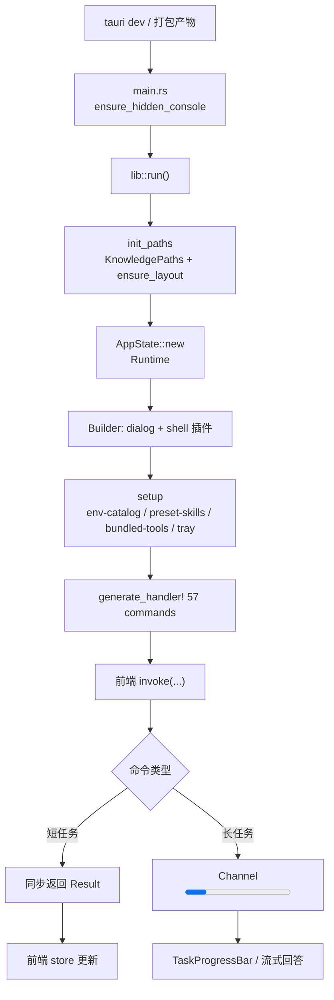

# 桌面壳领域

**模块路径**：`src-tauri/`（`src/main.rs`、`src/lib.rs`、`src/commands/`、`src/tray.rs`、`build.rs`）
**生成日期**：2026-11-14

---

## 这个模块在做什么

`src-tauri/` 是 Terrain 的**外壳与配电盘**：它把 Rust 后端包装成桌面应用，负责窗口、托盘、权限、随包二进制，以及最重要的——**把 57 个后端能力暴露成前端可调用的 IPC 命令**。

它不实现业务。`scan_project` 内部调用 `terrain_core`，`ask_knowledge_cmd` 内部调用 `terrain_agent`。这一层的职责可以概括为：

| 职责 | 落点 |
|------|------|
| 应用生命周期与单例状态 | `AppState`、`run()` |
| 57 个 IPC 命令的注册与参数转换 | `lib.rs:64`、`commands/` |
| 长任务的进度回传 | `Channel<T>` + `payloads.rs` |
| 系统托盘与多窗口 | `tray.rs` |
| 打包期裁剪 sidecar | `build.rs` |
| 能力白名单（权限） | `capabilities/default.json` |

一句话：**它让"一个 Rust 库"变成"一个可安装的桌面产品"**。

---

## 核心功能点

1. **单例运行时**——`AppState`（`lib.rs:12`）只持有 `runtime: Runtime`，并转发 `paths()` / `model_config()` / `set_model_config()`。所有命令通过 `State<'_, AppState>` 拿到同一份路径与引擎缓存，避免每个命令各自读设置。

2. **命令注册**——`generate_handler![...]`（`lib.rs:64`）列出 **57 个**命令。分组大致是：知识读取（8）、项目与生成（12）、问答会话（10）、SDD（6）、新鲜度（2）、环境集成（3）、模型与 ACP（7）、用量（2）、杂项（7）。命令名带 `_cmd` 后缀的是"与核心函数重名时的消歧约定"。

3. **启动引导**——`bootstrap_app`（`commands/settings.rs:12`）一次返回前端启动所需的全部状态：`model_settings`、`registry_projects`、`llm_status`、`acp_ok`。前端 `App.svelte` 只需一次 IPC 就能完成首屏初始化，而不是发五六个请求。

4. **长任务进度**——Litho 生成、SDD 阶段、项目初始化、环境集成这四类耗时操作都通过 `tauri::ipc::Channel<T>` 把事件推给前端。`payloads.rs` 定义每种任务的 `Progress` / `Done` 载荷，前端 `TaskProgressBar` 统一渲染；问答则走另一套 `AskStreamEvent`（定义在 `terrain-agent` 的 chat 类型里）。

5. **托盘与窗口**——`tray.rs` 管理主窗口与独立的 `usage` 窗口：左键菜单、显示/隐藏、关于、退出。关闭主窗口不退出应用（`attach_main_window_close_handler`），这是桌面常驻工具的常规行为。语言切换后 `refresh_menu` 重建菜单文案。

6. **打包期 sidecar**——`build.rs` 在编译时把 `rtk`、`terrain-cli`、`codegraph` 按目标平台复制/裁剪进 `bundled-resources/`，并设置 `TERRAIN_TARGET_TRIPLE`。`TERRAIN_SKIP_SIDECAR_DOWNLOAD=1` 可跳过下载，用于完全离线构建。

7. **权限最小化**——`capabilities/default.json` 只给主窗口与 usage 窗口开放 `core:default`、`dialog:default`、`shell:default`，并**显式列出**允许执行的 sidecar（`binaries/rtk`、`binaries/terrain-cli`）。前端不能任意执行系统命令。

8. **Windows 无控制台**——`main.rs` 在 GUI 子系统下先 `ensure_hidden_console()`。注释说明了原因：不只是自己 spawn 的子进程，**库内部**（repomix-core 调 git）拉起的控制台程序也会闪窗，所以要先挂一个隐藏控制台。

---

## 关键组件

| 组件/类型 | 文件路径 | 核心职责 |
|---------|---------|---------|
| `main` | `src-tauri/src/main.rs` | 隐藏控制台 + 启动 |
| `run` | `src-tauri/src/lib.rs:34` | Tauri Builder、插件、setup、handler |
| `AppState` | `src-tauri/src/lib.rs:12` | 全局单例（Runtime） |
| `generate_handler!` | `src-tauri/src/lib.rs:64` | 57 个命令注册 |
| `commands/knowledge.rs` | `src-tauri/src/commands/knowledge.rs` | 检索、读文档、源码切片 |
| `commands/project.rs` | `src-tauri/src/commands/project.rs` | 项目列表、概览、初始化、备注 |
| `commands/workflows.rs` | `src-tauri/src/commands/workflows.rs` | Litho / 上下文 / 问答 / SDD 编排 |
| `commands/sessions.rs` | `src-tauri/src/commands/sessions.rs` | Ask / SDD 会话持久化 |
| `commands/settings.rs` | `src-tauri/src/commands/settings.rs` | 引导、模型、ACP 检查 |
| `commands/assets.rs` / `env.rs` / `usage.rs` | `src-tauri/src/commands/` | 打包、环境集成、用量 |
| `payloads.rs` | `src-tauri/src/commands/payloads.rs` | 四类长任务的事件载荷 |
| `init_paths` / `resolved_acp_settings` | `src-tauri/src/commands/mod.rs` | 启动路径与设置解析 |
| `tray::init` | `src-tauri/src/tray.rs:16` | 托盘菜单与窗口 |
| `build.rs` | `src-tauri/build.rs` | sidecar 裁剪与资源清单 |
| `default.json` | `src-tauri/capabilities/default.json` | 窗口权限白名单 |

---

## 内部数据流

**关键步骤说明**：

1. `init_paths`（`commands/mod.rs:28`）调用 `knowledge_paths_from_env()` 并 `ensure_layout()`。桌面端启动即保证 `.terrain/` 存在，与 CLI 行为一致。
2. `setup` 阶段初始化三个随包资源目录（env catalog、preset skills、bundled tools）并挂托盘。这些必须在第一个命令执行前完成，否则 `check_acp` 之类会找不到技能目录。
3. `.manage(state)` 把 `AppState` 注入 Tauri 的状态容器，命令参数里写 `State<'_, AppState>` 即可获取。
4. 长任务命令（如 `run_litho_generation_cmd`）接受 `on_progress: Channel<...>`，在 `spawn_blocking` 里跑核心逻辑并逐条 `send`。
5. 命令返回 `Result<T, String>`：核心错误一律 `.map_err(|e| e.to_string())`。前端因此只需要处理字符串错误，不需要理解 Rust 错误枚举。

---

## 关键接口与扩展点

- **新增命令**：写 `#[tauri::command]` 函数 → 在 `commands/mod.rs` re-export → 在 `generate_handler!` 加一行 → 在 `src/lib/api.ts` 加类型化封装。四处对齐，漏一处前端就调不到。
- **新增事件载荷**：在 `payloads.rs` 定义 `Serialize` 结构，并同步前端 `types.client.ts`（事件类型不走 ts-rs）。
- **新增窗口**：`tray.rs` 里参照 `open_usage_window`，并在 `capabilities/default.json` 的 `windows` 数组加窗口 id。
- **sidecar**：`build.rs` 的 `stage_sidecar` 是唯一入口；新增二进制要同时改 `capabilities` 的 `shell:allow-execute` 白名单。

---

## 与其他模块的交互

| 交互模块 | 方向 | 接口/协议 | 说明 |
|---------|------|---------|---------|
| `terrain-core` | 依赖 | 检索、资产、新鲜度、环境、用量 | 命令的实际实现 |
| `terrain-agent` | 依赖 | `Runtime`、`ChatEngine`、工作流 | 问答与生成 |
| 前端 `src/` | 被依赖 | `invoke` + `Channel` | 57 个命令与任务事件流 |
| `build.rs` | 依赖 | `packages/{rtk,terrain,codegraph}` | sidecar 来源 |
| `capabilities/` | 约束 | Tauri 权限模型 | 限制前端可执行范围 |

---

## 跨模块协作场景

**在「一键初始化」中**：前端 `initializeProject` → `initialize_project_cmd` → `spawn_blocking` 跑 `terrain_agent::workflows::init`，期间通过 `Channel<ProjectInitProgressPayload>` 推送阶段；完成后发 `ProjectInitDonePayload`，前端刷新项目列表与概览。

**在「DeepWiki 问答」中**：`ask_knowledge_cmd` 接受 `Channel<AskStreamEvent>`，把 `chunk` / `tool_calls` / `usage` 逐条推给 `DeepWikiPanel`。这是一条从 `ChatEngine` 到 Svelte 组件的完整流式链路，中间不落盘（落盘由 `save_ask_messages_cmd` 单独负责）。

**在「用量看板」中**：托盘菜单打开 `usage` 窗口，该窗口加载同一份前端 bundle，通过 `usage_snapshot_cmd` 取数据。多窗口共享 `AppState`，所以用量缓存也共享。

---

## 性能考量

- **单例 `Runtime`**：引擎与配置只在进程内构造一次，多窗口、多命令共享。
- **`spawn_blocking`**：扫描、生成、打包都是 CPU/IO 密集，放在阻塞线程池里，避免卡住 Tauri 的异步运行时。
- **`bootstrap_app` 合并首屏请求**：一次 IPC 换五个状态，冷启动少四次往返。
- **打包期裁剪**：`build.rs` 只复制当前平台需要的 sidecar，安装包体积因此可控。
- **隐藏控制台**：Windows 上避免每次子进程调用闪窗，也避免控制台创建开销。

---

## 实现亮点

**亮点一：命令层只做"翻译"。** 每个 `#[tauri::command]` 基本是"取 state → 调核心 → map_err"，没有业务分支。这让 CLI 与桌面端能共享 95% 的逻辑，也让"某功能只在桌面端有 bug"这类问题几乎不可能出现。

**亮点二：`enable_hidden_console` 的注释。** 它明确写出"不只是我们 spawn 的进程，库内部 spawn 的也会闪窗"。这种注释解释的是**为什么需要**，而不是**做了什么**——正是这类信息让后来者不会误删它。

**亮点三：权限白名单显式到二进制名。** `shell:allow-execute` 没有用通配符，而是逐条列出 `binaries/rtk` 与 `binaries/terrain-cli`。在一个"前端代码可以被 XSS 影响"的桌面应用里，这是必要的纵深防御。
