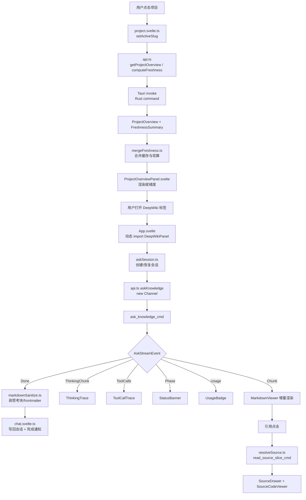

# 前端 UI 领域

**模块路径**：`src/`、`src/lib/`
**生成日期**：2026-11-14

---

## 这个模块在做什么

前端是 Terrain 的**驾驶舱**。它自己不生成任何知识，但它决定了人能不能看懂"这个仓库的知识现在有多可信、哪一段落后了、问题回答得对不对"。

它的特殊之处在于：后端已经把复杂性封装成了 57 个 IPC 命令，但前端并不能简单地把命令摊在界面上。它必须把"扫描 → 生成 → 阅读 → 追问"这条时间线画成用户能跟上的进度，把流式返回的 token 变成可折叠的思考过程，把模型随口提到的 `path:line` 变成能点开的源码抽屉。换句话说，**后端的复杂度在 UI 层不是消失了，而是被翻译成了交互**。

技术上它是一套 Svelte 5（runes）+ Vite 8 + Tailwind 4 的单页应用，跑在 Tauri 2 的 WebView 里，只通过 `invoke` 与事件通道和 Rust 通信。

---

## 核心功能点

1. **七大面板的统一编排**——`src/App.svelte`（74.9K）是唯一的编排层。它维护 `activeTab`（`overview` / `knowledge` / `sdd` / `env`，见 `src/lib/types.client.ts:63`）与若干浮层状态（`settingsOpen` / `helpOpen` / `deepWikiOpen`），并通过**动态 import** 懒加载重面板：`SddWorkflowPanel`、`EnvIntegratePanel`、`DeepWikiPanel`、`SettingsPanel`、`HelpPanel` 都是"用到才拉"（`src/App.svelte:359-395`）。这让首屏不必为一个从不打开的设置面板付出解析成本。

2. **项目总览与就绪度**——`ProjectOverviewPanel.svelte`（48.2K）是最大的单文件组件，承担"这个项目能不能用"的判断：新鲜度分数、文档完备度、Action Banner 建议的下一步。它把后端返回的 `FreshnessSummary` 与 `ProjectOverview` 融合成一句人话（"知识落后 3 个提交，建议刷新"），而不是把字段名直接显示出来。

3. **流式问答**——`DeepWikiPanel.svelte`（34.2K）消费 `Channel<AskStreamEvent>`。它按事件类型分流：`Chunk` 追加正文、`ThinkingChunk` 进 `ThinkingTrace.svelte`、`ToolCalls` 进 `ToolCallTrace.svelte`、`Phase` 更新状态条、`Usage` 更新 Token 徽标、`Done` 收尾并触发完成通知。这套分流的价值在于"过程可见"：用户能看到 Agent 正在 grep 哪个包，而不是盯着一个转圈。

4. **文档阅读器**——`HumanDocTree.svelte` + `MarkdownViewer.svelte` + `MarkdownArticleToc.svelte`。树负责 `human/` 的层级导航，阅读器负责渲染与目录联动。`humanDocPath.ts` 处理"裸文件名 → 真实路径"的映射，`markdownToc.ts` 从渲染后的标题生成锚点。

5. **图表与源码联动**——`MermaidLightbox.svelte` + `mermaidLoader.ts`。Mermaid 是**按需加载**的（`let api: Mermaid | null = null`，首次遇到图表才 `import("mermaid")`），因为 mermaid 11 的包体接近 1 MB，放进首屏会明显拖慢启动。配色不是默认主题，而是硬编码了与 `app.css` 设计令牌对应的 `TERRAIN` 常量（`mermaidLoader.ts:4-21`），保证图表和界面是同一套视觉语言。

6. **源码抽屉与引用跳转**——`SourcePanel.svelte` / `SourceDrawer.svelte` / `SourceCodeViewer.svelte` 三层结构：Panel 是容器，Drawer 是可滑出的壳（`SlideDrawer.svelte` 提供动效），Viewer 负责高亮渲染。`sourceRef.ts` / `resolveSource.ts` 解析 `path:line` 并调用 `read_source_slice_cmd`，`highlightSetup.ts` 按语言注册 highlight.js。

7. **Markdown 清洗与安全**——`markdownSanitize.ts`（8.3K）在渲染前剥掉模型输出的噪音：`<thinking>` 块、Qwen 风格的推理前缀、包裹整段答案的 ```` ```markdown ```` 围栏、以及 Terrain 自己写入的 YAML frontmatter。最后一项尤其细致：注释解释"不剥 frontmatter 的话，结尾的 `---` 会把最后一个 key 变成 setext 标题"，而正则故意写得很严（只认 `key: value` 行），避免把"回答刚好以 `---` 开头"误判成 frontmatter。

8. **SDD 与环境的可视化**——`SddWorkflowPanel.svelte`（17.1K）把四阶段画成带状态的流水线，`SddSessionSelector.svelte` 管理会话；`EnvIntegratePanel.svelte` + `EnvPlanPanel.svelte` 把 `plan → apply` 的两步确认做成可见的差异列表。

9. **Token 用量**——`UsagePanel.svelte`（17.4K）+ `UsageBarChart` / `UsageDetailTable` / `UsageBadge` / `UsageMonitor`。它不只显示总量，还按来源（Claude Code / Codex / ccusage）拆分，因为"钱花在哪"比"花了多少"更有决策价值。

10. **国际化与一致性守护**——`src/lib/i18n/` 提供 `tr` / `t` / `applyLocale`，词条在 `locales/en` 与 `locales/zh-CN` 下成对维护。`scripts/check-i18n-parity.ts`（`bun run check:i18n`）检查两边键集合是否一致——这是防止"中文加了新文案、英文漏翻"的唯一可靠手段。

---

## 关键组件

下表按"职责层"排列，而不是按文件大小。路径列是阅读入口：想改某个行为，先定位到对应文件。

| 组件/类型 | 文件路径 | 核心职责 |
|---------|---------|---------|
| `App.svelte` | `src/App.svelte` | 全局编排：标签页、浮层、懒加载、事件订阅 |
| `ProjectOverviewPanel` | `src/lib/components/ProjectOverviewPanel.svelte` | 项目就绪度总览与下一步建议 |
| `DeepWikiPanel` | `src/lib/components/DeepWikiPanel.svelte` | 问答主界面、流式事件分流 |
| `SettingsPanel` | `src/lib/components/SettingsPanel.svelte` | 模型/ACP/知识策略配置表单 |
| `HumanDocTree` | `src/lib/components/HumanDocTree.svelte` | `human/` 文档树导航 |
| `MarkdownViewer` | `src/lib/components/MarkdownViewer.svelte` | Markdown 渲染、代码高亮、链接拦截 |
| `MermaidLightbox` | `src/lib/components/MermaidLightbox.svelte` | 图表放大与导出 |
| `SourcePanel` / `SourceDrawer` / `SourceCodeViewer` | `src/lib/components/` | 源码切片展示三层结构 |
| `ToolCallTrace` / `ThinkingTrace` | `src/lib/components/` | 工具调用与思考过程的可视化 |
| `TaskProgressBar` / `StatusBanner` | `src/lib/components/` | 长任务进度与全局状态提示 |
| `chat.svelte.ts` | `src/lib/stores/chat.svelte.ts` | 会话消息、流式状态、完成通知（`$state`） |
| `project.svelte.ts` | `src/lib/stores/project.svelte.ts` | 当前项目、活动标签、面板开关 |
| `status.svelte.ts` | `src/lib/stores/status.svelte.ts` | 全局忙碌/错误状态 |
| `usageDisplay.svelte.ts` | `src/lib/stores/usageDisplay.svelte.ts` | 用量视图的展示偏好 |
| `api.ts` | `src/lib/api.ts` | 51 个 IPC 封装函数 + `Channel` 流式入口 |
| `types.ts` | `src/lib/types.ts` | 类型统一出口（generated + client） |
| `AppTab` / `AskKnowledgeReplyUi` | `src/lib/types.client.ts` | UI 专用类型 |
| `agentExecution.ts` | `src/lib/agentExecution.ts` | 执行模式（acp / native）的展示逻辑 |
| `askSession.ts` | `src/lib/askSession.ts` | 会话创建/切换/删除的编排 |
| `markdownSanitize.ts` | `src/lib/markdownSanitize.ts` | 模型输出清洗 |
| `mermaidLoader.ts` | `src/lib/mermaidLoader.ts` | 懒加载 + 主题注入 |
| `sourceRef.ts` / `resolveSource.ts` | `src/lib/` | 引用解析与源码定位 |
| `mergeFreshness.ts` | `src/lib/mergeFreshness.ts` | 缓存账本与现算结果合并 |
| `i18n/index.ts` / `translate.ts` | `src/lib/i18n/` | 语言切换与词条解析 |

一个容易被忽略的事实：**`src/lib/generated/` 是只读的**。它由 `bun run gen:types`（`ts-rs`）生成，手改会在下次生成时被覆盖。UI 专用字段一律放 `types.client.ts`，例如 `SourceSlice = IpcSourceSlice & { format?, focus_line? }`。这个分层是 IPC 类型不漂移的前提。

---

## 内部数据流

下图是一次"打开项目并提问"的完整路径，从点击到渲染。注意左半部分是命令式调用（`invoke`），右半部分是事件驱动（`Channel` / `listen`）。



**关键步骤说明**：

1. `bootstrap_app` 在启动时一次性返回全局状态（项目列表、知识根、设置摘要），由 `appBootstrap.ts` 分发到各 store。这避免了"每个组件各调一次列表"的瀑布请求。
2. `mergeFreshness.ts` 做的不是简单覆盖：缓存账本可能比现算结果旧，合并策略决定界面显示"缓存分数"还是"正在重算"。这个细节直接影响用户对"新鲜度"的信任。
3. `askSession.ts` 先尝试恢复上次会话，失败才新建。会话存在 `~/.terrain/ask/`，因此"关掉应用再打开，对话还在"。
4. `Channel` 必须在调用前创建并挂好 `onmessage`（`api.ts:132`），否则早期事件会丢——流式接口的经典时序陷阱。
5. `Done` 之后才做清洗与落库，而不是每个 chunk 都清洗。原因是"半截的 ` ``` ` 围栏"无法可靠判断，逐块清洗会破坏内容。

---

## 关键接口与扩展点

前端没有插件系统，但有三类明确的扩展点：

**新增一个标签页**：在 `AppTab`（`types.client.ts:63`）加枚举值 → 在 `MainNavTabs.svelte` 加按钮 → 在 `App.svelte` 加一个 `{#if}` 分支与动态 import。这套流程刻意保持"三处改动"，因为标签页是产品级决策，不应该一行代码就加出来。

**新增一个 IPC 封装**：改 Rust → `bun run gen:types` → 在 `api.ts` 加一行 `invoke<T>` 导出。不要在组件里直接 `invoke` 字符串：命令名写错在 TS 里不会报错，只会运行时 500。

**新增一种渲染类型**：`MarkdownViewer.svelte` 的渲染分支 + `mermaidLoader` 的懒加载模式是可复用的模板。若要加"图表之外的富内容"（例如交互式调用图），建议同样走"懒加载 + 设计令牌注入"，避免首屏膨胀。

`SourceSlice` 是跨模块契约的典型例子：它来自 Rust 的 `IpcSourceSlice`，前端在 `types.client.ts` 上扩展 `format` / `focus_line` 两个纯 UI 字段。这种"生成类型 + 局部扩展"的模式，让后端字段变化不会直接破坏 UI，同时后端也不需要知道 UI 想要什么。

---

## 与其他模块的交互

| 交互模块 | 方向 | 接口/协议 | 说明 |
|---------|------|---------|------|
| 桌面壳（`src-tauri`） | 被依赖 | `invoke` 命令 + `app.emit` 事件 | 前端**只**通过这一层访问系统；没有直接文件或 shell 访问 |
| 类型桥（`terrain-ts-export`） | 依赖 | `src/lib/generated/*` | 所有 IPC 载荷类型由 Rust 生成 |
| 工作流编排 | 间接 | `initialize_project_cmd`、`run_quick_refresh_cmd`、`ask_knowledge_cmd` | 长任务靠 `litho-progress` / `project-init-progress` 事件驱动 UI |
| 检索与文档 | 间接 | `search_knowledge`、`read_document` | 阅读器的数据源，支持裸文件名 |
| 源码与文本 | 间接 | `read_source_slice_cmd`、`resolve_source_citation_cmd` | 引用跳转与源码抽屉 |
| Token 用量 | 间接 | `usage_probe_cmd`、`usage_snapshot_cmd` | 用量面板 |
| i18n 脚本 | 依赖 | `scripts/check-i18n-parity.ts` | 构建前的词条一致性检查 |

---

## 跨模块协作场景

**在「项目初始化」中**：本模块是"发起者 + 进度显示器"。用户点"初始化"→ `initialize_project_cmd` → 后端依次扫描、跑 Litho、生成上下文。前端监听 `project-init-progress` 与 `litho-progress`，把 stage 映射成进度节点。关键协作点是**幂等展示**：初始化可能因为文档已完整而跳过 Litho，UI 必须能表达"跳过了"而不是"卡住了"。

**在「DeepWiki 问答」中**：本模块承担"翻译官"角色。后端的 `AskStreamEvent` 是机器可读的六种事件，前端把它翻译成"正在检索 → 正在阅读源码 → 正在组织答案"的人类叙事。`ToolCallTrace` 显示的是工具名与参数摘要，而不是原始 JSON——因为用户关心"它查了什么"，不关心"它传了什么字段"。

**在「知识阅读」中**：`HumanDocTree` → `readDocument` → `MarkdownViewer`。渲染链路里嵌了两个安全阀：`markdownSanitize` 剥模型噪音，`markdownToc` 保证锚点稳定。图表交给 `MermaidLightbox`，超大图可导出 PNG（`save_png_files` + `html2canvas`）。

**在「设置」中**：`SettingsPanel` 是唯一会修改 `~/.terrain/settings.json` 的界面入口。它与后端共享 `ModelSettings` 类型，因此新增字段时"表单少一个输入框"会立刻被发现——因为类型检查会提示未使用字段。

---

## 性能考量

前端没有"高并发"，但有三个真实的性能压力点，处理方式各不相同：

- **首屏体积**：重面板全部动态 import；mermaid 与 highlight.js 按需加载。`App.svelte` 74.9K 看着大，但它是唯一必载的编排层。
- **流式渲染抖动**：每个 `Chunk` 都触发重渲染会让长回答明显卡顿。实际策略是"文本增量 + 结构延迟"——正文随到随渲染，目录/引用等结构在 `Done` 后一次性计算。
- **大文档与长会话**：`chat.svelte.ts` 用 `Record<slug, ChatMessage[]>` 分项目保存，切换项目不重算；`ReaderLayout` 状态单独抽成 store，避免阅读器尺寸变化导致整棵树重渲染。

另外两个容易被忽略的细节：`scheduleIdle.ts` 把非关键计算推到 `requestIdleCallback`；`ime.ts` 处理中文输入法的组合态，防止"拼音还没上屏就触发搜索"。后者是中文产品的必备项，但在英文项目里几乎总被遗漏。

---

## 实现亮点

**亮点一：`App.svelte` 的"懒加载 + 保持存活"组合。** 面板不是简单地 `{#if}` 卸载，而是把组件引用存在 `$state` 里（`let DeepWikiPanel = $state<DeepWikiPanelType | null>(null)`），首次进入时 import 并保留。这样"切走再切回"不会丢失对话滚动位置与输入草稿——一个很小的决定，但直接决定产品"像应用"还是"像网页"。

**亮点二：`markdownSanitize.ts` 的克制。** 它清洗四类噪音，但每条正则都写了"为什么不能更宽"的注释。例如 frontmatter 正则只认 `key: value` 行，因为放宽会把以 `---` 开头的正常回答吃掉。这类"知道边界在哪"的代码，比功能本身更能说明工程成熟度。

**亮点三：i18n 一致性脚本。** 大多数项目的国际化靠自觉，结果是中文界面里混着英文键名。`bun run check:i18n` 把"两边键集合必须相等"变成可执行检查，让翻译缺失在 CI 就暴露，而不是等用户截图。

**亮点四：类型生成 + 局部扩展的双层类型。** `generated/` 保证 IPC 不漂移，`types.client.ts` 允许 UI 加纯展示字段。两层各司其职，避免了"为了加一个 UI 字段去改 Rust"或"为了省事手写 IPC 类型"这两种常见退化。
