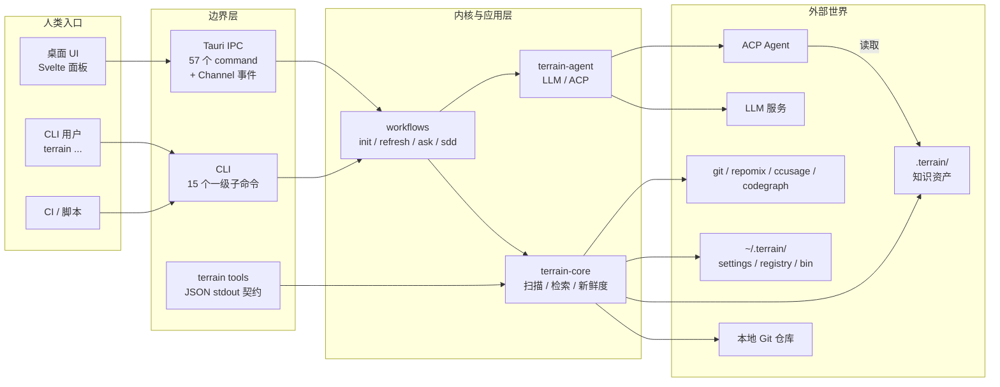
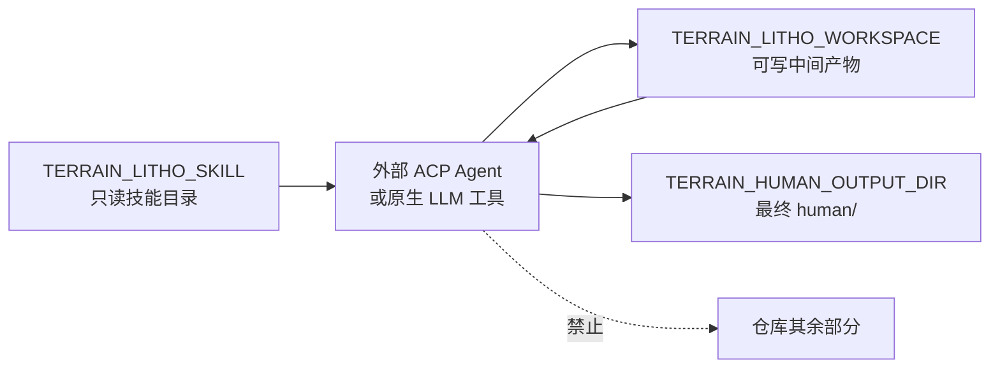

# 系统边界接口文档

Terrain 对外暴露的接口不止一套。人类用户看到的是桌面应用的按钮，CI 脚本看到的是 `terrain` 命令，外部编码 Agent 看到的是 `terrain tools` 输出的 JSON，而模型本身看到的是 ACP 或 OpenAI 兼容协议。这四种"语言"必须描述同一件事——**`.terrain/` 目录里有什么、该怎么读**——因此它们共享同一批底层函数与同一套路径约定。

这份文档按"从外到内"的顺序拆解这些边界：先讲命令行与桌面 IPC 这两个人类/程序入口，再讲配置与环境变量这类"隐式参数"，最后讲文件系统契约与外部进程协议。阅读时建议特别关注"含义解读"一列——参数的名字往往比它的作用更难猜，例如 `--force` 在 `assets run-litho` 下不是"覆盖文件"，而是"放弃增量、整篇重写"。

---

## 1. 接口全景

下图把 Terrain 的边界画成四层。左侧是人类与流水线，右侧是外部世界（仓库、模型、Agent、工具链），中间的三个方块就是本文档要讲的内容。



从图中能读出一个关键设计：**只有 `terrain-core` 会直接碰文件系统**。CLI 与 IPC 都是薄壳，Agent 的能力被包成工具调用，外部 Agent 则通过 `terrain tools` 的 JSON 契约访问知识——没有任何一条路径允许模型直接 `cat` 仓库文件。这条约束同时是安全边界和成本边界。

---

## 2. 命令行接口（CLI）

CLI 是 Terrain 最完整的入口，也是 CI 里唯一可用的入口。它的定义集中在 `crates/terrain-cli/src/cli.rs`（clap 派生），实现在 `crates/terrain-cli/src/commands/` 下的 12 个文件里。设计上遵循三条惯例：

- **全局参数只有一个**：`--repo-path`，用于覆盖"当前工作目录所属的 Git 仓库"这一默认推断。
- **面向 Agent 的子命令输出 JSON**：`tools` 与 `assets` 系列把结果打到 stdout，日志走 stderr，便于管道消费。
- **面向人的子命令输出文本**：`list`、`project overview`、`read` 等直接打印可读内容。

### 2.1 全局约定

| 项目 | 值 | 含义解读 |
|------|-----|---------|
| 二进制名 | `terrain` | 桌面应用内置同一份二进制；`~/.terrain/bin/terrain` 是部署后的副本 |
| 全局参数 | `--repo-path <PATH>` | 不传时先看 `TERRAIN_REPO_PATH`，再向上寻找最近的 Git 根目录（`crates/terrain-core/src/paths.rs:42-52`）。CI 中强烈建议显式传，避免在子模块目录里跑出意外的项目边界 |
| 启动副作用 | `load_dotenv()` / 部署 bundled tools / env catalog / preset skills | 每次启动都会尝试把随包资源同步到 `~/.terrain/`（`crates/terrain-cli/src/main.rs:11-17`）。这让"第一次运行"不需要额外安装步骤，但也意味着 CLI 不是纯只读的 |
| 退出码 | `anyhow::Result` 传播 | 出错时进程非零退出并打印错误链。脚本里应检查退出码，不要只 grep 输出 |
| 语言 | 由 `settings.language` 决定 | `settings language` 可切换 CLI 输出、知识资产与 Agent 回答的语言；`system` 跟随系统 locale |

### 2.2 摄取与登记命令

这四个命令构成"把一个仓库变成知识资产"的主干。它们的区别不在功能多少，而在**愿意花多少时间与 token**。

| 命令 | 位置参数 | 选项 | 输出 | 含义解读 |
|------|---------|------|------|---------|
| `terrain list` | — | — | 项目列表 | 读 `~/.terrain/registry.json`，只列指针，不触发任何扫描。适合脚本先确认项目是否已登记 |
| `terrain scan <repo>` | 仓库路径 | `--slug` | `ScanReport` | 只做"确定性"部分：走查仓库、写 `index.md`、生成 `repomix.md`、更新 `sync.json`。不调用任何模型，CI 里可安全高频执行 |
| `terrain init <repo>` | 仓库路径 | `--slug` | `ProjectInitResult` | 完整初始化：扫描 → Litho 人类文档 → Agent 上下文。会拉起 ACP 或 LLM，耗时从几分钟到几十分钟 |
| `terrain refresh <repo>` | 仓库路径 | `--slug` | `QuickRefreshResult` | 扫描 + 重打包 + 按 `git diff` 增量更新上下文，**跳过 Litho**。日常改完代码后的默认选择 |

```bash
# CI 中的典型用法：只刷新确定性资产，不产生模型费用
terrain refresh . --slug my-service

# 首次接入：指定 slug，避免从目录名推断出不想要的名字
terrain init ~/code/my-service --slug my-service
```

`--slug` 值得单独解释：它是项目在 `~/.terrain/registry.json` 与 `.terrain/` 中的唯一键。不传时会从仓库目录名 slugify，重命名目录就会变成"新项目"，因此长期项目建议显式固定。

### 2.3 检索与阅读命令

检索命令面向"我知道要找什么"，阅读命令面向"我已经知道在哪"。

| 命令 | 参数 | 默认值 | 含义解读 |
|------|------|-------|---------|
| `terrain search <query>` | `<query>`、`--project`、`--limit` | `--limit 20` | 在 `.terrain/` 的 Markdown 上做加权全文检索。`--limit` 默认 20 是给人看的量；给模型的同类工具体默认只给 10 条，因为上下文比屏幕贵 |
| `terrain read <path>` | `<path>` | — | 读单篇文档并打印。支持裸文件名（如 `1.概述.md`），会自动在 `human`/`modules`/`interfaces`/`routes`/`events`/`knowledge`/`agent` 等目录下查找（`search.rs:243` 的 `DOC_SUBDIRS`） |
| `terrain source read` | `--file`、`--start-line`、`--end-line`、`--repo-path` | 行号必填 | 从**实时仓库**读源码切片，而不是从 repomix 包读。用于"引用跳转"场景：文档里的 `path:line` 必须指向当前代码，而不是打包时的快照 |

```bash
terrain search "新鲜度 阈值" --project terrain --limit 5
terrain read "3.工作流.md"
terrain source read --file crates/terrain-core/src/freshness/scoring.rs --start-line 20 --end-line 45
```

### 2.4 问答与 SDD 命令

这两组命令把 Terrain 从"文档生成器"变成"可对话的知识入口"。

| 命令 | 参数 | 含义解读 |
|------|------|---------|
| `terrain ask query <query>` | `--project`、`--stream` | 面向项目的自然语言问答。`--stream` 打开后输出 NDJSON 事件流（`chunk` / `tool_calls` / `phase` / `usage` / `done`），适合做进度 UI 或日志回放；不开则等最终 `ChatReply` |
| `terrain ask sessions-list` | `--project` | 列出该项目的问答会话。会话本身存盘，重启后仍可继续 |
| `terrain sdd status` | `--project` | 查看 SDD 四阶段（requirements / tech-design / code-gen / code-review）走到哪一步 |
| `terrain sdd run` | `--project`、`--phase`、`--session-id`、`--input`、`--repo-path` | 执行一个阶段。`--phase` 是枚举而非自由文本——这四个阶段有固定顺序与固定产物，不允许跳步 |

```bash
# 流式问答：每行一个 JSON 事件，适合 tee 到日志
terrain ask query "Litho 断点续跑是怎么实现的？" --project terrain --stream

# 指定会话继续某个 SDD 阶段
terrain sdd run --project terrain --phase tech-design --session-id sdd-20261114
```

### 2.5 Agent 契约命令：`terrain tools`

这一组命令的存在理由很特别：**它们不是给人用的，是给外部编码 Agent 用的**。在 ACP 模式下，Terrain 并不直接回答所有问题，而是把"查项目、看包、读文档"这些原子操作暴露成 CLI，让 Agent 通过 shell 调用。所有输出都是单行或单文档 JSON，字段名与 Rust 侧 `schema.rs` 的 IPC 类型一致。

| 子命令 | 关键参数 | 返回 | 含义解读 |
|--------|---------|------|---------|
| `tools list-projects` | — | 项目数组 | Agent 的"入口地图"：先知道有哪些项目，才谈得上检索 |
| `tools pack-meta` | `--project` | 包元信息 + 目录树 | 只给结构和统计，不给正文。目录树有字符上限（2500），防止一次把包目录全塞进上下文 |
| `tools grep-pack` | `--project`、`--pattern`、`--context`(2)、`--limit`(20) | `GrepMatch[]` | 在 repomix 整包上做正则检索。`--context 2` 是"前后各两行"，因为只给命中行往往看不懂 |
| `tools read-pack-file` | `--project`、`--file`、`--start-line`、`--end-line` | 切片 + 行号可靠性标记 | 按文件读包内内容。返回里的 `line_numbers_reliable` 为 `false` 时，说明包是压缩视图，**不能拿行号当引用** |
| `tools read-context` | `--project`、`--section` | 上下文片段 | 读 `agent/context.md`，可按章节名取单节，避免整篇 16 KiB 全灌 |
| `tools search` | `--query`、`--project`、`--limit`(10) | `SearchHit[]` | 文档检索。默认 10 条，比人的 20 条更保守 |
| `tools read-doc` | `--project`、`--path` | 文档正文 | 读单篇知识文档，同样支持裸文件名 |
| `tools freshness` | `--project` | 新鲜度账本（现算） | 注意：这是**重算**命令，会回写 `.meta/freshness.json`，不是读缓存 |
| `tools codegraph-drift` | `--project` | 漂移判定 | 基于 git 独立验证 CodeGraph 索引是否过期。`codegraph status` 会误报"最新"，这个命令是交叉验证手段 |

```bash
# 外部 Agent 的一次典型调用序列
terrain tools list-projects
terrain tools pack-meta --project terrain
terrain tools grep-pack --project terrain --pattern "fn compute_freshness" --context 3
terrain tools read-pack-file --project terrain --file crates/terrain-core/src/freshness/compute.rs --start-line 40 --end-line 90
terrain tools freshness --project terrain
```

### 2.6 资产与环境命令

这两组命令操作的是"生成流水线"和"AI 工程环境"，通常由桌面 UI 调用，也可以在 CI 里手工触发。

| 命令 | 子命令 | 关键参数 | 含义解读 |
|------|-------|---------|---------|
| `terrain assets` | `pack-agent` | `<repo>`、`--slug` | 只重打包 repomix 与 `meta.json`，不动文档 |
| | `plan-litho` | `<repo>`、`--slug` | 产出 `LithoPlan`（技能目录、工作区、输出目录），不执行。适合"先看它打算干什么" |
| | `prepare-litho` | `<repo>`、`--slug` | 准备技能目录与工作区副本，供外部 Agent 读取 |
| | `plan` | `<repo>`、`--slug` | 增量计划：`KnowledgeUpdateMode`（UpToDate / Incremental / Full） |
| | `run-litho` | `<repo>`、`--slug`、`--force` | 真正跑文档生成。`--force` 表示放弃断点与增量、整篇重建，代价是最贵的 |
| | `list-human` | `--project` | 列出 `human/` 下已生成的文档与完整性判定 |
| | `grep-pack` | `--project`、`<pattern>`、`--context`、`--limit` | 与 `tools grep-pack` 同能力，位置参数形式 |
| | `agent-context` | `<repo>`、`--slug`、`--force` | 生成 `agent/context.md`（16 KiB 上限） |
| | `register` | `<repo>`、`--slug` | 只登记到 registry，不做扫描 |
| | `repair-context` | `--slug`、`--repo-path` | 上下文损坏/截断后的修复入口 |
| `terrain env` | `status` | `--repo-path` | 当前 Skills / 工具 / AGENTS.md 片段的部署状态 |
| | `plan` | `--ids`、`--reinstall`（逗号分隔） | 只算计划，不动文件。`--reinstall` 用于强制重装指定集成 |
| | `apply` | `--ids`、`--reinstall` | 执行部署。这是会写仓库文件的命令（注入 AGENTS.md 片段），在受保护分支上要谨慎 |

### 2.7 设置、用量与项目元数据

| 命令 | 子命令 | 参数 | 含义解读 |
|------|-------|------|---------|
| `terrain settings` | `get` | — | 打印生效中的 `ModelSettings`（含 profile 归一化结果） |
| | `set` | `<file>` | 从 JSON 文件整体替换设置。用文件而不是逐字段参数，是因为设置是多层嵌套结构 |
| | `language` | `[system\|zh-CN\|en]` | 省略参数则打印当前语言。切换后知识资产与 Agent 回答都会跟着变 |
| | `check-llm` | — | 探测 LLM 连通性。返回的是"能否发一次最小请求"，不是"模型质量如何" |
| | `check-acp` | — | 探测 ACP Agent 是否可执行（`acp_available`，`crates/terrain-agent/src/acp.rs:48`） |
| `terrain usage` | `probe` | — | 探测本地用量数据源（Claude Code 会话、Codex 会话、ccusage） |
| | `snapshot` | `--detail summary`、`--force` | 汇总 Token 用量。默认 summary；`--force` 绕过 120 秒 TTL 缓存 |
| `terrain project` | `overview` | `--project` | 项目概览：新鲜度、文档数量、路径 |
| | `remark` | `--project`、`<remark>` | 写项目备注（存 registry） |
| | `remove` | `--project` | 从 registry 移除，**不删 `.terrain/`**。这是刻意的：删知识是不可逆操作，应该由人手动做 |
| | `list` | — | 列出登记项目及就绪状态 |
| | `freshness-cached` | `--project` | 只读缓存账本，不重算。与 `tools freshness` 形成"快读 vs 准读"的对照 |

---

## 3. 桌面 IPC 接口（Tauri）

桌面壳的职责只有两件：把窗口/托盘/剪贴板这类操作系统能力包好，把前端的一次点击翻译成一次 Rust 调用。所有命令在 `src-tauri/src/lib.rs` 的 `generate_handler!` 中注册，按当前代码统计为 **57 个**（早期文档记为 59，以 `src-tauri/src/lib.rs:56-112` 的实际条目为准）。

IPC 的返回约定是 `Result<T, String>`：成功返回结构体，失败返回可直接展示的中文/英文错误串。长任务不靠"等返回"，而是靠事件流——调用方拿到 `Channel` 或监听 `app.emit` 的事件，边执行边更新界面。

### 3.1 命令分组

| 分组 | 代表命令 | 主要参数 | 说明 |
|------|---------|---------|------|
| 引导与知识 | `bootstrap_app`、`get_knowledge_root`、`list_projects`、`get_project_overview_cmd` | 无 / `project` | 启动时一次性拉齐全局状态；`bootstrap_app` 是前端首帧的唯一数据源 |
| 扫描与生成 | `scan_project`、`initialize_project_cmd`、`run_quick_refresh_cmd`、`generate_human_docs_cmd`、`run_litho_generation_cmd`、`run_agent_context_generation_cmd` | `repo_path`、`project_slug`、`force_refresh` | 全部是长任务，配合 `litho-progress` / `project-init-progress` 事件 |
| 计划与资产 | `plan_litho_cmd`、`plan_assets_cmd`、`pack_agent_assets_cmd`、`list_human_docs_cmd` | `repo_path`、`slug` | 只读或只打包，不触发生成 |
| 检索与阅读 | `search_knowledge`、`read_document`、`read_source_slice_cmd`、`resolve_source_citation_cmd` | `query`、`path`、`file`、行区间 | UI 阅读器的数据源；引用解析把 `path:line` 变成可跳转的切片 |
| 问答 | `ask_knowledge_cmd` + 8 个 ask session 命令 | `query`、`project`、`Channel<AskStreamEvent>` | 会话可持久化、可切换、可丢弃 |
| SDD | `get_sdd_status_cmd`、`create_sdd_session_cmd`、`set_active_sdd_session_cmd`、`delete_sdd_session_cmd`、`save_sdd_output_cmd`、`run_sdd_phase_cmd` | `project`、`phase`、`session_id` | 与 CLI 的 `sdd` 共用 `terrain-agent::workflows::sdd` |
| 新鲜度 | `compute_freshness_cmd`、`read_project_freshness_cached_cmd` | `project`、`force` | 前者会重算并写盘，后者只读缓存 |
| 环境 | `get_env_status_cmd`、`plan_env_integration_cmd`、`run_env_integration_cmd` | `repo_path`、`ids` | 与 `terrain env` 一一对应 |
| 设置与模型 | `get_model_settings`、`save_model_settings_cmd`、`check_llm`、`test_llm_cmd`、`list_provider_models_cmd`、`check_acp`、`check_opencode`、`acp_spawn_command_cmd` | 设置对象、provider 凭证 | `list_provider_models_cmd` 会真发一次 `GET /models` |
| 用量与杂项 | `usage_probe_cmd`、`usage_snapshot_cmd`、`copy_image_to_clipboard`、`save_png_files`、`open_repo_folder_cmd`、`open_local_path_cmd`、`save_project_remark_cmd`、`remove_project_cmd` | 路径、PNG 字节 | 纯操作系统能力，无业务逻辑 |

### 3.2 事件与流式载荷

| 事件 / 通道 | 载荷 | 触发时机 | 含义解读 |
|------------|------|---------|---------|
| `Channel<AskStreamEvent>` | `Chunk{text}` / `ThinkingChunk{text}` / `ToolCalls{tool_calls}` / `Phase{phase}` / `Usage{usage}` / `Done{reply}` | `ask_knowledge_cmd` 执行期间 | `ThinkingChunk` 与 `Chunk` 分开，是为了让 UI 能折叠"思考过程"而不污染正文 |
| `litho-progress` | `project_slug`、`stage`、`message` | Litho 每进入一个阶段 | `stage` 是机器可判定的，`message` 是给人看的；UI 用前者画进度点，用后者写日志 |
| `litho-done` | `project_slug`、`result: LithoGenerationResult` | Litho 结束 | 即使失败也会发（result 里带错误），避免前端永远转圈 |
| `project-init-progress` | `project_slug`、`stage`、`message` | `initialize_project_cmd` 期间 | 初始化会串行经过 scan → litho → context，这个事件把三段进度统一成一条时间线 |
| `sdd-progress` | `project_slug`、`phase`、`message` | SDD 阶段执行 | 阶段名来自 `SddPhase` 枚举，不可自由扩展 |
| `env-progress` | 阶段与消息 | `run_env_integration_cmd` | 部署 Skills/工具时的逐项进度 |

### 3.3 调用示例

前端不直接写 `invoke` 字符串，而是统一走 `src/lib/api.ts`。这样做的好处是参数名与 Rust 侧一一对应，改 IPC 时编译期就能发现漏改。

```ts
// 流式问答：Channel 是 Tauri 2 的流式原语
const channel = new Channel<AskStreamEvent>();
channel.onmessage = (event) => {
  if (event.type === "chunk") appendAnswer(event.text);
  if (event.type === "tool_calls") renderToolCards(event.tool_calls);
  if (event.type === "done") finish(event.reply);
};
await invoke("ask_knowledge_cmd", {
  query: "Litho 如何判定文档已稳定？",
  project: "terrain",
  repoPath: null,
  onStream: channel,
});
```

---

## 4. 配置文件

Terrain 只有一份真正的配置文件：`~/.terrain/settings.json`（`settings_path()`，`crates/terrain-core/src/settings.rs:135` 附近的 `ModelSettings`）。注意不是研究阶段猜测的 `model-settings.json`——实际文件名就是 `settings.json`，代码即真相。

这份文件把"用哪个模型""怎么连外部 Agent""知识资产怎么刷新"三件事装在一起，并且带一层**归一化**：保存时会补齐默认 profile、同步顶层扁平字段（`provider`/`model`/`api_key` 等）与 `profiles` 映射，读回时再做一次 `normalize_settings`。这意味着手工编辑文件是可行的，但不要期待未填字段保持缺失——下次保存会被补全。

**示例配置**：

```json
{
  "provider": "openai",
  "model": "stepfun-ai/step-3.7-flash",
  "api_key": "sk-...",
  "base_url": "https://integrate.api.nvidia.com/v1",
  "profiles": {
    "openai": {
      "model": "stepfun-ai/step-3.7-flash",
      "api_key": "sk-...",
      "base_url": "https://integrate.api.nvidia.com/v1",
      "api_mode": "chat_completions"
    },
    "ollama": {
      "model": "qwen3.5:9b",
      "ollama_host": "http://localhost:11434"
    }
  },
  "acp": {
    "binary": "opencode",
    "args": "acp",
    "agent_execution": "acp",
    "auto_approve": true
  },
  "knowledge": {
    "incremental_refresh": true,
    "incremental_max_changed_files": 60,
    "incremental_human_docs": false
  },
  "language": "system"
}
```

### 4.1 顶层与 Provider 字段

| 字段 | 类型 | 默认值 | 含义解读 |
|------|------|-------|---------|
| `provider` | string | `openai`（回退） | 当前使用的供应商。取值 `openai` / `ollama` / `ollama-cloud` / `lmstudio`，别名（如 `lm-studio`、`nvidia`）会被归一化（`crates/terrain-agent/src/model.rs:52-53`） |
| `model` | string | 随 provider 而定 | 主模型。默认值很有意思：`openai` 指向 NVIDIA 托管的 `stepfun-ai/step-3.7-flash`，说明作者把"便宜的强模型"当默认而非"最强的模型" |
| `api_key` | string | 空 | OpenAI 兼容端点用。Ollama Cloud 走 Bearer，也用这个字段 |
| `base_url` | string | 随 provider | OpenAI 兼容端点。`api_mode` 决定拼 `/chat/completions` 还是 `/responses` |
| `ollama_host` | string | `http://localhost:11434` | 本地 Ollama 地址。即使不用 Ollama 也常被填上，因为它是 profile 的共用字段 |
| `profiles` | map | 空 | 每个 provider 一份独立配置。切换 provider 不会丢另一家的 key——这是"多环境开发"的刚需 |
| `language` | enum | `system` | `system` / `zh-CN` / `en`。影响 UI、知识文档语言与 Agent 回复，一处设置三处生效 |

### 4.2 ACP 字段：外部 Agent 的接线板

| 字段 | 默认值 | 含义解读 |
|------|-------|---------|
| `binary` | `opencode` | 要拉起的可执行文件。默认选 OpenCode，因为它是目前 ACP 支持较完整的编码 Agent |
| `args` | `acp` | 子命令参数。`opencode acp` 进入 ACP 服务模式（stdio JSON-RPC） |
| `command` | 空 | 完整命令行覆盖。优先级最高，用于 Windows 带空格路径或自定义包装脚本（`crates/terrain-agent/src/acp.rs:38-47`） |
| `agent_execution` | `acp` | 三档语义：`acp`（纯外部 Agent，全部负载走 ACP）、`acp_native`（混合：ACP 优先，原生 LLM 兜底）、以及仅原生 LLM 的路径（未配置 ACP 时的回退）。这个字段直接决定 Litho 走哪条 `LithoTransport` |
| `auto_approve` | `true` | 是否自动批准 Agent 的写文件/执行请求。默认开是为了无人值守跑通，代价是**必须信任所配置的 Agent** |

### 4.3 知识资产字段

| 字段 | 默认值 | 含义解读 |
|------|-------|---------|
| `incremental_refresh` | `true` | 是否用 `git diff` 增量更新资产。关掉就退回"每次全量重生成"，慢但结果更一致 |
| `incremental_max_changed_files` | `60` | 超过这个改动文件数就放弃增量、改为全量。60 不是魔法数字：diff 大到这个程度时，"总结变更"已经不比"重新读一遍"便宜（`settings.rs` 的注释写明了这一点） |
| `incremental_human_docs` | `false` | 快速刷新时是否也更新人类文档。默认关——Litho 是最慢的一段，日常刷新只想要 Agent 资产 |

---

## 5. 环境变量

环境变量在这里承担两种角色：**运维覆盖**（不想改配置文件时）和**子进程契约**（Terrain 拉起 Agent 时告诉它"知识在哪"）。后者尤其重要——外部 Agent 不读 Terrain 的配置文件，它只认这几个变量。

| 变量 | 作用域 | 含义解读 |
|------|-------|---------|
| `TERRAIN_REPO_PATH` | 全局 | 覆盖工作区仓库路径，优先于"向上找 Git 根"（`crates/terrain-core/src/paths.rs:44`）。CI 中比 `--repo-path` 更适合做全局默认 |
| `TERRAIN_REGISTRY_FILE` | 全局 | 覆盖 `~/.terrain/registry.json` 的位置。测试与多账号隔离的关键开关 |
| `TERRAIN_KNOWLEDGE_ROOT` | 全局 / 子进程 | 覆盖知识根目录。Terrain 拉起问答复用进程时会显式注入，保证 Agent 读的是同一个 `.terrain/` |
| `TERRAIN_LLM_PROVIDER` / `TERRAIN_MODEL` / `TERRAIN_API_KEY` / `TERRAIN_OPENAI_API_MODE` | 全局 | 无配置文件时的模型参数来源。适合容器里用 env 注入凭证，避免把 key 写进挂载卷 |
| `TERRAIN_OLLAMA_CTX` | 全局 | Ollama 的上下文窗口覆盖。默认窗口常常装不下 repomix 片段，这个变量是必要的逃生阀 |
| `TERRAIN_LLM_COOLDOWN_MS` | 全局 | LLM 调用冷却毫秒数（`crates/terrain-agent/src/throttle.rs:21`）。注意实际变量名是 `TERRAIN_LLM_COOLDOWN_MS`，不是早期报告写的 `TERRAIN_CALL_COOLDOWN_MS` |
| `TERRAIN_ACP_BINARY` / `TERRAIN_ACP_ARGS` / `TERRAIN_ACP_COMMAND` | 全局 | 覆盖 ACP 启动方式。三者优先级：`command` > `TERRAIN_ACP_COMMAND` > `binary`+`args` |
| `TERRAIN_AGENT_ARCH_SKILL` / `TERRAIN_ASK_SKILL` / `TERRAIN_SDD_SKILL` | 子进程 | 注入技能目录。Agent 通过读这些目录里的 `SKILL.md` 获得任务说明 |
| `TERRAIN_LITHO_SKILL` / `TERRAIN_LITHO_WORKSPACE` / `TERRAIN_HUMAN_OUTPUT_DIR` | 子进程 | Litho 的三路径契约：技能、中间产物、最终输出。改这三个等于换一套文档流水线 |
| `TERRAIN_AGENT_CONTEXT_OUTPUT` | 子进程 | `agent/context.md` 的输出路径覆盖 |
| `TERRAIN_SDD_WORKSPACE` / `TERRAIN_SDD_OUTPUT_DIR` / `TERRAIN_PROJECT_SLUG` | 子进程 | SDD 阶段的工作区、产物目录与项目标识 |
| `TERRAIN_LITHO_TIMEOUT_SECS` | 全局 | Litho 单次运行的超时秒数（`crates/terrain-agent/src/litho.rs:159`）。外部 Agent 卡住时，这个值决定多久放弃 |
| `TERRAIN_ENV_CATALOG` | 全局 | 覆盖 `~/.terrain/env-catalog/` 位置，自定义可安装的集成清单 |
| `TERRAIN_PRESET_SKILLS` | 全局 | 覆盖随包预设技能目录，调试技能本身时用 |
| `TERRAIN_TARGET_TRIPLE` | 全局 | 覆盖平台三元组，影响 bundled tools 的选择。交叉打包/测试时才会用到 |

此外，CLI 启动时会调用 `dotenvy::dotenv()`（`crates/terrain-agent/src/model.rs:277`），意味着仓库根或当前目录的 `.env` 也会被读入。这让本地开发不必 export 一堆变量，但也意味着 **`.env` 里的同名变量会覆盖 shell 环境**，排查"为什么 key 不生效"时先看它。

---

## 6. 文件系统契约

Terrain 不用数据库，所以文件系统就是它的 schema。这一节列出"哪些路径是公开契约、哪些是本机衍生物"。

### 6.1 仓库内：`.terrain/`

| 路径 | 内容 | 是否入库 | 含义解读 |
|------|------|---------|---------|
| `.terrain/index.md` | 仓库结构总览 | 是 | 人类可读的"项目地图" |
| `.terrain/agent/context.md` | 16 KiB 宏观上下文 | 是 | Agent 的预载层。超限截断并保留章节索引 |
| `.terrain/agent/context-meta.json` | 上下文出处（baseline HEAD、时间） | 是 | 没有它，新鲜度评分无法判断"这份文档基于哪个提交" |
| `.terrain/agent/repomix.md` | 源码包 | 否（本机衍生） | 体积大且可重建，入库只会制造冲突 |
| `.terrain/human/` | Litho 六件套文档 | 是，`-merge` | 生成物禁止自动合并；冲突时保留一版并重跑 |
| `.terrain/knowledge/` | 人为维护的私域知识 | 是，正常合并 | 这是唯一"人手写"的目录，Agent 只读不写 |
| `.terrain/.meta/sync.json` | 扫描元数据（`SyncMeta`） | 是 | 记录 synced_at 与 collectors |
| `.terrain/.meta/freshness.json` | 新鲜度账本（`FreshnessLedger`） | 是 | 缓存快照，只在显式重算时更新 |
| `.terrain/.litho-agent/` | Litho 中间产物（研究报告 + `run-state.json`） | 否 | 断点续跑的依据；`run-state.json` 记录每篇文档是否完成 |
| `.terrain/.sdd-agent/` | SDD 阶段产物 | 否 | 与 Litho 同构的检查点机制 |
| `.terrain/env/` | 环境集成本地清单 | 否 | `agent-tools.json` 之类 |

### 6.2 用户主目录：`~/.terrain/`

| 路径 | 内容 | 含义解读 |
|------|------|---------|
| `settings.json` | `ModelSettings` | 唯一配置源 |
| `registry.json` | slug → repo_path 指针 | **只存指针，不存知识正文**。知识永远跟着仓库走 |
| `bin/terrain`、`bin/rtk`、`bin/codegraph` | Agent 工具链 | 随包部署；`ensure_bundled_tools_initialized` 在启动时对齐版本 |
| `skills/` | 预设与注入技能 | 由 `preset_skills.rs` 部署，可被 `TERRAIN_PRESET_SKILLS` 覆盖 |
| `env-catalog/` | 可安装集成清单 | 环境集成的"应用商店"数据 |
| `sdd/<project>/sessions/` | SDD 会话 | 跨进程可恢复的会话状态 |

### 6.3 Litho 三路径契约

Litho 把"技能在哪、草稿写哪、成品写哪"显式拆成三个环境变量，这是它能安全委托给外部 Agent 的前提：



原生回退路径把这条契约做成了两个工具：`read_litho_file_tool` 只允许读技能目录与仓库，`write_litho_file_tool` 只允许写工作区与输出目录。ACP 路径无法强制约束，只能靠 `SKILL.md` 里的说明与 `auto_approve` 的信任——这是设计上已知的取舍。

---

## 7. 外部进程与协议边界

Terrain 自己不实现"读 git 历史""解析任意语言符号""统计 Token"这些能力，全部外包给成熟工具。理解这一点，才能理解它的失败模式。

| 外部依赖 | 调用方式 | 协议/输出 | 失败时的表现 |
|---------|---------|----------|------------|
| `git` | 子进程（`terrain_core::process::command`） | 文本 | 漂移无法计算 → 新鲜度 fail-closed 扣分，而不是"假装很新" |
| `repomix`（经 `repomix-core`） | 库调用 + 可选 CLI | `repomix.md` | 包缺失 → 问答拒绝预载并提示重打包 |
| `ccusage` | 子进程 + JSON | 用量快照 | 探测失败 → 用量面板显示"不可用"，不影响其他功能 |
| `codegraph` | 子进程 | JSON / 文本 | `<cg> status` 可能误报最新，因此另有 `tools codegraph-drift` 用 git 交叉验证 |
| ACP Agent | stdio JSON-RPC | ACP 协议 | `AcpStrict` 直接报错；`AcpWithFallback` 降级到原生 LLM |
| LLM 服务 | HTTP（OpenAI 兼容 / Ollama） | SSE / JSON | 401/404 在 `check_llm` 阶段暴露；运行中被限流则由 `throttle.rs` 冷却重试 |

一个跨平台的实现细节值得记录：所有子进程都必须通过 `terrain_core::process::{command, async_command}` 创建，因为它们在 Windows 上会加上 `CREATE_NO_WINDOW`。直接 `Command::new` 会让打包版桌面应用（GUI 子系统）每调用一次 git 就闪一个黑窗。`crates/terrain-core/tests/process_convention.rs` 会扫描代码强制这条规则。

---

## 8. 集成建议

### 8.1 CI 流水线

CI 里最值得跑的是"确定性资产"，而不是 Litho。扫描与打包不需要 API Key，失败也不会产生费用：

```bash
# 1. 只刷新确定性资产（无模型调用）
terrain refresh . --slug my-service

# 2. 检查知识新鲜度，低于阈值就让流水线告警
terrain tools freshness --project my-service

# 3. 可选：有 key 时才生成人类文档
terrain assets run-litho . --slug my-service
```

判断标准很简单：如果这一步失败会造成"知识落后于代码"，就放进 CI；如果失败只造成"文档措辞不完美"，就放到夜间任务。

### 8.2 给外部 Agent 接入

如果想让别的编码 Agent（Codex、Claude Code 等）用上 Terrain 的知识，不需要实现 ACP，只要让它能执行 shell：

```bash
terrain tools list-projects
terrain tools read-context --project my-service --section "模块划分"
terrain tools grep-pack --project my-service --pattern "TODO" --limit 5
```

建议在 Agent 的系统提示里明确两条约束：先用 `read-context` 建立宏观认知，再用 `grep-pack`/`read-pack-file` 取细节；`line_numbers_reliable=false` 时不要引用行号。

### 8.3 跨平台注意

| 场景 | 注意点 |
|------|-------|
| Windows 打包版 | 不要绕过 `process.rs`；否则每个子进程都会闪窗 |
| 路径含空格 | ACP 优先用 `binary` + `args` 两个字段，而不是 `command` 单串（`acp.rs:104-118` 解释了为什么不使用 `shell_words`） |
| WSL / 容器 | `~/.terrain/` 与仓库要同时可见，否则 registry 指针会指向不可达路径 |
| 多项目并行 | 用 `TERRAIN_REGISTRY_FILE` 做隔离，不要共享同一份 registry |

---

## 9. 边界与已知限制

最后把"这套接口做不到什么"讲清楚，比列功能更有用：

- **CLI 不是只读的**。`main` 每次启动都会同步 bundled tools 与技能目录到 `~/.terrain/`，`scan` 会改写 `.terrain/`。把 CLI 当纯查询工具嵌进高安全环境前，需要先接受这个前提。
- **`terrain tools freshness` 会写盘**。它按需重算并回写 `.meta/freshness.json`；只想读缓存请用 `terrain project freshness-cached`。
- **IPC 命令数会漂移**。文档按当前代码统计为 57；早期描述为 59。这类数字一旦写进文档就会过期，校验方式是直接数 `generate_handler!` 的条目。
- **`--force` 的语义随命令变化**。在 `run-litho` 是"放弃增量重写"，在 `usage snapshot` 是"绕过 TTL 缓存"，在 `env apply` 是"强制重装"。使用前先看对应子命令的帮助。
- **原生回退不是等价替代**。原生 LLM 路径能生成文档，但没有 ACP Agent 的多轮工具使用能力，长文档质量与一致性会下降。`AcpWithFallback` 的意义是"别彻底失败"，不是"效果一样"。
- **配置文件没有 schema 校验入口**。`settings set` 只做反序列化与归一化，字段名写错会被静默忽略。改完建议用 `settings get` 回读确认。
