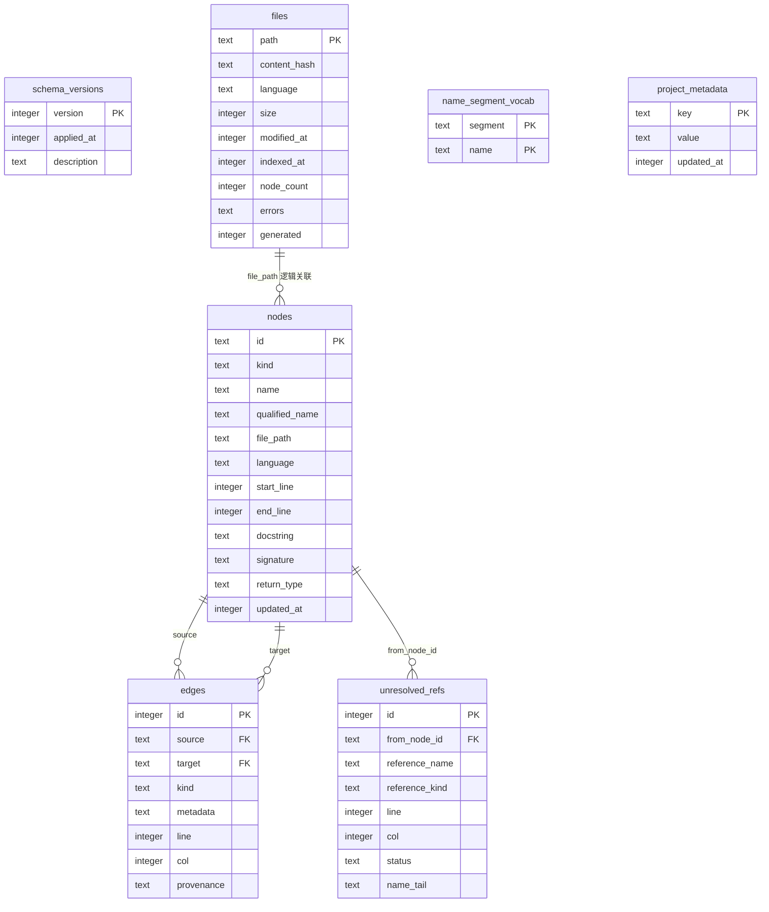
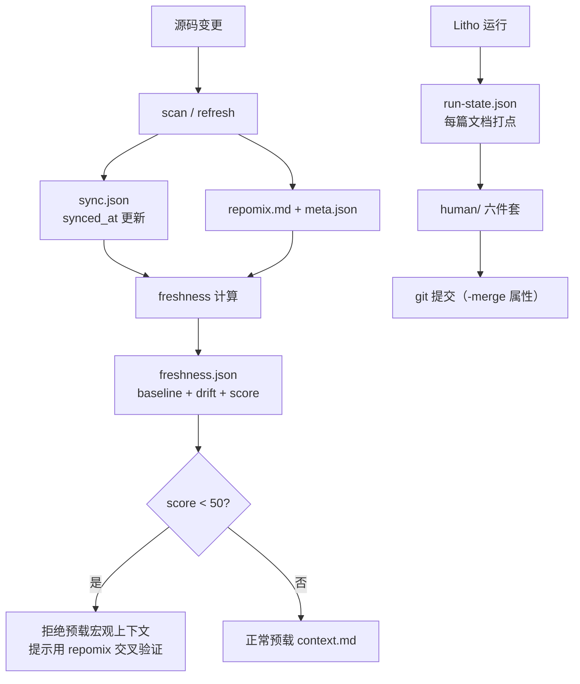

# 数据库概览

先说结论：**Terrain 本身没有数据库**。它没有 `.sql` 建表脚本，`Cargo.toml` 里没有 `sqlx`/`diesel`/`rusqlite`，`package.json` 里也没有 Prisma/TypeORM。所有持久化都是文件——Markdown 存知识，JSON 存元数据与账本，TOML/YAML 存配置与策略。

但这个结论需要说清楚边界：仓库里确实**检出**一个 SQLite schema，它属于随包分发的第三方工具 CodeGraph，而不是 Terrain 的存储层。这份文档因此分两部分：先讲那个"别人的数据库"，再讲 Terrain 自己用文件实现的逻辑数据模型——后者才是真正决定系统行为的东西。

---

## 1. 统计摘要

下表只统计仓库中实际存在的 `.sql` 文件，因此数字反映的是"随包工具"而非"Terrain 存储"。把它放在最前面，是为了让读者一眼看清"这个项目的数据层到底是什么形态"。

| 类型 | 数量 | 位置 |
|------|------|------|
| 数据表（实体表） | 6 | `packages/codegraph/darwin-arm64/lib/dist/db/schema.sql` |
| 虚拟表（FTS5 全文索引） | 1 | 同上（`nodes_fts`） |
| 触发器 | 3 | 同上（`nodes_ai` / `nodes_ad` / `nodes_au`） |
| 索引 | 21 | 同上 |
| 视图 | 0 | — |
| 存储过程 / 函数 | 0 | SQLite 不支持存储过程；schema 中无自定义函数 |

同一个 schema 在 `src-tauri/bundled-resources/codegraph/lib/dist/db/schema.sql` 下还有一份副本——那是桌面应用打包时携带的资源，内容相同。**两份都不是 Terrain 写的，也不该被 Terrain 修改**；升级 CodeGraph 版本时它们会整体被替换。

---

## 2. 为什么 Terrain 选择"没有数据库"

要理解这个选择，得先看 Terrain 的数据要满足什么要求。它存的是"关于代码的理解"：模块划分、架构决策、调用链、新鲜度评分。这类数据有三个和典型业务数据相反的特征。

**第一，它必须能被人直接打开。** 用户会点开 `2.架构.md` 读一段，判断模型有没有胡编。如果这些内容躺在 SQLite 的 BLOB 里，产品就失去了"可核查"这个最重要的信任基础。

**第二，它必须能随 Git 走。** 知识要和代码同版本：切到旧分支，就该看到旧分支的知识。数据库文件不适合入库——二进制、冲突不可合并、diff 无意义。所以 Terrain 把知识放在仓库内的 `.terrain/`，用 `git_policy.rs` 给生成物写 `-merge` 属性，明确"冲突不要手工合并，重跑生成"。

**第三，它必须能被 grep。** Agent 访问知识的主要方式是 `grep-pack` 与全文检索，本质都是对文本做正则/加权匹配。文件天然支持；数据库则需要额外实现一套查询接口。

代价也很直接：**没有索引，检索就是全量遍历**。`KnowledgeSearch::search` 用 `WalkDir` 扫 `.terrain/` 下的 Markdown（`crates/terrain-core/src/search.rs:47`），仓库大、文档多时会慢。Terrain 的应对不是引入数据库，而是三件事：剪枝（跳过 `repomix.md` 与 `.litho-agent/`，它们占了 90% 体积）、缓存（`read_pack_text_cached` 用 `Arc<str>` 缓存整包）、限额（默认只返回 10~20 条）。

这是一次清醒的取舍：**用查询性能换可读性与可协作性**。对"几十到几百篇文档"的规模，这个交换是划算的；如果哪天单仓库文档量到几万篇，这个决策就该重新评估。

---

## 3. 检出的 SQLite Schema（CodeGraph）

CodeGraph 是 Terrain 用来做符号关系分析的随包工具。它需要回答"谁调用了这个函数""改动这个类型会影响哪些文件"，这类查询用图数据库或带索引的关系表最自然，所以它选了 SQLite。

下图是它的实体关系。注意 `files` 与 `nodes` 之间是**逻辑关联**（靠 `file_path` 字符串），没有外键——这是索引器的常见做法：文件记录与符号记录由不同阶段写入，强外键会让批量导入变慢甚至失败。

### 3.1 核心表

**`nodes`——代码符号表**。它把函数、类、变量、类型都压成同一种"节点"，用 `kind` 区分。这种"统一节点 + 类型标签"的设计让图查询不需要为每种语言写一套 SQL，代价是字段变得很宽（21 列），其中不少列只有特定语言会填。

| 字段 | 类型 | 约束 | 说明 |
|------|------|------|------|
| `id` | TEXT | PK | 稳定标识，通常由文件路径 + 符号路径派生 |
| `kind` | TEXT | NOT NULL | 符号类型（function / class / method / variable …） |
| `name` | TEXT | NOT NULL | 短名，如 `compute_freshness` |
| `qualified_name` | TEXT | NOT NULL | 全限定名，如 `terrain_core::freshness::compute_freshness` |
| `file_path` | TEXT | NOT NULL | 定义所在文件（相对仓库根） |
| `language` | TEXT | NOT NULL | 语言标识 |
| `start_line` / `end_line` | INTEGER | NOT NULL | 行区间，引用高亮的基础 |
| `start_column` / `end_column` | INTEGER | NOT NULL | 列区间，用于精确跳转 |
| `docstring` | TEXT | 可空 | 文档注释，参与全文索引 |
| `signature` | TEXT | 可空 | 签名，参与全文索引 |
| `visibility` | TEXT | 可空 | public / private 等 |
| `is_exported` / `is_async` / `is_static` / `is_abstract` | INTEGER | 默认 0 | 布尔标记，用 INTEGER 是 SQLite 惯例 |
| `decorators` / `type_parameters` | TEXT | 可空 | JSON 数组字符串 |
| `return_type` | TEXT | 可空 | 归一化后的返回类型，用于"接收者类型推断" |
| `updated_at` | INTEGER | NOT NULL | 毫秒时间戳 |

**`edges`——符号关系表**。每条边是"从哪个节点到哪个节点、什么关系"。

| 字段 | 类型 | 约束 | 说明 |
|------|------|------|------|
| `id` | INTEGER | PK AUTOINCREMENT | 自增主键 |
| `source` / `target` | TEXT | FK → `nodes.id`，`ON DELETE CASCADE` | 关系两端。级联删除保证删节点不留悬空边 |
| `kind` | TEXT | NOT NULL | calls / imports / extends / implements … |
| `metadata` | TEXT | 可空 | JSON 对象，存调用参数数量等附加信息 |
| `line` / `col` | INTEGER | 可空 | 关系出现的位置。可空是为了容纳"文件级"或"合成"边 |
| `provenance` | TEXT | 默认 NULL | 边的来源（解析器版本/推导方式），用于排查错误关系 |

**`files`——已索引文件表**。它记录"这个文件上次是什么状态"，让增量索引只处理变化的文件。

| 字段 | 类型 | 约束 | 说明 |
|------|------|------|------|
| `path` | TEXT | PK | 相对路径 |
| `content_hash` | TEXT | NOT NULL | 内容哈希，增量判断的核心 |
| `language` | TEXT | NOT NULL | 语言 |
| `size` / `modified_at` / `indexed_at` | INTEGER | NOT NULL | 字节数、文件修改时间、索引时间 |
| `node_count` | INTEGER | 默认 0 | 该文件产出的节点数，用于统计与异常检测 |
| `errors` | TEXT | 可空 | JSON 数组，解析失败原因 |
| `generated` | INTEGER | NOT NULL 默认 0 | 是否为生成代码。schema 注释解释了为什么要在索引时判定：Go 的生成标记在文件内容里，只查路径会漏判，而排序逻辑又不该每次请求都读文件头 |

**`unresolved_refs`——待解析引用表**。索引时遇到"调用了 `util.greet` 但还没见到定义"的情况，先落库，等全量索引完成后再统一解析。

| 字段 | 类型 | 约束 | 说明 |
|------|------|------|------|
| `id` | INTEGER | PK AUTOINCREMENT | 自增主键 |
| `from_node_id` | TEXT | FK → `nodes.id`，CASCADE | 发出引用的节点 |
| `reference_name` | TEXT | NOT NULL | 原始引用文本（如 `util.greet`） |
| `reference_kind` | TEXT | NOT NULL | 引用类型 |
| `line` / `col` | INTEGER | NOT NULL | 引用位置 |
| `candidates` | TEXT | 可空 | JSON 数组，解析候选 |
| `file_path` / `language` | TEXT | 默认 `''` / `'unknown'` | 冗余存储，避免解析时回表 |
| `status` | TEXT | 默认 `'pending'` | `pending`（待解析）/ `failed`（尝试过但没匹配上，保留以便下次增量重试） |
| `name_tail` | TEXT | 默认 `''` | 引用名最后一段（`util.greet` → `greet`），供失败后按新符号名重试 |

**`name_segment_vocab`** 与 **`project_metadata`** 是两个辅助表：前者把驼峰符号名拆成小写词段（`OrderStateMachine` → `order`/`state`/`machine`），供"自然语言提问里的技术名词是否真实存在于代码图"这类校验使用；后者存 schema 版本与来源信息。`name_segment_vocab` 用 `WITHOUT ROWID`，因为它是纯复合主键的查找表，不需要额外 rowid。

### 3.2 索引与全文检索

21 个索引不是随手加的，每一个都对应一类查询：

| 索引组 | 索引 | 服务的查询 |
|-------|------|-----------|
| 节点定位 | `idx_nodes_kind`、`idx_nodes_name`、`idx_nodes_qualified_name`、`idx_nodes_file_path`、`idx_nodes_language`、`idx_nodes_file_line`、`idx_nodes_lower_name` | 按类型/名字/文件/语言过滤；`idx_nodes_file_line` 是复合索引，支持"这个文件某行附近有什么符号"；`lower(name)` 支持大小写不敏感查找 |
| 边查询 | `idx_edges_source_kind`、`idx_edges_target_kind`、`idx_edges_kind`、`idx_edges_identity`、`idx_edges_provenance` | 调用者/被调用者查询。注释特别说明：单独的 `source`/`target` 索引被**刻意省略**，因为复合索引的左前缀已经覆盖，窄索引只会拖慢写入 |
| 边去重 | `idx_edges_identity`（UNIQUE） | `(source, target, kind, IFNULL(line,-1), IFNULL(col,-1))`。没有它时 `INSERT OR IGNORE` 等价于普通 INSERT，两趟解析会产生重复边并污染引用计数 |
| 文件 | `idx_files_language`、`idx_files_modified_at`、`idx_files_generated`（部分索引） | 增量扫描与"排除生成代码"。部分索引只覆盖 `generated=1` 的行，因为它总是少数 |
| 待解析引用 | `idx_unresolved_from_node`、`idx_unresolved_name`、`idx_unresolved_file_path`、`idx_unresolved_from_name`、`idx_unresolved_status`、`idx_unresolved_failed_tail`（部分索引） | 解析与重试用。`failed_tail` 只索引失败行，让"重试失败引用"的代价与历史总量无关 |

全文检索用 SQLite FTS5 的**外部内容表**模式：`nodes_fts` 的 `content='nodes'`，正文存在 `nodes` 里，FTS 只存倒排索引。三个触发器（`nodes_ai` / `nodes_ad` / `nodes_au`）保证增删改时索引同步。这种模式比"把正文再存一份到 FTS 表"省一半空间，代价是更新时必须显式维护触发器。

### 3.3 版本演进

`schema_versions` 只有一行初始记录（version=1），但 schema 注释里提到了 v4、v6、v9 三次迁移：v4 删除冗余的边索引，v6 去重并加唯一约束，v9 给 `files` 加 `generated` 列。迁移逻辑在 `migrations.js` 里，不在 `.sql` 文件中——`.sql` 只是"全新安装"的建库脚本。这是一个值得借鉴的做法：**schema.sql 描述终态，迁移脚本描述过程**，两者不混在一起。

---

## 4. Terrain 的逻辑数据模型：文件即表

Terrain 没有数据库，但它有等价物：一批 JSON 文件，每个文件对应一个 Rust 结构体。把它们当作"表"来读，就能理解系统的状态存在哪里、什么时候会失效。

| "表"（文件） | 主键 | 结构字段 | 对应 Rust 类型 | 生命周期 |
|------|------|---------|--------------|---------|
| `.terrain/.meta/sync.json` | project | `project`、`repo_path`、`synced_at`、`collectors` | `SyncMeta` | 每次 scan 覆盖 |
| `.terrain/.meta/freshness.json` | project | `baseline`、`assets`、`drift`、`factors` | `FreshnessLedger` | 显式重算时覆盖（`ledger.rs`） |
| `.terrain/agent/meta.json` | project | `total_files`、`total_tokens`、`baseline_head`、`token_heavy_files` | `AgentPackMeta` | 每次打包覆盖 |
| `.terrain/agent/context-meta.json` | project | 上下文出处（HEAD、生成时间） | `AgentContextMeta` | 每次生成上下文覆盖 |
| `~/.terrain/registry.json` | slug | slug → `repo_path` 列表 | `RegistryEntry` | 注册/移除时更新 |
| `~/.terrain/settings.json` | 单例 | `provider`、`profiles`、`acp`、`knowledge`、`language` | `ModelSettings` | 保存设置时整体覆盖 |
| `.terrain/.litho-agent/run-state.json` | project + HEAD | `schema_version`、`target_head`、`mode`、`status`、`docs[]` | `LithoRunState` | 每篇文档完成后更新 |
| `~/.terrain/sdd/<project>/sessions/*.json` | session_id | 阶段、输入、输出 | SDD 会话结构 | 每次阶段执行后更新 |

这张表里最值得关注的是 `run-state.json` 的 `target_head` 字段：它记录"这次生成针对哪个提交"。如果当前 HEAD 变了，即使 `status` 还是 `running`，续跑也会被判定为无效（`litho_run_state.rs:49-56` 的注释写明了理由：不同 HEAD 意味着文档描述的是另一份代码）。这是一个用"逻辑外键"实现的完整性约束——没有数据库，但约束一点没少。

### 4.1 新鲜度账本的结构

`freshness.json` 是 Terrain 里最接近"计算视图"的东西。它不是原始数据，而是"基于当前代码算出来的派生结果"，包含四块：

| 字段 | 含义 | 为什么单独存 |
|------|------|------------|
| `baseline` | 资产生成时对应的提交 | 判断漂移的锚点。没有它就无法回答"落后多少" |
| `assets` | 各类资产的评分 | 人类文档、Agent 上下文、repomix 包分别评分，分数不能混算 |
| `drift` | Git/CodeGraph 漂移量 | 提交数、变更文件数、距今天数 |
| `factors` | 扣分因子明细 | 让"为什么 62 分"可解释，而不是一个黑盒数字 |

因为它是派生数据，所以**可以随时删掉重算**——这正是 `terrain tools freshness` 会主动重写它的原因，也是不该把它当权威数据源的原因。

### 4.2 数据生命周期

从图中能读出两个设计意图：**评分不是展示，而是开关**（低于 50 分直接改变系统行为）；**检查点与产物分离**（`run-state.json` 在 `.litho-agent/`，产物在 `human/`，前者不入库，后者入库）。

---

## 5. 一致性与并发

没有数据库，就没有事务。Terrain 用三种更朴素的手段保证一致性：

**写盘采用"整文件原子替换"**。`doc::write_json` / `write_doc` 都是先序列化再一次性写入，不做原地追加。这避免了"写一半崩溃留下半个 JSON"，但对并发写没有保护。

**长任务用检查点而非锁**。Litho 的 `run-state.json` 记录每篇文档的完成状态，中断后从断点继续。它不阻止两个进程同时跑同一个项目——这种情况下的后果是"两边都写 `human/`"，由人通过 `--force` 或删除工作区来解决。这是刻意的简化：单人桌面场景加锁的复杂度大于收益。

**缓存靠键失效而非 TTL**。`read_pack_text_cached` 以"路径 + mtime + len"为键，文件一变就自动失效；只有 `usage.rs` 用 120 秒 TTL，因为 Token 用量本身变化慢且查询贵。

值得记录的一个边界情况：`settings.json` 保存时会做归一化并回写，如果两个 Terrain 进程（比如 CLI 与桌面应用）同时改设置，后写的会覆盖先写的。没有锁文件，也没有冲突检测。

---

## 6. 审查要点

这份文档里有几处需要人工确认的地方，列出来避免把推断当事实：

- **CodeGraph schema 的归属**。它随 `packages/codegraph/` 与 `src-tauri/bundled-resources/` 分发，属于第三方工具。如果上游升级，表结构可能变化，本文档对应章节会过期。
- **表数量 6 + 1 虚拟表** 是按当前 `schema.sql` 静态统计的。迁移脚本（`migrations.js`）可能在旧库上产生额外对象，未纳入统计。
- **Terrain 的逻辑数据模型** 是从 Rust 结构体与路径方法（`KnowledgePaths`，`crates/terrain-core/src/paths.rs:106-160`）反推的，不是正式 schema。加字段不需要迁移，但也意味着没有机制阻止结构漂移——唯一的保障是 `serde` 反序列化失败时回退到默认值。
- **没有数据库这件事本身是设计决策，不是缺失**。如果未来需要跨项目检索或大规模符号查询，最可能的演进是"给 CodeGraph 建索引"而不是"给 Terrain 加数据库"——因为知识文档的可读性是不可让渡的约束。
